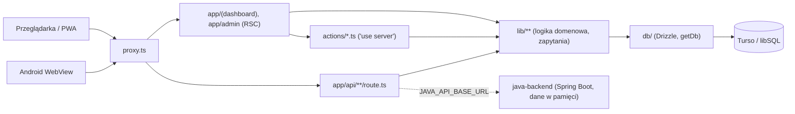

# ADR 0000: Architektura stanu obecnego (baza wiedzy)

- Status: zaakceptowany jako opis stanu (nie decyzja zmiany)
- Data: 2026-10-23
- Autor: architekt
- Zakres: opis faktów potwierdzonych w kodzie na gałęzi `feat/error-handling-system`. Każdy nowy ADR, który zmienia coś z poniższych punktów, powinien się do tego dokumentu odwołać.

## 1. Stos i wersje

| Obszar | Technologia (wersja z `package.json`) | Uwagi |
|---|---|---|
| Framework | Next.js `16.4.2`, App Router, RSC | build: `next build --webpack` (nie Turbopack); `turbopack: {}` w `next.config.ts` tylko dla dev |
| UI | React `19.2.4`, Tailwind 4 (`@tailwindcss/postcss`), shadcn 4 + `@base-ui/react`, `lucide-react`, `framer-motion`, `recharts` | `components.json` (shadcn) |
| Stan klienta | `zustand` 5 (`lib/stores/`) | |
| Formularze / walidacja | `react-hook-form` + `@hookform/resolvers`, `zod` 4 | |
| ORM / baza | `drizzle-orm` 0.45, `drizzle-kit` 0.31, `@libsql/client` 0.17; dialekt `sqlite` | Turso w chmurze, lokalnie `file:./local.db` |
| Auth | `next-auth` 5 beta 32 (JWT), Credentials + Google + Facebook; `bcryptjs` | `auth.ts` |
| Błędy / obserwowalność | `@sentry/nextjs` 10 (ładowany dynamicznie: `lib/sentry-init.ts`, `components/sentry-client.tsx`), własny logger `lib/errors/server-log.ts` | brak `sentry.*.config.ts` i `instrumentation-client.ts` |
| Rate limiting | `@upstash/ratelimit` + `@upstash/redis` z fallbackiem w pamięci (`lib/rate-limit.ts`) | |
| AI | brak LLM. `ai/coach.ts` = heurystyki; jedyny zewnętrzny "AI" to Pollinations (grafiki przepisów, `lib/pollinations-image.ts`) | |
| Inne | `web-push` (VAPID), `nodemailer` (SMTP), `@zxing/*` (kody kreskowe), `unpdf`/`mammoth`/`word-extractor`/`saxes`/`fflate` (import planów i katalogu z plików) | |
| Testy | Vitest 2 (`vitest.config.ts`, `**/*.test.ts`, env `node`), Playwright 1.59 (`e2e/`: `smoke.spec.ts`, `diet-admin-session.spec.ts`) | testy obok kodu (`lib/*.test.ts`) |
| Backend Java | Java 17, Spring Boot `3.3.5` (`java-backend/pom.xml`, artefakt `gymbrat-backend` 0.2.0) | tylko `spring-boot-starter-web` + `validation`, **bez bazy danych** |
| Android | powłoka WebView w Javie (`android/`), `versionCode 17` / `0.1.16` w `android/app/build.gradle.kts` | |
| Node | `engines.node >= 20` | |

### Różnice Next.js 16 widoczne w kodzie
- `proxy.ts` zamiast `middleware.ts`, eksport funkcji musi nazywać się `proxy` (zob. `node_modules/next/dist/docs/01-app/03-api-reference/03-file-conventions/proxy.md`: konwencja `middleware` jest przestarzała).
- `params` w stronach i trasach to `Promise` (`const { id } = await params;`, np. `app/(dashboard)/cardio/[id]/page.tsx`); `headers()` i `cookies()` są asynchroniczne (`lib/action-guard.ts`).
- `instrumentation.ts`: `register()` (Sentry, migracje) oraz `onRequestError` (typ `Instrumentation.onRequestError` z `next`).
- Cache: w repo używane jest wyłącznie `revalidatePath` (168 wywołań w 27 plikach). Brak `"use cache"`, `cacheTag`, `revalidateTag`, `unstable_cache`. Przed wprowadzeniem cache przeczytaj dokumenty w `node_modules/next/dist/docs/01-app/`.
- Trasy deklarują `export const runtime = "nodejs"` i często `dynamic = "force-dynamic"`.

## 2. Mapa katalogów (co gdzie i gdzie dodawać)

| Katalog | Zawartość | Dodawaj tu |
|---|---|---|
| `app/(auth)` | `/login`, `/register` | strony logowania |
| `app/(dashboard)` | ~50 stron użytkownika (treningi, cardio, nutrition, progress, community, profile, package…) | nowe ekrany użytkownika |
| `app/(legal)` | `/regulamin`, `/polityka-prywatnosci` | dokumenty prawne |
| `app/admin` | `page.tsx` (bramka), `(panel)/` z `layout.tsx` i sekcjami: audit, branding, bugs, catalog, exercises, overview, packages, settings, users | ekrany panelu |
| `app/api` | 75 route handlerów | tylko endpointy potrzebne klientom bez RSC (Android, cron, upload, stream, webhook) |
| `actions/` | 36 plików server actions (`"use server"`), nazwy wg domeny | mutacje i odczyty wywoływane z UI |
| `lib/` | ~400 plików: logika domenowa, zapytania Drizzle, kalkulacje, walidacja, integracje. Podkatalogi: `analytics/`, `community/`, `errors/`, `ghost-training/`, `live-coach/`, `monitoring/`, `stores/` (zustand), `validations/`, `i18n/`, `docx/`, `excel/`, `pdf/` | logika i zapytania (jedno miejsce na regułę) |
| `services/` | **pusty** | nie używać (zob. sekcja 9) |
| `ai/` | `coach.ts` (heurystyka planu, stuby analizy zdjęć) | |
| `db/` | `schema.ts` (2103 linie), `index.ts` (`getDb()`, singleton na `globalThis`), `migrate.ts`, `ensure-schema.ts` (1488 linii DDL), `resilient-client.ts`, `with-retry.ts`, `migrations/` | schemat i migracje |
| `components/` | podział domenowy (`workout/`, `cardio/`, `nutrition/`, `community/`, `admin/`, `layout/`…), prymitywy w `components/ui/` (shadcn) | komponenty; prymitywy wyłącznie w `components/ui/` |
| `hooks/` | 8 hooków klienckich (realtime, visibility, android identity) | |
| `utils/` | jeden plik `format.ts` | (zob. sekcja 9) |
| `types/` | `next-auth.d.ts`, `word-extractor.d.ts`, `fitatu.ts` | deklaracje typów |
| `scripts/` | `check-gymbrat-deploy.mjs`, `fetch-android-apk.mjs`, `db-reset.js`, codemody (`codemod-guard-server-actions.mjs`, `codemod-wrap-api-routes.mjs`), skrypty Androida | |
| `java-backend/` | Spring Boot: `android/`, `bodyreport/`, `workout/`, `version/`, `health/`, `security/UserContextFilter`, `config/CorsConfig` | |
| `android/` | aplikacja WebView, `API_BASE_URL` w `android/gradle.properties` | |
| `.github/workflows/` | `android-apk.yml`, `android-signing-bootstrap.yml`, `dependency-security.yml`, `deploy-guardian.yml`, `reminders-cron.yml` | |

## 3. Model danych

Schemat: `db/schema.ts` (ok. 85 tabel `sqliteTable`). Klucze to `text` z `crypto.randomUUID()`, daty `integer` w trybie `timestamp_ms`, dni kalendarzowe jako `text` `YYYY-MM-DD`. Relacje przez `references(() => users.id, { onDelete: "cascade" })`.

Grupy tabel (skrót):
- Konto i konfiguracja: `users` (w tym `appRole`, waga/wzrost/wiek/płeć, pakiet, `fitatuAccessToken` oznaczony `@deprecated`), `oauth_accounts`, `email_verification_codes`, `user_settings`, `app_settings`, `app_branding_assets`, `subscription_plans`, `subscription_orders`, `push_subscriptions`, `reminder_dispatches`.
- Trening: `workouts`, `workout_plans`, `active_workout_sessions`, `training_sessions`, `exercise_technique_links`.
  - Zaplanowana zmiana (ADR `0002-ekran-trening-dane-huba.md`, zadanie 003, bez zmian schematu): stały `dayNumber` planu (created_at asc) w `WorkoutPlanWithLastWorkoutDTO`, wspólny loader `lib/workout-plans-with-last-workout.ts` (React.cache) dla Treningu, Home i akcji, wspólna kolejka `pickNextWorkoutPlan` (remis = najniższy numer dnia), dane huba `lib/treningi-hub-data.ts` (tydzień z jednego `todayKey`, partie mięśni, obciążenia ostatniej sesji planu). Po wdrożeniu opis do przepisania.
- Ciało i zdrowie (dane wrażliwe): `body_reports`, `body_report_photos`, `weight_logs`, `daily_checkins`.
- Żywienie: `meal_logs`, `meal_catalog`, `meal_catalog_images`.
- Operacje: `page_views`, `site_activity_log`, `admin_audit_log`, `bug_reports`, `bug_report_photos`.
- Społeczność (ok. 55 tabel): `teams*`, `team_post*`, `chat_*`, `challenge*`, `group_workout_*`, `hof_*`, `team_quest*`, `war*`/`team_war_*`, `progression_xp_ledger`, `*_xp`, `user_cosmetic*`, `user_social_profiles`, `user_follows`, `user_activity_posts`, `user_reputation*`, `user_badges`, `notifications`, `notification_events`, `friendships`, `friend_live_presence`.

Zdjęcia (raporty ciała, zgłoszenia, media feedu) są przechowywane w bazie (data URL / blob). Pola wrażliwe szyfrowane AES-256 w `lib/app-field-crypto.ts` (prefiks `gbenc:v1:`, klucz `APP_ENCRYPTION_KEY`), migracja starych rekordów przy starcie: `lib/migrate-sensitive-encryption.ts`. Retencja: `lib/db-retention.ts` (zmienne `RETENTION_*`, wywołanie z `/api/cron/cleanup`); nie usuwa treningów, posiłków, wag, kont ani zdjęć. Budżet pamięci: `lib/db-storage-budget.ts` (`TURSO_STORAGE_SOFT/HARD_LIMIT_MB`).

### Jak powstaje schemat w bazie (trzy mechanizmy)
1. `drizzle-kit generate` tworzy SQL w `db/migrations/` (konfiguracja `drizzle.config.ts`, sam ładuje `.env.local`/`.env`).
2. Przy starcie procesu `instrumentation.ts` uruchamia `db/migrate.ts` (`migrate()` z `drizzle-orm/libsql/migrator`); błędy "already exists / duplicate column" są połykane.
3. Następnie `db/ensure-schema.ts` (`ensureCriticalSchema`) wykonuje 69 `CREATE TABLE IF NOT EXISTS` i `ALTER TABLE ... ADD COLUMN` z ignorowaniem duplikatów. To faktyczne źródło schematu na Vercel, gdy brakuje journala.

Stan journala: `db/migrations/meta/_journal.json` ma 24 wpisy (0000 do 0028). Pliki `0004_daily_checkins`, `0006_meal_logs_slot`, `0007_meal_catalog`, `0029_users_sex`, `0030_push_reminders` **nie są w journalu** (nie wykona ich `migrate`; pokrywa je `ensure-schema.ts`), brak numerów 0017 i 0018, jest tylko jeden snapshot (`0000_snapshot.json`), daty `when` są sztuczne.

Procedura dla nowej zmiany schematu (obecna praktyka): zmiana w `db/schema.ts` → `npm run db:generate` → sprawdzenie, czy wpis trafił do journala → odpowiadający idempotentny DDL w `db/ensure-schema.ts` (tylko addytywnie: nowe tabele, kolumny nullable lub z domyślną wartością). Zmian destrukcyjnych (DROP, RENAME, NOT NULL bez default) nie robić bez osobnego ADR.

## 4. Uwierzytelnianie i autoryzacja

- `auth.ts`: NextAuth v5, `session.strategy = "jwt"`, `maxAge` 30 dni, strony `/login`. Credentials: limit prób na IP i e-mail (`RATE.loginIp`, `RATE.loginEmail`) przed bcrypt; OAuth Google/Facebook włączane warunkowo (`lib/google-auth.ts`), łączenie kont po zweryfikowanym e-mailu (`allowDangerousEmailAccountLinking: true`).
- Role (`lib/auth-role.ts`): `zawodnik` | `trener` | `admin`, kolumna `users.app_role`. Rola trenera jest wyłączona (`isTrainerFlowEnabled()` zwraca `false`). Admin: `appRole = "admin"` albo e-mail w `ADMIN_EMAILS` (podnoszony do admina przy logowaniu), plus "primary admin / founder" (`lib/admin-session.ts`). Token JWT niesie `role`, `id`, `profileComplete` (`types/next-auth.d.ts`).
- `proxy.ts`: czyta JWT (`getToken`, obie nazwy ciasteczka), przepuszcza publiczne ścieżki (`/api/android/*`, `/api/cron/*`, `/api/version`, `/api/branding*`, `/api/csrf`, `/api/client-errors`, `/api/security/csp-report`, `/api/analytics/*`, `/api/catalog-meal-image/*`, `/.well-known/*`, `*.apk`); dla `/api/*` bez sesji zwraca 401 JSON, dla stron przekierowuje na `/login?callbackUrl=`; wymusza `/complete-profile` (`lib/auth-public-paths.ts`). Matcher wyklucza `api/auth`, `api/android`, statyki.
- Autoryzacja zasobów: każda trasa i akcja sama woła `auth()` i filtruje po `session.user.id`. Admin API: `requireAdminApi()` (`lib/admin-api.ts`) = `isAdminEligible()`; panel: `app/admin/(panel)/layout.tsx`.
- PIN admina: istnieją `ADMIN_PIN`, `/api/admin/unlock`, `/api/admin/lock`, ciasteczko `gymbrat_admin_unlock` i `readAdminUnlockVerified()`, ale nic nie wymaga odblokowania: `/api/admin/status` zwraca `unlocked: eligible`, a `readAdminUnlockVerified` nie ma wywołań (sekcja 9).
- CSRF: double-submit (`lib/csrf.ts`, `assertCsrf`, `/api/csrf`, `components/csrf-bootstrap.tsx`) w 31 z 37 tras mutujących; bez CSRF świadomie: analytics, client-errors, cron, webhook HotPay, csp-report.
- Server actions: `guardAction("plik.nazwa")` (`lib/action-guard.ts`) jako pierwsza instrukcja = limity na IP i sesję.
- Zaplanowana zmiana (ADR `0001-rejestracja-weryfikacja-i-laczenie-kont.md`, zadanie 001): `users.email_verified_at` i `users.session_version`, decyzja OAuth w `signIn` (`lib/oauth-link-policy.ts`), rola admin tylko dla zweryfikowanego e-maila (`resolveEffectiveRole`), usunięcie `PRIMARY_ADMIN_EMAIL`, unieważnianie JWT przez `session_version` w `jwt` i `proxy.ts`, dziennik `security.*` w `admin_audit_log`. Po wdrożeniu opis w tej sekcji do przepisania.
- Java: `UserContextFilter` ufa nagłówkowi `X-GymBrat-User-Id`; `X-GymBrat-Proxy-Token` sprawdzany tylko, gdy ustawiono `GYMBRAT_PROXY_TOKEN` (domyślnie pusty).

## 5. Kontrakty API

Wszystkie trasy (poza `app/api/auth/[...nextauth]`) są opakowane w `withApiErrors` (`lib/errors/api.ts`). Kontrakt błędu: `{ ok: false, error, code, status, requestId, fieldErrors? }` + nagłówek `x-request-id`; odpowiedzi >= 400 z handlerów są normalizowane do tego kształtu.

Publiczne (bez sesji):
| Endpoint | Konsument | Uwagi |
|---|---|---|
| `GET /api/version` | ludzie, Deploy Guardian, health check VPS, Uptime Kuma | `readDeployProvenance()` (`lib/gymbrat-source.ts`) + `changelog` (wdrożone); `plannedChangelog` tylko na Preview/development; `backend` z Javy, gdy `JAVA_API_BASE_URL`; rate limit `RATE.version`; `Cache-Control: public, no-store` |
| `GET, OPTIONS /api/android/version` | aplikacja Android (in-app update) | `resolveAndroidVersion()` (`lib/android-version.ts`) + `downloadPath`; CORS `*`, cache 60 s; proxy do Javy przy `JAVA_API_BASE_URL` |
| `GET /api/android/download` | Android, przycisk pobrania | redirect na APK; proxy do Javy |
| `GET /api/branding`, `/api/branding/manifest`, `/api/branding/asset/[slot]` | PWA, login, WebView | |
| `GET /api/csrf` | klient web | token double-submit |
| `GET /api/catalog-meal-image/[id]` | `` | |
| `POST /api/client-errors`, `/api/security/csp-report`, `/api/analytics/page-view` | przeglądarka | |
| `GET /api/cron/cleanup`, `/api/cron/reminders` | Vercel Cron (`vercel.json`: cleanup 03:00), GitHub Actions `reminders-cron.yml` | weryfikacja `CRON_SECRET` w trasie |
| `POST /api/payments/hotpay/notify` | bramka HotPay | podpis `HOTPAY_*` |

Z sesją użytkownika: `active-workout-session`, `body-reports` (+ `import`), `bug-reports`, `community/**` (chat, friends, group-workout, notifications, teams feed; warianty `stream` = SSE, domyślnie klient używa poll: `lib/community/realtime-config.ts`), `ghost-training/*`, `media/*` (zdjęcia raportów, cardio, start), `package/checkout|status`, `progress/exercise`, `recipe-image`, `user/account`, `user/export`, `workout-plans/import`, `workouts/complete`.

Admin (`requireAdminApi`): `admin/analytics(+hourly)`, `bootstrap` (`ADMIN_BOOTSTRAP_TOKEN`), `branding`, `bug-reports(/[id])`, `catalog(+images)`, `config-status`, `exercises/technique`, `lock`, `unlock`, `status`, `maintenance/cleanup`, `monitoring`, `subscription-plans`, `users(/[id], /[id]/detail)`.

Ścieżka Java (`lib/java-api.ts`: `fetchJavaApi`, `passThroughJavaResponse`, timeout 15 s): proxowane są tylko `/api/version` (meta), `/api/android/version`, `/api/android/download`, `GET/POST /api/body-reports`, `POST /api/workouts/complete`. Reszta API istnieje wyłącznie w TypeScript. Nie ma osobnych tras `/api/android/*` poza dwiema powyżej: Android to WebView i korzysta z tych samych stron, akcji i API co web (identyfikacja przez User-Agent `GymBratAndroidApp/...`, `lib/app-webview.ts`, `hooks/use-android-app-identity.ts`).

Większość funkcji web nie ma REST; UI używa RSC + server actions (`actions/`, 110 eksportowanych funkcji).

## 6. Integracje zewnętrzne i zmienne środowiskowe

Integracje: Turso (baza + Platform API do monitoringu, `lib/monitoring/turso-usage.ts`), Render API (`lib/monitoring/render-metrics.ts`), Upstash Redis, Google/Facebook OAuth, SMTP (`lib/email.ts`), Web Push VAPID (`lib/web-push.ts`), HotPay (`lib/hotpay.ts`), Pollinations (grafiki), Open Food Facts i USDA FDC (`lib/food-products*.ts`), GitHub API (wyzwalanie buildu APK, `lib/trigger-android-apk-build.ts`), Sentry, PostHog (`lib/analytics/posthog.ts`), AdMob (Android), AWP (osadzanie w iframe, `NEXT_PUBLIC_AWP_URL`, CSP `frame-ancestors` w `next.config.ts`).

Źródła prawdy:
- `env.example`: tabela wszystkich zmiennych na górze pliku i bloki z opisem.
- `lib/admin-config-status.ts`: integracje (`database`, `auth`, `app-url`, `admin-access`, `encryption`, `cron`, `rate-limit`, `email`, `web-push`, `google`, `facebook`, `payments`, `legal`, `recipe-images`, `nutrition`, `errors`, `analytics`, `hosting-monitor`, `android`, `java-api`, `ads`) z poziomem `required/recommended/optional`; widoczne w panelu (`/api/admin/config-status`). Nowa zmienna = wpis tu + w `env.example`.

Rozjazdy wykryte w kodzie:
- Używane w kodzie, brak w `env.example`: `CSRF_ALLOWED_ORIGINS`, `GITHUB_APK_DISPATCH_TOKEN`, `POLLINATIONS_DAILY_LIMIT`, `NEXT_PUBLIC_APP_URL`, `NEXT_PUBLIC_VAPID_PUBLIC_KEY`, `NEXT_PUBLIC_RECIPE_IMAGE_PROVIDER`, `NEXT_PUBLIC_SENTRY_ENVIRONMENT`, `ANALYTICS_DEPLOYMENT_ENV`, `ANALYTICS_TIMEZONE`, `MOCK_REGISTER_EMAIL_CODE`, `FDC_API_KEY` (alias), `AUTH_URL`/`NEXTAUTH_SECRET` (aliasy).
- Używane, brak w `admin-config-status.ts`: `ADMIN_BOOTSTRAP_TOKEN`, `CALENDAR_TIMEZONE`/`NEXT_PUBLIC_CALENDAR_TIMEZONE`, `NEXT_PUBLIC_COMMUNITY_REALTIME`, `NEXT_PUBLIC_AWP_URL`, `EMAIL_REPLY_TO`, `SMTP_SECURE`, `SENTRY_ENVIRONMENT`, `*_TRACES_SAMPLE_RATE`, `NEXT_PUBLIC_SENTRY_RELEASE` (część to ustawienia opcjonalne).

## 7. Wdrożenie

- Hosting faktyczny (wg `docs/vps-docker-production.md`): tymczasowo Render Free (`gymbrat.onrender.com`), Vercel Hobby w pauzie (402), plan docelowy VPS Hetzner + Docker Compose + Caddy + Cloudflare (Faza 1, "implementacja później"). Repo nie zawiera Dockerfile dla Next; `docker-compose.yml` uruchamia tylko `java-backend` (obraz maven, `mvn spring-boot:run`, port 8080 wystawiony).
- Vercel: `vercel.json` ma tylko cron `/api/cron/cleanup` (03:00). Build: `scripts/fetch-android-apk.mjs` pobiera gotowy APK z GitHub Release, potem `next build --webpack`. `outputFileTracingIncludes` dołącza `db/migrations/**` do paczki.
- Flow (AGENTS.md): PR/Preview → zatwierdzenie → Promote. Changelog: `components/changelog/changelog-data.ts` (128 wpisów), wpis PR z `planned: true`, po Promote data bez `planned`; `sourceRepo: GYMBRAT_GITHUB_SLUG`. `lib/deploy-changelog.ts` (`isPlannedChangelogEntry`) i `/api/version` rozdzielają wdrożone od zapowiedzianych.
- `npm run deploy:check` = `scripts/check-gymbrat-deploy.mjs`: sprawdza slug remote (`damianchmielewski33-cmyk/GymBrat`), obecność `sourceRepo: GYMBRAT_GITHUB_SLUG` w changelogu, a w zdarzeniu `pull_request` wymaga zmiany changelogu, gdy PR dotyka `app/`, `components/`, `public/`, `actions/`, `proxy.ts`, `next.config.ts`. Lokalnie (bez `GITHUB_EVENT_NAME`) reguła changelogu się nie wykonuje. Workflow: `.github/workflows/deploy-guardian.yml`.
- Android: `.github/workflows/android-apk.yml` buduje APK przy pushu na `master`/`main`, release `android-latest`.
- Gałęzie: lokalnie istnieje `master` (brak lokalnego `main`); skrypt porównuje domyślnie z `origin/master`.

## 8. Konwencje kodu obserwowane w repo

- Server actions: plik `actions/<domena>.ts` z `"use server"`, każda eksportowana funkcja zaczyna od `await guardAction("<plik>.<funkcja>")` (codemod `scripts/codemod-guard-server-actions.mjs`), następnie `auth()`, walidacja, zapis przez `getDb()`, `revalidatePath(...)`. Wynik: `{ ok: true, ... } | { ok: false, error: string }` z komunikatem po polsku. Wyjątki bez `guardAction`: `actions/reminders-prefs.ts`, `actions/workout-finish-context.ts`.
- Route handlers: `async function handleGET/POST(...)` + `export const GET = withApiErrors(handleGET)` (codemod `scripts/codemod-wrap-api-routes.mjs`), `runtime = "nodejs"`, rate limit `checkRateLimitAsync(rateLimitKey(...), RATE.x.limit, RATE.x.windowMs)`, `assertCsrf(req)` dla mutacji.
- Błędy: `AppError(code)` z katalogiem kodów i komunikatów w `lib/errors/catalog.ts`; `errorResponse(code)`; komunikaty dla użytkownika w `lib/user-facing-errors.ts` (`UserMessages`); logi przez `logServerError` z `requestId`; `app/error.tsx`, `app/global-error.tsx`, `components/errors/`.
- Walidacja: Zod inline w akcjach i trasach; współdzielone schematy tylko w `lib/validations/register.ts` (pozostałe rozproszone). Część akcji waliduje ręcznie (np. `actions/weight.ts`).
- Nazewnictwo: pliki kebab-case, testy obok (`*.test.ts`), kolumny snake_case, pola camelCase. Komentarze i UI po polsku; i18n w `lib/i18n/messages/{pl,en}.ts`.
- Dostęp do bazy wyłącznie przez `getDb()` w `lib/`, `actions/`, `app/api/`, `auth.ts`; komponenty UI nie importują `db/` (nie zweryfikowano wyczerpująco).

## 9. Dług techniczny i ryzyka

| # | Problem | Ścieżki | Priorytet |
|---|---|---|---|
| R1 | Eksportowana funkcja w pliku `"use server"` bez `auth()` i `guardAction`, przyjmująca dowolne `userId` (odczyt historii wagi). Obecnie nie ma wywołań, więc Next prawdopodobnie nie nadaje jej ID akcji; pierwsze użycie z komponentu klienckiego zrobi z niej publiczny endpoint IDOR na danych wrażliwych. Usunąć albo przenieść do `lib/`. | `actions/weight.ts:48` `getRecentWeightLogs(userId, limit)` | wysoki (ukryta luka), do weryfikacji przez `tester-bezpieczenstwa` |
| R2 | Backend Java trzyma raporty ciała i treningi w pamięci (`ConcurrentHashMap`), bez Turso. Włączenie `JAVA_API_BASE_URL` przekierowuje `body-reports` i `workouts/complete` do Javy: dane znikają po restarcie i rozjeżdżają się z Turso. Dodatkowo bez `GYMBRAT_PROXY_TOKEN` (domyślnie pusty, także w `docker-compose.yml`) i z portem 8080 wystawionym każdy może podać `X-GymBrat-User-Id`. | `java-backend/.../bodyreport/BodyReportStore.java`, `workout/WorkoutService.java`, `security/UserContextFilter.java`, `docker-compose.yml` | wysoki (ścieżki Java nie włączać na produkcji przed ADR) |
| R3 | Trzy mechanizmy schematu: journal Drizzle niekompletny (brak 0004, 0006, 0007, 0029, 0030, luka 0017-0018, jeden snapshot), `ensure-schema.ts` (1488 linii ręcznego DDL) jako faktyczne źródło, połykanie błędów migracji. `db:generate` liczy diff od starego snapshotu. | `db/migrations/meta/_journal.json`, `db/ensure-schema.ts`, `db/migrate.ts`, `instrumentation.ts` | wysoki |
| R4 | PIN admina nie jest egzekwowany: cookie odblokowania ustawiane, ale nigdzie nie wymagane; `ADMIN_PIN` opisany w `env.example` i `admin-config-status` jako "produkcja panelu". Martwy kod lub luka w zależności od intencji. | `lib/admin-session.ts:106` (`readAdminUnlockVerified` bez wywołań), `app/api/admin/status/route.ts` (`unlocked: eligible`), `app/api/admin/unlock`, `lock` | wysoki (decyzja produktu) |
| R5 | Zduplikowany wzór Keytela z różnym zachowaniem przy braku płci (wzór męski vs średnia obu) i różnymi progami: dwie wartości kcal cardio dla tych samych danych. | `lib/analytics/cardio-calories.ts:12`, `lib/extra-cardio-from-macros.ts:310` | średni |
| R6 | Rozjazd wersji Androida i originów: `build.gradle.kts` 17/0.1.16 vs `public/android-version.json` i `java-backend/src/main/resources/android-version.json` 12/0.1.11; origin domyślny Render (`lib/android-version.ts:17`, `lib/trigger-android-apk-build.ts:9`, `android/gradle.properties`) vs Vercel (`java-backend` `application.yml`, `lib/legal-seller.ts:50`, `android/README.md`). W repo leży stary `public/gymbrat-0.1.11.apk`. | jw. | średni |
| R7 | Martwy kod: `lib/cache-tags.ts` (tylko `fitatuTag` `@deprecated`, brak importów), `compareProgressPhotos` w `ai/coach.ts` (brak wywołań), `analyzeBodyPhoto` zwraca stały tekst, `isTrainerFlowEnabled()` zawsze `false`, kolumna `users.fitatu_access_token` `@deprecated`, pusty katalog `services/`. | jw. | niski |
| R8 | Nazewnictwo historyczne: typy `Fitatu*` w `types/fitatu.ts` używane w 10 plikach dla lokalnego dziennika posiłków. | `types/fitatu.ts` | niski |
| R9 | Rozproszone formatery i drobne duplikaty: `formatSignedPct` w `lib/cardio-week-stats.ts:166` i `lib/nutrition-day-balance.ts:223`; ok. 40 funkcji `format*` w różnych plikach `lib/` obok `utils/format.ts` i `lib/i18n/format.ts`. | jw. | niski |
| R10 | Rozjazd konfiguracji: zmienne bez wpisu w `env.example` / `admin-config-status.ts` (sekcja 6). `deploy:check` porównuje z `origin/master`, a dokumentacja zespołu mówi o `main`; reguła changelogu działa tylko w CI. | `scripts/check-gymbrat-deploy.mjs:46` | niski |
| R11 | Zdjęcia w Turso (data URL) przy limicie 5 GB planu Free; plan R2 dopiero w Fazie 2. | `body_report_photos`, `bug_report_photos`, `team_post_media`, `docs/vps-docker-production.md` §5 | średni (koszt) |
| R12 | Brak warstwy kontraktu dla Androida (`/api/android/*` to tylko wersja i pobranie, bez wersjonowania API); zmiany stron i akcji wpływają na WebView bez osobnego kontraktu. | `app/api/android/` | niski |
| R14 | Usuwanie konta polega na `ON DELETE CASCADE`, a w repo nie ma `PRAGMA foreign_keys = ON` (SQLite/Turso domyślnie nie wymuszają FK): możliwe osierocone dane po usunięciu konta. | `app/api/user/account/route.ts`, `app/api/admin/users/[id]/route.ts` | wysoki (RODO art. 17); rozwiązanie: `lib/account-purge.ts` z ADR 0001 |
| R15 | Cron `/api/cron/cleanup` zaplanowany tylko w `vercel.json`; na Render (produkcja) nic go nie wywołuje, więc retencja nie działa. | `vercel.json`, `.github/workflows/` | średni (włączać po zabezpieczeniu dowodów, ADR 0001 D8) |
| R13 | `requireAdminApi` zwraca `{ error: "Unauthorized" }` po angielsku; normalizuje to dopiero `withApiErrors`. Rozjazd między kształtami błędów w akcjach (`{ ok:false, error }`) a API (`ApiErrorBody`). | `lib/admin-api.ts` | niski |

Świadomie poza zakresem tego dokumentu: pełny audyt importów `db/` w komponentach, analiza cykli zależności (`madge`/`knip` nie są zainstalowane), uruchomienie `npm run lint` i `npm test`. `npx tsc --noEmit` przechodzi bez błędów (2026-10-23).
