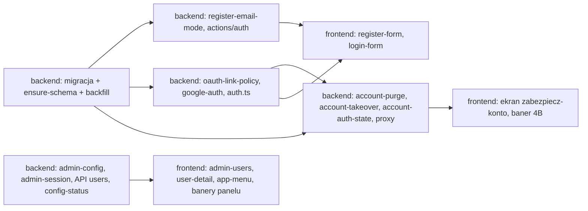

# ADR 0001: Rejestracja, weryfikacja e-maila, łączenie kont OAuth i rola admina

- Status: zaproponowany (etap 3 zadania 001)
- Data: 2026-10-23
- Autor: architekt
- Karta: `docs/zadania/001-rejestracja-kod-i-oauth.md`
- Wejście: `docs/analiza/001-rejestracja-kod-i-oauth.md` (US-1..US-10, BR-1..BR-14), `docs/prawo/001-bramka-wejsciowa-rejestracja.md` (LR-19..LR-30), `docs/ux/001-rejestracja-i-laczenie-kont.md`, W1/S2/N7 w `docs/bezpieczenstwo/00-model-zagrozen-bazowy.md`, DW-1/DW-3/DW-4 w `docs/zespol/decyzje-wlasciciela.md`.
- Zmienia stan opisany w `docs/adr/0000-architektura-stanu-obecnego.md` (sekcje 3, 4, 6, 9).

## 1. Kontekst

Stan potwierdzony w kodzie:
- `actions/auth.ts`: `isRegisterEmailMockMode()` włącza stały kod `1234`, gdy brak SMTP albo `MOCK_REGISTER_EMAIL_CODE=1`, także na produkcji. Ścieżka mock jest osobną kopią tworzenia konta (linie 236-286) i niczego nie zapisuje w `email_verification_codes`.
- `auth.ts`: `allowDangerousEmailAccountLinking: true` dla Google i Facebooka. **Bez adaptera ta flaga nic nie robi** (`@auth/core` 0.41.3, `lib/actions/callback/handle-login.js` używa jej tylko z adapterem). Faktyczne łączenie po e-mailu robi `resolveGoogleSignInUser` w `lib/google-auth.ts`, a `ensureOauthLink` przenosi istniejące powiązanie na inne konto.
- `lib/admin-config.ts`: `PRIMARY_ADMIN_EMAIL` na stałe w kodzie, dodawany do `parseAdminEmails()`. Pojęcie "głównego admina" jest używane w `lib/admin-session.ts`, `app/api/admin/users/route.ts`, `app/api/admin/users/[id]/route.ts` (ochrona przed zmianą roli i usunięciem, prawo nadawania roli admin) oraz w trzech komponentach klienckich (`admin-users-client.tsx`, `admin-user-detail-client.tsx`, `layout/app-menu-button.tsx`).
- Sesje: JWT 30 dni, bez stanu w bazie; `jwt` nie sprawdza, czy konto nadal istnieje ani czy hasło lub rola się zmieniły (S2).
- `users` nie ma znacznika weryfikacji e-maila.
- Dziennik: `admin_audit_log` (`lib/admin-audit.ts`, `logAdminAction`; retencja 180 dni z `RETENTION_ADMIN_AUDIT_DAYS`) oraz `site_activity_log` (45 dni). `listAdminAuditLogs` nie ma konsumenta (katalog `app/admin/(panel)/audit` jest pusty).
- Retencja kodów: 14 dni (`RETENTION_EMAIL_CODES_DAYS`). **Cron `/api/cron/cleanup` jest zaplanowany tylko w `vercel.json`; na Render (produkcja, D1) nic go nie wywołuje.** Wymóg LR-20 "co najmniej raz na dobę" nie może więc zależeć od crona. Skutek uboczny: dowody incydentu (LR-27) dziś nie są kasowane.
- Usuwanie konta (`app/api/user/account`, `app/api/admin/users/[id]`) polega wyłącznie na `ON DELETE CASCADE`. SQLite i Turso domyślnie **nie wymuszają kluczy obcych** (`PRAGMA foreign_keys` jest ustawiane per połączenie; [Turso: pragmas](https://docs.turso.tech/sql-reference/pragmas)), a w repo nie ma żadnego `PRAGMA foreign_keys = ON`. Kaskada nie jest więc gwarantowana.
- W repo nie ma transakcji bazodanowych. `db/resilient-client.ts` obsługuje `batch` (libSQL wykonuje batch jako jedną transakcję).

## 2. Decyzje

### D1. Tryb kodu rejestracji: jedna funkcja serwerowa, tryb testowy tylko dev/test

Opcje:
- A. `NODE_ENV !== "production"` i brak SMTP.
- B. Lista dozwolonych: `NODE_ENV` równe `development` albo `test`, brak SMTP **i** brak znaczników hostingu (`VERCEL`, `RENDER`). `MOCK_REGISTER_EMAIL_CODE` usunięte.
- C. Jawna flaga na Preview (jak sugerował W1).

Decyzja: **B**. A przepuszcza nietypowe wartości `NODE_ENV` (R9), C narusza LR-21 (Preview to też `NODE_ENV=production`). Znaczniki hostingu to tani drugi bezpiecznik.

Jedno źródło prawdy, nowy plik `lib/register-email-mode.ts` (`import "server-only"`):

```ts
export type RegisterEmailMode = "smtp" | "test" | "disabled";
export function getRegisterEmailMode(env?: NodeJS.ProcessEnv): RegisterEmailMode;
export type RegistrationAvailability = {
  emailMode: RegisterEmailMode;
  google: boolean;   // isGoogleAuthConfigured()
  facebook: boolean; // isFacebookAuthConfigured()
  blocked: boolean;  // emailMode === "disabled" && !google && !facebook
};
export function getRegistrationAvailability(env?: NodeJS.ProcessEnv): RegistrationAvailability;
export const TEST_REGISTER_CODE = "123456";
```

`isSmtpConfigured()` dochodzi do `lib/email.ts` (jedno miejsce sprawdzania `SMTP_HOST/USER/PASS`).

Tryb testowy **nie ma osobnej ścieżki tworzenia konta**. Różni się tylko transportem: `sendRegisterCode` zapisuje skrót `TEST_REGISTER_CODE` w `email_verification_codes` i nie wysyła wiadomości. Limity, próby, wygaśnięcie i retencja działają tak samo jak na produkcji. Usuwamy blok mock z `registerUser` (linie 236-286) i `MOCK_REGISTER_CODE`. Kod testowy ma 6 cyfr, więc `lib/validations/register.ts` przyjmuje wyłącznie `^\d{6}$`. **Odchylenie od US-3/UX 2A**: w kopii zamiast "1234" ma być "123456" (do poprawienia przez `ux`; intencja wymagania zachowana).

Egzekwowanie po stronie serwera (BR-3): gdy `getRegisterEmailMode() === "disabled"`, `sendRegisterCode` i `registerUser` zwracają `registration_disabled` przed jakimkolwiek zapisem. Konto z trybu testowego ma `email_verified_at = NULL`.

### D2. Model weryfikacji e-maila i wersji sesji: dwie kolumny w `users`

Opcje:
- A. `users.email_verified_at` (timestamp_ms, NULL = niezweryfikowany) oraz `users.session_version` (integer NOT NULL DEFAULT 0).
- B. Flaga boolean `email_verified` (bez daty).
- C. Osobna tabela `account_security(user_id, …)`.

Decyzja: **A**. Data jest wymagana przez prawnika (sekcja 2 bramki: "flaga i data"), dwie kolumny addytywne są bezpieczne dla działającej bazy, a C dokłada złączenie do każdego logowania bez zysku.

Migracja (addytywna, bez kasowania danych, LR-27):
- `db/schema.ts`: `emailVerifiedAt: integer("email_verified_at", { mode: "timestamp_ms" })`, `sessionVersion: integer("session_version").notNull().default(0)`.
- `db/migrations/0031_users_email_verification.sql`:
  ```sql
  ALTER TABLE `users` ADD `email_verified_at` integer;
  --> statement-breakpoint
  ALTER TABLE `users` ADD `session_version` integer DEFAULT 0 NOT NULL;
  ```
  Wpis w `_journal.json` dodać ręcznie (idx 24, tag `0031_users_email_verification`). **Nie polegać na `db:generate`**: journal i snapshot są niespójne (R3 w ADR 0000), więc diff byłby błędny.
- `db/ensure-schema.ts`: dwa `tryAddColumn(...)` obok `sex` (linia ~349). To faktyczne źródło schematu na hostingu.

Uzupełnienie danych istniejących kont (backfill): nowy plik `lib/migrate-email-verification.ts`, wywoływany z `instrumentation.ts` po `ensureCriticalSchema` (ten sam wzorzec co `migrateSensitiveFieldsAtStartup`). Naturalnym znacznikiem idempotencji jest `email_verified_at IS NULL`, więc nie potrzeba tabeli znaczników. Reguły (wyłącznie dla wierszy z `email_verified_at IS NULL`):

| Reguła | Warunek | Skutek | Uzasadnienie |
|---|---|---|---|
| R-A | powiązanie `google`, którego `created_at` jest najwyżej 5 min po `users.created_at` (konto założone przez Google) | `email_verified_at = oauth.created_at` | LR-24: konta Google są zweryfikowane |
| R-B | powiązanie `google` dodane później (konto najpierw hasłowe, potem łączone po e-mailu) | `email_verified_at = now`, `password_hash` = losowy bcrypt, `session_version + 1`, zdarzenie `security.backfill_password_reset` | Scenariusz S2: właściciel Google kontroluje adres, ale założyciel może znać hasło. Unieważniamy hasło i sesje, a użytkownik dalej loguje się przez Google. **DW-5: odrzucone przez właściciela (2026-10-23) - tylko `email_verified_at = now`, bez resetu hasła i sesji; zob. `docs/zespol/decyzje-wlasciciela.md`.** |
| R-C | `app_role = 'admin'` i e-mail na liście `ADMIN_EMAILS` | `email_verified_at = now` | DW-1 (jedyne konto admin należy do właściciela) i DW-3 (właściciel ustawi `ADMIN_EMAILS` przed Promote). Kotwicą zaufania jest konfiguracja właściciela. |
| pozostałe | konta hasłowe bez Google, konta tylko z Facebookiem | bez zmian (NULL) | BR-6, LR-24 |

Jak właściciel nie straci dostępu:
1. Rola zapisana w bazie (`app_role = 'admin'`) zostaje (US-6), więc logowanie hasłem daje panel także przed weryfikacją.
2. R-C weryfikuje konto właściciela, gdy `ADMIN_EMAILS` jest ustawione. Jeśli zmienną ustawi się po wdrożeniu, R-C zadziała przy kolejnym starcie procesu.
3. Konto z rolą admin i niezweryfikowanym e-mailem **nigdy nie jest przejmowane** (D3): logowanie Google kończy się odmową `OAuthLinkRefused`, a dane zostają. To chroni właściciela, gdyby R-C jeszcze nie zadziałała.

### D3. Logowanie OAuth: decyzja w czystej funkcji, mutacja w `signIn`, odczyt w `jwt`

Opcje miejsca logiki:
- A. Jak dziś: tworzenie i łączenie w `jwt`, w `signIn` tylko walidacja. Odmowa z `jwt` kończy się błędem `Configuration`/`CallbackRouteError`, bez rozróżnialnego kodu dla UI.
- B. Decyzja i mutacja w `signIn`. Odmowa to zwrot ścieżki `/login?error=<Kod>` (Auth.js robi wtedy przekierowanie bez tworzenia sesji: `handleAuthorized` w `@auth/core/lib/actions/callback/index.js`). `jwt` tylko odczytuje konto po powiązaniu (provider + providerAccountId).

Decyzja: **B**. Daje osobne kody błędów (US-8, UX sekcja 3) i jedno wywołanie mutacji.

Reguły jako czysta funkcja, nowy plik `lib/oauth-link-policy.ts` (bez importu bazy, w pełni testowalna):

```ts
export type OAuthDecision =
  | { kind: "login_linked"; userId: string }
  | { kind: "create"; emailVerified: boolean }
  | { kind: "link_existing"; userId: string }
  | { kind: "takeover_confirm"; userId: string }
  | { kind: "reject"; code: OAuthErrorCode };

export function decideOAuthSignIn(input: {
  provider: "google" | "facebook";
  email: string;                   // znormalizowany, może być ""
  providerEmailVerified: boolean;  // Google: email_verified === true; Facebook: zawsze false
  linkedUserId: string | null;     // właściciel (provider, providerAccountId)
  accountByEmail: { id: string; emailVerified: boolean; isAdmin: boolean } | null;
}): OAuthDecision;
```

Tabela decyzji:

| Dostawca | Powiązanie istnieje | E-mail od dostawcy potwierdzony | Konto o tym e-mailu | Wynik |
|---|---|---|---|---|
| dowolny | tak | dowolny | dowolne | `login_linked` (BR-8: nigdy nie przenosimy powiązania; zmiana adresu w Google nic nie zmienia) |
| dowolny | nie | - | - (brak e-maila) | `reject OAuthNoEmail` |
| google | nie | nie (brak pola też = nie) | dowolne | `reject OAuthEmailUnverified` (identycznie przy braku konta, bez enumeracji) |
| google | nie | tak | brak | `create` z `emailVerified: true` |
| google | nie | tak | zweryfikowane | `link_existing` |
| google | nie | tak | niezweryfikowane, admin | `reject OAuthLinkRefused` (D2 pkt 3) |
| google | nie | tak | niezweryfikowane, nie admin | `takeover_confirm` (D4) |
| facebook | nie | - | istnieje | `reject OAuthLinkRefused` |
| facebook | nie | - | brak | `create` z `emailVerified: false` |

Wykonanie: `lib/google-auth.ts` zostaje (rozszerzamy, nie dublujemy). `resolveGoogleSignInUser` zmienia się w `resolveOAuthSignIn(input): Promise<OAuthDecision>`, które czyta dane, woła `decideOAuthSignIn` i wykonuje `create` lub `link_existing`. `ensureOauthLink` traci obie gałęzie przenoszenia: `INSERT ... ON CONFLICT DO NOTHING`, a potem sprawdzenie właściciela. Jeśli powiązanie należy do innego konta, kończy się to odmową `OAuthSignInFailed`. Usunąć gałąź "linked, ale e-mail wskazuje inne konto, scal" (linie 606-641).

`create` wykonuje się jednym `db.batch` (users + user_settings + oauth_accounts + zdarzenie). Przy naruszeniu unikalności (dwa urządzenia naraz) decyzja jest liczona jeszcze raz, raz (US-4, brzeg).

`auth.ts`:
- Usunąć `allowDangerousEmailAccountLinking` (martwa flaga bez adaptera, myląca przy przeglądzie).
- `signIn`: dla OAuth wywołuje `resolveOAuthSignIn`. `reject` zwraca `/login?error=<code>`. `takeover_confirm` zwraca `/login/zabezpiecz-konto?t=<token>` (D4). Wyjątek zwraca `/login?error=OAuthSignInFailed` i trafia do `logServerError` bez e-maila.
- `jwt` przy `account` OAuth: tylko odczyt `findUserByOAuthLink(provider, providerAccountId)` (nowa funkcja w `lib/google-auth.ts`), ustawienie `id`, `email`, `role`, `sv`.

Kody błędów w `lib/auth-error-codes.ts` (rozszerzenie istniejącego pliku):

```ts
export const OAUTH_ERROR_CODES = [
  "OAuthEmailUnverified", "OAuthLinkRefused", "OAuthNoEmail", "OAuthSignInFailed",
] as const;
export type OAuthErrorCode = (typeof OAUTH_ERROR_CODES)[number];
export const SESSION_EXPIRED_PARAM = "expired"; // /login?session=expired
```

`OAuthAccountNotLinked` znika z mapy w `login-form.tsx` (UX sekcja 3).

### D4. Przejęcie konta niezweryfikowanego: ekran potwierdzenia (wariant A z UX) i usuwanie danych w jednym batchu

Opcje przebiegu:
- A. Ekran potwierdzenia przed przejęciem (rekomendacja `ux`): podpisany, krótkotrwały token, a dopiero potem usunięcie.
- B. Natychmiastowe przejęcie w callbacku `signIn`.

Decyzja: **A**. Daje prawdziwemu właścicielowi, który pamięta hasło, szansę zachowania danych (R4), a nie zmienia LR-23: nowy właściciel nigdy nie dostaje danych. Koszt: jedna strona i jedna akcja serwerowa. Stan oczekujący nie jest zapisywany w bazie, tylko w tokenie.

Token: `lib/account-takeover.ts` (`server-only`), HMAC-SHA256 z `getAuthSecret()`, ładunek `{ uid, provider: "google", pid: providerAccountId, given, family, exp: now + 10 min }`. Token jest w URL-u (`?t=`), bo callback Auth.js nie gwarantuje zapisu ciasteczek z `next/headers`. Ponowne użycie tokenu jest nieszkodliwe: akcja przejęcia działa tylko na koncie z `email_verified_at IS NULL`, a jej skutek (powiązanie Google tej samej osoby) jest dokładnie tym, czego chciał wystawca. Po pierwszym użyciu token zwraca `expired`.

Kontrakt akcji (`actions/account-takeover.ts`, `"use server"`, `guardAction` jako pierwsza instrukcja, Zod na wejściu):

```ts
export type ConfirmTakeoverState =
  | { ok: true }                                    // klient woła signIn("google", { callbackUrl: "/register?oauth=1&notice=account_reset" })
  | { ok: false; code: "expired" | "failed"; error: string };
export async function confirmAccountTakeover(input: { token: string }): Promise<ConfirmTakeoverState>;
export async function readTakeoverToken(token: string): Promise<{ valid: boolean }>; // dla RSC strony, bez danych konta
```

Po `ok: true` klient ponownie loguje się przez Google. Konsent jest już udzielony, więc przekierowanie jest szybkie, a powiązanie istnieje (`login_linked`). Komunikat 4B pokazuje się na podstawie `notice=account_reset` w `callbackUrl` (jednorazowo: frontend czyści parametr przez `router.replace`). Nie potrzeba stanu w sesji ani w bazie.

Usuwanie danych. Opcje:
- A. Usunięcie wiersza `users` i poleganie na `ON DELETE CASCADE`.
- B. Ręczna lista ok. 60 tabel.
- C. Lista instrukcji wyprowadzona z metadanych schematu Drizzle (`getTableConfig(table).foreignKeys` z `drizzle-orm/sqlite-core`), rekurencyjnie, od liści do korzenia, wykonywana jawnie.

Decyzja: **C**. A nie działa bez `PRAGMA foreign_keys = ON` (sekcja 1), a B rozjedzie się z każdą nową tabelą. C działa niezależnie od pragmy i automatycznie obejmuje nowe tabele.

Nowy moduł `lib/account-purge.ts` (`server-only`), jedno miejsce odpowiedzialności "usuń dane użytkownika":

```ts
/** Instrukcje usuwające wszystkie dane zależne od users.id (bez wiersza users). Kolejność: od liści. */
export function buildUserDataPurgeStatements(db: Database, userId: string, opts?: { onlyIfUnverified?: boolean }): BatchItem<"sqlite">[];
```

Reguły generowania:
- Klucz obcy do `users` z `onDelete: "cascade"`: `DELETE FROM t WHERE col = :uid`. Ich dzieci kaskadowe (np. `team_post_comments` innych osób pod postem użytkownika, `body_report_photos`) idą wcześniej: `DELETE FROM child WHERE fk IN (SELECT ref FROM t WHERE col = :uid)`, rekurencyjnie, z ochroną przed cyklami.
- Klucze z `set null` (`site_activity_log`, `page_views`, `team_post_*.created_by` i podobne) są **pomijane**. Przy przejęciu `users.id` zostaje, więc dowody zdarzeń (LR-27) pozostają powiązane z kontem i nie trafiają do UI użytkownika.
- `admin_audit_log` (bez klucza obcego) jest nietykany.
- Przy `onlyIfUnverified` każda instrukcja dostaje warunek `AND EXISTS (SELECT 1 FROM users WHERE id = :uid AND email_verified_at IS NULL)`. To ochrona przed równoległym podwójnym przejęciem (US-5, brzeg). Batch jest wykonywany w transakcji zapisu (serializowanej), więc drugi batch nic nie zmieni.
- Kolumny użytkownika bez klucza obcego (np. `actor_user_id` w zdarzeniach feedu innych drużyn, retencja 7 dni) zostają. Ryzyko niskie, zapisane w sekcji 5.

Przejęcie (`takeOverUnverifiedAccount` w `lib/account-takeover.ts`) to **jeden `db.batch`**: (1) instrukcje purge, (2) `UPDATE users SET password_hash = <losowy bcrypt>, email_verified_at = :now, session_version = session_version + 1, app_role = 'zawodnik', name/first_name/last_name = dane z Google, weight_kg/height_cm/age/sex/activity_level/admin_note/package_ends_at/package_plan_sku = NULL WHERE id = :uid AND email_verified_at IS NULL`, (3) `INSERT INTO user_settings ... ON CONFLICT DO NOTHING` (domyślne ustawienia), (4) `INSERT INTO oauth_accounts ... ON CONFLICT DO NOTHING`, (5) zdarzenie `security.account_takeover`. Błąd dowolnej instrukcji wycofuje całość (US-5: brak stanu częściowego). Po batchu: `invalidateAccountAuthState(uid)` (D5).

`subscription_orders` ma kaskadę, więc purge je usuwa (zgodnie z literą LR-23). **Pytanie do `prawnik`**: czy dokumenty rozliczeniowe muszą zostać (przepisy podatkowe). Jeśli tak, dopisać tabelę do jawnej listy wyłączeń w `lib/account-purge.ts`.

Ponowne użycie: `app/api/user/account` i `app/api/admin/users/[id]` (DELETE) dziś polegają na kaskadzie. Przejście na `buildUserDataPurgeStatements` + `DELETE FROM users` w jednym batchu jest poza zakresem tego zadania. Wpis do backlogu jako ryzyko RODO art. 17 (sekcja 5).

### D5. Unieważnianie sesji JWT: `session_version` w tokenie, sprawdzane z krótkim cache

Opcje:
- A. Przejście na sesje w bazie (adapter Auth.js).
- B. `users.session_version` w tokenie (`token.sv`), porównywane z bazą przy każdym `jwt` i w `proxy.ts`, z cache w procesie (TTL 60 s).
- C. Lista unieważnionych tokenów (denylist) w Upstash.

Decyzja: **B**. A to duża zmiana całego logowania i WebView. C wymaga Upstash, którego produkcja może nie mieć (S7).

Nowy moduł `lib/account-auth-state.ts` (`server-only`):

```ts
export type AccountAuthState = { exists: boolean; email: string; appRole: string; emailVerified: boolean; sessionVersion: number };
export async function getAccountAuthState(userId: string): Promise<AccountAuthState>; // cache na globalThis, TTL 60 s
export function invalidateAccountAuthState(userId: string): void;
export function isTokenRevoked(token: { id?: unknown; sv?: unknown }, state: AccountAuthState): boolean; // brak sv w starym tokenie = 0
```

Punkty egzekwowania (ta sama funkcja, bez kopii logiki):
- `auth.ts` `jwt`: poza logowaniem pobiera stan. Jeśli `isTokenRevoked`, zwraca `null` (Auth.js czyści ciasteczko w `/api/auth/session`, a `auth()` w RSC i akcjach zwraca brak sesji). Przy okazji odświeża `token.role` z `resolveEffectiveRole` (D6), co częściowo zamyka S2.
- `proxy.ts`: przy obecnym tokenie pobiera stan. Jeśli `isTokenRevoked`, czyści ciasteczka sesji i przekierowuje na `/login?session=expired`. Bez tego unieważniona sesja zapętliłaby się (strona: brak sesji, przekierowanie na `/login`; proxy: ciasteczko jest, przekierowanie na pulpit). Proxy w Next 16 działa w runtime Node.js (`node_modules/next/dist/docs/01-app/03-api-reference/03-file-conventions/proxy.md`), więc może używać `getDb()`. Cache na `globalThis` jest wspólny w jednym procesie (Render).

Koszt: najwyżej jedno zapytanie po kluczu głównym na użytkownika na 60 s na instancję. Okno 60 s między przejęciem a wylogowaniem na innych instancjach jest akceptowane; na tej samej instancji `invalidateAccountAuthState` działa od razu.

Kto podbija `session_version`: przejęcie (D4) i backfill R-B. Zmiana hasła (`actions/profile.ts`) i odebranie roli w panelu to naturalne następne użycia (S2), wpisane do backlogu, poza zakresem.

Java: brak wpływu. `X-GymBrat-User-Id` jest wysyłany dopiero po `auth()` w Next, więc unieważniona sesja nie dociera do Javy. Android: WebView korzysta z tych samych stron; po unieważnieniu widzi `/login?session=expired`. Kontrakty `/api/android/*` się nie zmieniają.

### D6. Rola admina: jedna funkcja, tylko zweryfikowany e-mail, bez adresu w kodzie

Opcje zastąpienia "głównego admina" (`PRIMARY_ADMIN_EMAIL`):
- A. Główny admin = pierwsze konto z rolą admin (`getFounderUserId`, już istnieje).
- B. Główni admini = zweryfikowane konta z e-mailem w `ADMIN_EMAILS`; gdy lista jest pusta, A jako rezerwa.

Decyzja: **B**. Konfiguracja właściciela (DW-3) jest jawną kotwicą. A zostaje jako rezerwa, bo `getProtectedAdminUserId` już tak działa.

Zmiany:
- `lib/admin-config.ts`: usunąć `PRIMARY_ADMIN_EMAIL` i `isPrimaryAdminEmail`. `parseAdminEmails()` zwraca tylko adresy ze zmiennej. Nowa funkcja (jedyne miejsce reguły roli):
  ```ts
  export function resolveEffectiveRole(input: { appRole: string | null; email: string; emailVerified: boolean }): "zawodnik" | "trener" | "admin";
  // admin  <=> appRole === "admin" || (emailVerified && parseAdminEmails().has(normalize(email)))
  ```
- `auth.ts`: `authorize` (Credentials) i `jwt` używają `resolveEffectiveRole`. Zapis `app_role = 'admin'` wyłącznie, gdy e-mail jest zweryfikowany. Zdarzenia `security.admin_role_granted` / `security.admin_role_denied` zapisujemy tylko przy logowaniu (nie przy każdym odświeżeniu tokenu). Usunąć nadpisanie roli w callbacku `session` (linie 337-342), bo rola pochodzi z `jwt`.
- `lib/google-auth.ts`: `resolveAppRole` zastąpione przez `resolveEffectiveRole`.
- `lib/admin-session.ts`: `getPrimaryAdminUserId` zastąpić przez `getOwnerAdminUserIds()` (zweryfikowane konta z e-mailem w `ADMIN_EMAILS`), `isPrimaryAdminActor` przez `isOwnerAdminActor(session)` (id sesji w tym zbiorze albo founder, gdy zbiór jest pusty), `getProtectedAdminUserId` przez `getProtectedAdminUserIds()`. `isAdminEligible` opiera się wyłącznie na `session.user.role === "admin"` (rola jest już liczona z weryfikacją).
- `app/api/admin/users/route.ts`: odpowiedź `{ users, protectedUserIds: string[], canGrantAdmin }` (zamiast `founderUserId` i `primaryAdminUserId`). `app/api/admin/users/[id]/route.ts` i `.../detail`: `isProtected` liczone na serwerze. Komunikaty "głównego administratora" bez zmian merytorycznych.
- Komponenty klienckie przestają importować `@/lib/admin-config` (dziś trafia to do bundla klienta razem z adresem). `app-menu-button.tsx` opiera się tylko na `role === "admin"`.
- `lib/meal-catalog-import.test.ts`: usunąć testy `PRIMARY_ADMIN_EMAIL` (linie ~148-151).

Uwaga: adres pozostaje w historii publicznego repo (R10 analizy). Usunięcie z kodu zmniejsza ekspozycję, ale nie jest zabezpieczeniem. Zabezpieczeniem jest warunek weryfikacji.

### D7. Dziennik zdarzeń bezpieczeństwa: rozszerzenie `admin_audit_log`

Opcje:
- A. Nowa tabela `security_events`.
- B. `admin_audit_log` z przestrzenią nazw `action = "security.<typ>"`.
- C. `site_activity_log` (45 dni, za krótko według LR-26).

Decyzja: **B**. Tabela ma już 180 dni retencji, indeks po `created_at`, brak klucza obcego (wpisy przeżywają usunięcie konta, co jest dobre dla dowodów) i nie wymaga migracji. A dublowałaby mechanizm.

Nowy cienki moduł `lib/security-events.ts` (`server-only`), który woła istniejące `logAdminAction`:

```ts
export type SecurityEventType =
  | "register" | "oauth_register" | "oauth_link" | "oauth_link_rejected"
  | "account_takeover" | "admin_role_granted" | "admin_role_denied" | "backfill_password_reset";
export async function logSecurityEvent(input: {
  type: SecurityEventType;
  userId: string;                 // actor_user_id = target_user_id = konto, którego dotyczy zdarzenie
  reason?: string;                // kod, np. "OAuthEmailUnverified", "email_code", "test_mode", "email_unverified"
  provider?: "google" | "facebook";
}): Promise<void>;                // błąd zapisu nie blokuje logowania; wpis do logServerError bez danych osobowych
```

`meta` to stała lista dozwolonych kluczy (`reason`, `provider`): **bez e-maila, kodu, hasła i danych zdrowotnych** (BR-10, LR-26). Odrzucenie bez konta (np. `OAuthEmailUnverified` przy braku konta) nie ma `userId`, więc nie trafia do dziennika (nie ma czego przypisać, a e-maila nie zapisujemy). Instrukcje do batchów (rejestracja, przejęcie) budowane są przez `securityEventInsert(...)` z tego samego modułu.

Przy okazji usunąć e-mail z `metaJson` wpisu "Powiązanie konta OAuth" w `site_activity_log` (`lib/google-auth.ts` linia ~689), zgodnie z BR-10.

Retencja: `getRetentionPolicy()` w `lib/db-retention.ts` ogranicza `adminAuditDays` do minimum 180 (`Math.max(180, env)`), żeby zmienna środowiskowa nie skróciła okresu poniżej LR-26. Przegląd dziennika w panelu (US-9, Should): katalog `app/admin/(panel)/audit` jest pusty, a `listAdminAuditLogs` nieużywane, więc widok to osobne zadanie z backlogu.

### D8. Retencja kodów 24 h niezależnie od crona

Opcje:
- A. Tylko cron `/api/cron/cleanup` z progiem 24 h.
- B. Usunięcie przy użyciu + oportunistyczne sprzątanie w `sendRegisterCode` + cron jako dodatkowe zabezpieczenie.

Decyzja: **B**, bo cron na Render nie działa (sekcja 1).
- `registerUser`: wiersz kodu jest usuwany w tym samym `db.batch`, który tworzy konto (users, user_settings, `DELETE email_verification_codes WHERE id = :codeId`, zdarzenie `security.register`). Zastępuje to dzisiejsze `consumedAt` i rozdzielne zapisy. Unikalność e-maila w batchu daje `account_exists` przy równoległych rejestracjach (US-1, brzeg).
- `sendRegisterCode`: przed wstawieniem kodu `DELETE FROM email_verification_codes WHERE created_at < now - 24 h` (indeks `idx_email_verification_codes_expires` istnieje; tanie).
- `lib/db-retention.ts`: `emailCodesDays` zastąpione przez `emailCodesHours` (`RETENTION_EMAIL_CODES_HOURS`, domyślnie 24, `Math.min(24, env)`). Usuwane są wiersze z `created_at` starszym niż próg albo z `consumed_at` (bez dzisiejszego warunku, że wygasły).
- Włączenie crona sprzątania na Render (np. harmonogram w `.github/workflows/`) **dopiero po zabezpieczeniu dowodów incydentu** (BR-14, LR-27), bo zacznie kasować `site_activity_log` po 45 dniach. Decyzja właściciela, osobne zadanie.

### D9. Konfiguracja: `lib/admin-config-status.ts`, `env.example`, changelog

Opcje poziomu SMTP: A. `required` (analityk), B. `recommended` + wyliczona flaga "nikt nie założy konta".
Decyzja: **B**. `required` oznacza w panelu "bez tego aplikacja nie działa" (zob. wpis changelogu "Admin: braki konfiguracji"), a logowanie działa bez SMTP. Stały czerwony stan do czasu D22 zagłuszyłby prawdziwe braki. Twardy sygnał daje flaga `registrationBlocked`.

- `lib/admin-config-status.ts`, integracja `email`: opis "Kody weryfikacyjne przy rejestracji e-mailem i dzienny skrót.", `effectWhenMissing`: "Rejestracja e-mailem jest wyłączona; konta można zakładać tylko przez Google lub Facebook (jeśli skonfigurowane). Lokalnie działa tryb testowy kodu.", `hostingHint` o dedykowanej skrzynce z DPA i SPF/DKIM/DMARC (LR-22). `ConfigSummary` dostaje `registrationBlocked: boolean` z `getRegistrationAvailability(env).blocked`.
- Integracja `admin-access`: `ADMIN_EMAILS` przestaje być `optional`, z podpowiedzią "Jedyna droga do roli admina z konfiguracji; działa tylko dla kont z potwierdzonym e-mailem." Brak zmiennej daje stan `partial` i widoczny baner (DW-3). `ADMIN_PIN` bez zmian (D15 to osobne zadanie).
- `env.example`: SMTP opisane jako wymagane do rejestracji e-mailem (bez rekomendacji prywatnego Gmaila, LR-22); `RETENTION_EMAIL_CODES_DAYS=14` zastąpione przez `RETENTION_EMAIL_CODES_HOURS=24`; przy `RETENTION_ADMIN_AUDIT_DAYS` uwaga "minimum 180"; przy `ADMIN_EMAILS` uwaga o weryfikacji. `MOCK_REGISTER_EMAIL_CODE` nie występuje w `env.example` i znika z kodu.
- `components/changelog/changelog-data.ts`, wpis na początku listy:
  ```ts
  {
    title: "Zapowiedź — Rejestracja: potwierdzony e-mail i bezpieczne logowanie Google",
    planned: true,
    sourceRepo: GYMBRAT_GITHUB_SLUG,
    bullets: [
      "Konto e-mailem założysz tylko po wpisaniu kodu z prawdziwej wiadomości; bez skonfigurowanej poczty rejestracja e-mailem jest wyłączona, a Google działa dalej.",
      "Logowanie Google łączy się z istniejącym kontem tylko wtedy, gdy oba potwierdzają ten sam adres; Facebook nie łączy kont automatycznie.",
      "Konto założone bez potwierdzenia adresu może zabezpieczyć właściciel adresu przez Google, po wyraźnym potwierdzeniu, że dotychczasowe dane zostaną usunięte.",
      "Rola administratora wymaga potwierdzonego e-maila, a panel pokazuje, gdy nikt nie może założyć konta.",
    ],
  },
  ```
  Treść dopracowuje `ux`.

## 3. Kontrakty dla `backend` i `frontend`

### Server actions (`actions/auth.ts`, kształt `{ ok, ... }` jak dziś, rozszerzony o `code`)

```ts
export type RegisterErrorCode =
  | "registration_disabled" | "rate_limited" | "invalid_email" | "invalid_form" | "account_exists"
  | "code_resend_too_soon" | "code_missing" | "code_expired" | "code_invalid"
  | "code_attempts_exhausted" | "send_failed";

export type SendRegisterCodeState =
  | { ok: true; mode: "smtp" | "test" }   // "test": UI pokazuje kopię trybu testowego, nigdy "Kod wysłany"
  | { ok: false; code: RegisterErrorCode; error: string };

export type RegisterState =
  | { ok: true }
  | { ok: false; code: RegisterErrorCode; error: string; attemptsLeft?: number;
      fieldErrors?: Partial<Record<keyof RegisterInput, string[]>> };

export async function sendRegisterCode(input: unknown): Promise<SendRegisterCodeState>;
export async function registerUser(input: unknown): Promise<RegisterState>;
```

`send_failed`: błąd SMTP jest łapany, wiersz kodu usuwany (żeby nie blokował ponowienia przez 60 s), a do `logServerError` trafia zdarzenie bez adresu i kodu. Teksty `error` po polsku zgodne z UX. Dzisiejsze angielskie "An account with this email already exists." i "Invalid form data." znikają.

### Akcje i strony przejęcia
- `actions/account-takeover.ts`: `confirmAccountTakeover`, `readTakeoverToken` (D4).
- Strona `app/(auth)/login/zabezpiecz-konto/page.tsx` (RSC czyta `searchParams.t` przez `await`, woła `readTakeoverToken`, renderuje klienta UX 4A). Ścieżka publiczna: dopisać ją do `lib/auth-public-paths.ts`.

### Propsy RSC → klient
- `app/(auth)/register/page.tsx` i `login/page.tsx` przekazują `availability: RegistrationAvailability` (zamiast osobnych `googleEnabled`/`facebookEnabled`; UX `emailRegistrationEnabled`/`emailCodeTestMode` = `emailMode`).
- `/login?error=<OAuthErrorCode>`, `/login?session=expired`, `/register?oauth=1&notice=account_reset`.
- `proxy.ts`: `/login?session=expired` nie jest odbijane na pulpit (wzór jak `oauth=existing`).

### Teksty do `ux`
Kody i kopia z `docs/ux/001-rejestracja-i-laczenie-kont.md` sekcja 3 obowiązują z mapowaniem nazw: `OAuthEmailUnverified`, `OAuthLinkRefused` (Facebook i admin bez weryfikacji), `OAuthNoEmail`, `OAuthSignInFailed` (zastępuje `OAuthTakeoverFailed` w `?error`; na ekranie 4A błąd akcji to `code: "failed"`). Kod testowy w kopii: `123456`. Do uzupełnienia przez `ux`: kopia dla `registration_disabled` (wywołanie akcji, gdy UI miał nieaktualny stan), `send_failed`, `code_missing`.

## 4. Podział pracy



**backend**: `db/schema.ts`, `db/migrations/0031_users_email_verification.sql` + `meta/_journal.json`, `db/ensure-schema.ts`, `instrumentation.ts`, `lib/migrate-email-verification.ts` (nowy), `lib/register-email-mode.ts` (nowy), `lib/email.ts`, `actions/auth.ts`, `lib/validations/register.ts`, `lib/oauth-link-policy.ts` (nowy), `lib/google-auth.ts`, `auth.ts`, `types/next-auth.d.ts` (`sv`), `lib/auth-error-codes.ts`, `lib/account-purge.ts` (nowy), `lib/account-takeover.ts` (nowy), `actions/account-takeover.ts` (nowy), `lib/account-auth-state.ts` (nowy), `proxy.ts`, `lib/auth-public-paths.ts`, `lib/security-events.ts` (nowy), `lib/admin-config.ts`, `lib/admin-session.ts`, `app/api/admin/users/route.ts`, `app/api/admin/users/[id]/route.ts`, `app/api/admin/users/[id]/detail/route.ts`, `lib/db-retention.ts`, `lib/admin-config-status.ts`, `env.example`, `vitest.config.ts` (alias `server-only` do pustego modułu, bo nowe moduły go importują; usuwa też część znanych niepowodzeń linii bazowej).

**frontend**: `components/auth/register-form.tsx`, `components/auth/login-form.tsx`, `components/auth/login-screen.tsx`, `app/(auth)/register/page.tsx`, `app/(auth)/login/page.tsx`, `app/(auth)/login/zabezpiecz-konto/page.tsx` (nowy) + komponent kliencki w `components/auth/`, `components/admin/admin-users-client.tsx`, `components/admin/admin-user-detail-client.tsx`, `components/layout/app-menu-button.tsx`, `components/admin/admin-overview-client.tsx`, `components/admin/admin-settings-client.tsx`, `components/changelog/changelog-data.ts`. Tylko istniejące prymitywy (`InlineBanner`, `Button`, `AdminNotice`), zgodnie z UX sekcja 0.

## 5. Plan testów jednostkowych (Vitest, pliki obok kodu)

| Plik testu | Co sprawdza |
|---|---|
| `lib/register-email-mode.test.ts` | macierz: production ± SMTP; development/test ± SMTP; development z `RENDER`/`VERCEL` = disabled; `MOCK_REGISTER_EMAIL_CODE=1` ignorowane; `blocked` |
| `lib/oauth-link-policy.test.ts` | każdy wiersz tabeli D3, w tym brak `email_verified` = niepotwierdzony, Facebook nigdy nie łączy, istniejące powiązanie zawsze `login_linked` (także przy innym e-mailu) |
| `lib/account-purge.test.ts` | zbiór tabel wyprowadzony z metadanych zawiera m.in. `body_reports`, `body_report_photos`, `weight_logs`, `meal_logs`, `workouts`, `daily_checkins`, `user_settings`, `oauth_accounts`, `push_subscriptions`, `chat_messages`, `team_posts`; nie zawiera `site_activity_log`, `page_views`, `admin_audit_log`, `users`; dzieci przed rodzicami; integracja na `@libsql/client` `:memory:` **z wyłączonymi kluczami obcymi**: po purge brak wierszy zależnych, wiersz `users` zostaje |
| `lib/account-takeover.test.ts` | token: podpis, wygaśnięcie, zmiana ładunku; batch: błąd wstrzyknięty w ostatnią instrukcję = nic nie zmienione; drugie wywołanie no-op; `session_version + 1`, `app_role` zresetowane |
| `lib/account-auth-state.test.ts` | `isTokenRevoked` (brak konta, różne `sv`, brak `sv` w starym tokenie = 0), TTL i `invalidateAccountAuthState` |
| `lib/admin-config.test.ts` | `resolveEffectiveRole` (zapisany admin; lista + zweryfikowany; lista + niezweryfikowany = zawodnik; pusta lista) |
| `lib/security-events.test.ts` | `meta` przepuszcza tylko `reason` i `provider`; e-mail podany przypadkiem nie trafia do zapisu |
| `lib/migrate-email-verification.test.ts` | reguły R-A/R-B/R-C, idempotencja (drugie uruchomienie nic nie zmienia), brak zmian dla kont hasłowych bez Google |
| `lib/db-retention.test.ts` | 24 h max dla kodów, min 180 dni dla audytu |
| `lib/admin-config-status.test.ts` (rozszerzenie) | `registrationBlocked`, `ADMIN_EMAILS` nieopcjonalne |
| `actions/auth.test.ts` (nowy, z mockiem `getDb`/limitów) | `registration_disabled` bez zapisu; tryb testowy przechodzi przez tabelę kodów; `123456` odrzucany na produkcji; `1234` odrzucany przez schemat; `send_failed` usuwa wiersz |

E2E (`tester`): Playwright działa na buildzie produkcyjnym, więc rejestracja e-mailem jest tam wyłączona (zgodnie z BR-2). Ścieżkę kodu testuje Vitest. Scenariusz e2e "rejestracja wyłączona bez SMTP" jest możliwy bez sekretów.

## 6. Konsekwencje i kompromisy

- Plusy: zamknięte trzy drogi z W1; jedna ścieżka rejestracji (tryb testowy to tylko transport); jedno miejsce reguły roli, decyzji OAuth i usuwania danych; mechanizm `session_version` gotowy dla S2; brak nowej zależności npm.
- Minusy: jedno zapytanie po kluczu głównym na użytkownika na minutę w `jwt` i `proxy`; okno do 60 s na innych instancjach; przejęcie wymaga drugiego przekierowania przez Google; generator purge z metadanych to nietrywialny kod (kompensowany testem integracyjnym).
- Świadomie odkładamy: przejście usuwania konta na `account-purge` (RODO art. 17 przy wyłączonych kluczach obcych), podbijanie `session_version` przy zmianie hasła lub roli (S2), widok dziennika bezpieczeństwa w panelu (US-9), harmonogram crona sprzątania na Render, baner "Potwierdź adres e-mail" po SMTP, enumeracja kont (N5).

## 7. Ryzyka

| # | Ryzyko | Mitigacja |
|---|---|---|
| A1 | Właściciel traci panel lub dane | stała rola w bazie, R-C, admin bez weryfikacji nigdy nie jest przejmowany; `ADMIN_EMAILS` przed Promote (DW-3) |
| A2 | R-B wyłącza logowanie hasłem legalnym użytkownikom, którzy połączyli Google | logują się dalej przez Google; decyzja DW-5 właściciela; zdarzenie w dzienniku |
| A3 | Generator purge pomija tabelę bez klucza obcego do `users` | test listy; reguła przeglądu: każda nowa tabela z `user_id` ma `references(() => users.id)` |
| A4 | Kolejne batche na Turso przekraczają limit długości lub czasu | batch to ok. 60-80 instrukcji przy rzadkim zdarzeniu; test na kopii bazy w Preview |
| A5 | Pętla przekierowań po unieważnieniu sesji | czyszczenie ciasteczek w `proxy.ts` i wyjątek `session=expired`; test e2e |
| A6 | Migracja Drizzle nie wykona się (R3) | `ensure-schema` jako źródło; backfill niezależny od journala |
| A7 | Włączenie crona przed zabezpieczeniem dowodów | D8: cron dopiero po decyzji właściciela (BR-14) |
| A8 | Kolumny użytkownika bez klucza obcego przeżyją przejęcie | dotyczą zdarzeń w cudzych zasobach z retencją 7 dni; akceptowane |
| A9 | `subscription_orders` usuwane przy przejęciu | pytanie do `prawnik` (D4) |

## 8. Kolejność wdrażania

1. Właściciel (przed Promote, BR-14/LR-27): wpis w rejestrze incydentów, eksport `users`, `oauth_accounts`, `site_activity_log`, `admin_audit_log`, `email_verification_codes`, przegląd kont admin (DW-1), ustawienie `ADMIN_EMAILS` na Render (DW-3), decyzja DW-5.
2. Backend: migracja + ensure-schema + backfill, potem rejestracja (D1, D8), OAuth (D3), przejęcie i sesje (D4, D5), rola (D6), dziennik (D7), konfiguracja (D9). Frontend równolegle po zamrożeniu kontraktów z sekcji 3.
3. Preview: sprawdzenie panelu Konfiguracja (`registrationBlocked`, SMTP brak), logowanie właściciela hasłem i Google, scenariusz przejęcia na koncie testowym.
4. Promote po bramkach 6-10 i zatwierdzeniu polityki prywatności (LR-25).
5. Po Promote: kontrola, że konto właściciela ma `email_verified_at` (R-C), a dopiero potem osobne zadania (cron, purge przy usuwaniu konta, S2).

## 9. Pytania otwarte
- DW-5 (właściciel): akceptacja reguły R-B (unieważnienie hasła kont, do których Google dołączono po rejestracji hasłem).
- `prawnik`: czy `subscription_orders` mają zostać przy przejęciu (A9).
- `ux`: kopia z kodem `123456`, kopie dla `registration_disabled`, `send_failed`, `code_missing`.

## Werdykt etapu 3
ZATWIERDZONE Z UWAGAMI. Projekt jest kompletny dla implementacji. Uwagi nie blokują implementacji, tylko Promote albo drobne teksty: DW-5, pytanie A9 do `prawnik`, korekty kopii po stronie `ux`.
