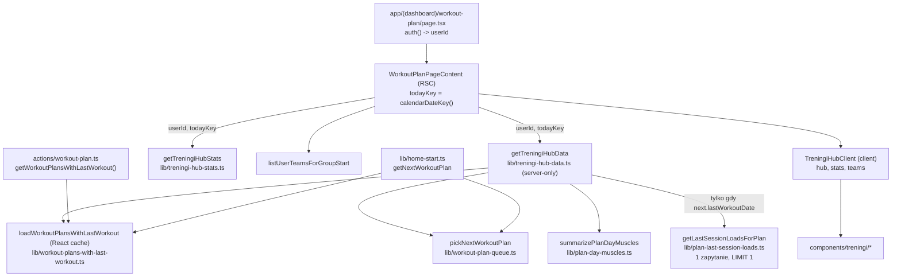

# ADR 0002: Ekran Trening - dane huba (numer dnia, kolejka, tydzień, ostatnie obciążenia, partie mięśni, podział komponentów)

- Status: zaproponowany (etap 3 zadania 003)
- Data: 2026-10-23
- Autor: architekt
- Karta: `docs/zadania/003-przebudowa-ekranu-trening.md` (decyzje użytkownika P-1..P-5 obowiązują)
- Wejście: `docs/analiza/003-przebudowa-ekranu-trening.md` (D-1..D-7, US-1..US-6, BR-1..BR-12), `docs/prawo/003-przebudowa-ekranu-trening-wejscie.md` (LR-1..LR-8), `docs/adr/0000-architektura-stanu-obecnego.md`
- Równolegle: `docs/ux/003-przebudowa-ekranu-trening.md` (wygląd, mikrokopia). Ten ADR ustala dane, kontrakty i podział kodu; nie ustala wyglądu.

## 1. Kontekst (stan potwierdzony w kodzie)

- `/workout-plan` -> `WorkoutPlanPageContent` (RSC) -> `Promise.all([getWorkoutPlansWithLastWorkout(), getTreningiHubStats(userId), listUserTeamsForGroupStart(userId)])` -> `TreningiHubClient` -> `TreningiHub` (539 linii, jeden plik).
- `getWorkoutPlansWithLastWorkout` (`actions/workout-plan.ts`): dwa sekwencyjne zapytania (max(`workouts.date`) per `workout_plan_id` oraz plany `ORDER BY created_at, id`), potem `out.sort(comparePlansByWorkoutRecencyAsc)`. Konsumenci: `/workout-plan`, `/active-workout` (`start-workout-screen.tsx`, `workout-plan-card.tsx`), Home (`home-today-page-content.tsx`, `home-training-card.tsx`, `next-workout-tile.tsx`), `lib/start-workout-session.ts`.
- `lib/home-start.ts` `getNextWorkoutPlan` **powtarza te same dwa zapytania** (z `ORDER BY updated_at DESC`) i sortuje tym samym komparatorem. Home woła więc w jednym żądaniu oba zestawy zapytań (4 zapytania zamiast 2). Kolejność wejściowa różni się (createdAt asc vs updatedAt desc), więc przy remisie Home i Trening wskazują różny "następny" (D-4).
- `comparePlansByWorkoutRecencyAsc` przy remisie nigdy-niewykonanych sortuje po `updatedAt` malejąco; przy remisie dat zwraca 0 (wynik zależy od kolejności wejściowej).
- Etykieta `D{idx+1}` liczona po sorcie kolejki: numer dnia zmienia się po każdym treningu.
- `TreningiHub` liczy `today = calendarDateKey()` w renderze klienta, a `getTreningiHubStats` osobno na serwerze. `calendarDateKey` używa tej samej strefy (`getCalendarTimezone()`, domyślnie Europe/Warsaw) po obu stronach, ale render serwera i hydratacja mogą wypaść po różnych stronach północy (rozjazd tygodnia i ryzyko błędu hydratacji).
- `lib/last-workout-hints.ts` (`getLastWorkoutHintsForPlan`) czyta 4 ostatnie sesje planu i liczy kontekst coacha; wynik per ćwiczenie pochodzi z najnowszej sesji, **w której to ćwiczenie wystąpiło**, a nie z ostatniej sesji planu. Ćwiczenia sesji mają `id` równe `id` ćwiczenia planu (`planExercisesToSession`).
- `lib/resolve-exercise-muscles.ts` ciągnie `lib/workout-exercise-catalog.ts` (ok. 34 KB źródła); wbrew pierwotnemu założeniu katalog **trafia** do bundla klienta ekranu Trening: przez `start-workout-session` -> `resolve-exercise-muscles` (ok. 23,7 KB min), i to od commitu sprzed zadania 003 (pomiar: `docs/wydajnosc/003-przebudowa-ekranu-trening.md`).
- `isCompletedWorkoutSet` odrzuca serie z ciężarem 0, więc nie nadaje się do serii z masą ciała (AC-3.7).
- W repo jest `WorkoutDiscardSessionDialog` (aktywny trening), `ConfirmDialog`, `components/ui/dropdown-menu.tsx`, `components/ui/sheet.tsx`, `hooks/use-mounted.ts`, `hooks/use-visibility-interval.ts`, `plural()` w `lib/progress-format.ts`, `formatKgPl()` w `lib/set-progression-suggestion.ts`. Brak komponentu sylwetki mięśni.
- `workouts` nie ma kolumny czasu utworzenia ani indeksu `(user_id, ...)` (znany problem z `docs/wydajnosc/00-analiza-bazowa.md`).

## 2. Przegląd rozwiązania



Zasada: wszystko, co zależy od "dziś", katalogu ćwiczeń albo bazy, liczy serwer w jednym przebiegu. Klient tylko renderuje, uruchamia start sesji i odświeża trasę po zmianie dnia.

## 3. Decyzje

### D1. Stały numer dnia w DTO (addytywnie)

Opcje:
- A. Pole `dayNumber: number` (1..N) w `WorkoutPlanWithLastWorkoutDTO`, nadawane po `created_at ASC, id ASC` spośród poprawnie sparsowanych planów; tablica dalej zwracana w kolejności kolejki.
- B. Zwracać listę w kolejności `createdAt` i liczyć numer z indeksu w kliencie.
- C. Nowa kolumna `workout_plans.day_number` (zmiana kolejności przez użytkownika w przyszłości).

Decyzja: **A**. Addytywne pole nie łamie konsumentów (Home, `/active-workout`, `start-workout-session`). B zmienia kolejność, na której polegają `/active-workout` i fallback `days[0]` w Home. C narusza LR-3 i P-7 (bez zmian schematu); wraca, jeśli powstanie edycja kolejności dni.

Numeracja jest ciągła po pominięciu uszkodzonych JSON-ów (uszkodzony plan nie zostawia dziury). Konsekwencja świadoma: usunięcie dnia 2 przenumerowuje kolejne dni (Dzień 3 staje się Dniem 2). Zgodne z D-2 analityka.

Jedno miejsce wyliczania: nowy loader `lib/workout-plans-with-last-workout.ts` (`import "server-only"`), opakowany w `React.cache` (memoizacja w obrębie jednego żądania, bez współdzielenia między żądaniami: `node_modules/next/dist/docs/01-app/01-getting-started/06-fetching-data.md`, "Reusing data with React.cache"; zgodne z LR-2). Oba zapytania loadera idą równolegle (`Promise.all`; dziś sekwencyjnie).
- `actions/workout-plan.ts` `getWorkoutPlansWithLastWorkout()` = `auth()` + `[...await loadWorkoutPlansWithLastWorkout(userId)]` (kopia, bo wynik `cache` jest współdzielony w żądaniu i nie wolno go mutować).
- `lib/home-start.ts` `getNextWorkoutPlan` korzysta z loadera i `pickNextWorkoutPlan`, mapuje na swój dotychczasowy kształt zwrotu (`planId, planName, exerciseCount, lastWorkoutDate, exerciseNames, firstTime`). Usuwa zdublowane zapytania. Na Home spada liczba zapytań o plany z 4 do 2.
- Loader przyjmuje `userId` z sesji; **nie może być eksportowany z pliku `"use server"`** (wzorzec R1 z ADR 0000).

### D2. Wspólny tie-break kolejki "następny dzień" (P-2)

Opcje:
- A. Zmienić komparator: wejście `{ lastWorkoutDate, dayNumber }`, remis (obie daty null albo równe) -> `dayNumber` rosnąco; dodać `pickNextWorkoutPlan` z regułą BR-4. Oba ekrany wołają `pickNextWorkoutPlan`.
- B. Zostawić komparator i ujednolicić tylko kolejność wejściową (createdAt asc w obu zapytaniach), polegając na stabilności sortu.

Decyzja: **A**. B jest kruche (wynik zależy od kolejności, którą każdy nowy konsument musi pamiętać) i nie usuwa reguły "ostatnio edytowany pierwszy" dla nigdy niewykonanych. A jest deterministyczne niezależnie od wejścia. `updatedAt` znika z komparatora (świadoma zmiana zachowania na Home: wśród nigdy niewykonanych wygrywa najniższy numer dnia, nie ostatnio edytowany).

`pickNextWorkoutPlan` (BR-4): pierwszy w kolejce plan z co najmniej jednym ćwiczeniem; jeśli żaden nie ma ćwiczeń, pierwszy w kolejce (karta "Dzień N jest pusty", AC-3.11); `null` tylko przy braku planów. Funkcja nie mutuje wejścia. Ta reguła obowiązuje też na Home (dziś Home może polecić pusty dzień) - zmiana do testu regresji.

Jedno miejsce: `lib/workout-plan-queue.ts` (czysty, bezpieczny dla klienta). `TreningiHub` przestaje sortować sam; dostaje `nextPlanId` z serwera.

### D3. "Wykonane w tym tygodniu" i jedna definicja "dziś"

Opcje:
- A. Serwer wylicza `todayKey` raz w `WorkoutPlanPageContent`, przekazuje go do `getTreningiHubStats` i `getTreningiHubData`; serwer liczy `doneThisWeek` per dzień; klient renderuje i odświeża trasę (`router.refresh()`), gdy `calendarDateKey()` w przeglądarce różni się od `todayKey`.
- B. Klient liczy tydzień i segmenty z `calendarDateKey()` (jak dziś), serwer liczy cardio i serię.

Decyzja: **A**. Jeden `today` dla segmentów, X, cardio, serii, zakresu tygodnia i etykiet względnych (AC-2.4, AC-1.4); brak liczenia daty w renderze klienta (koniec ryzyka błędu hydratacji o północy). AC-1.3 spełnia odświeżenie: `TreningiHubClient` używa istniejącego `useVisibilityInterval` (60 s, tylko gdy karta widoczna, uruchamia się też przy powrocie na kartę) i woła `router.refresh()`, gdy dzień się zmienił. Bezpiecznik: najwyżej jedno odświeżenie na wartość `todayKey` (ref), żeby rozjazd konfiguracji strefy serwer/klient (`CALENDAR_TIMEZONE` bez `NEXT_PUBLIC_CALENDAR_TIMEZONE`) nie dał pętli odświeżeń. `router.refresh()` przerenderowuje RSC bez utraty stanu klienta (`node_modules/next/dist/docs/01-app/03-api-reference/04-functions/use-router.md`).

Definicja tygodnia: nowa funkcja `calendarWeekMondayKey(dateKey)` w `lib/local-date.ts`; używają jej `weekDateKeysMondayFirst`, `getTreningiHubStats` (zastępuje prywatne `mondayOfWeek`) i `getTreningiHubData`. Pozostałe kopie `mondayOfWeek` (`lib/cardio-hub.ts`, `lib/progress-hub.ts`, `lib/exercise-period-compare.ts`) -> backlog (poza zakresem, inne ekrany).

`getTreningiHubStats(userId, todayKey = calendarDateKey())`: parametr opcjonalny, inni konsumenci (Home, `workout-finish-context`) bez zmian. Pola zwrotne bez zmian; **`streakWeeks` bez zmian (P-4)**, a chip ukrywany przy 0 po stronie UI.

Reguła X (AC-2.3): `X = days.filter(d => d.doneThisWeek).length`, liczone w kliencie z tablicy dni (jedno źródło, X <= N z konstrukcji). Na ekranie Trening nie używa się `stats.workoutsThisWeek`.

### D4. Ostatnie obciążenie dla następnego dnia

Opcje:
- A. Nowe zapytanie `SELECT exercises FROM workouts WHERE user_id = ? AND workout_plan_id = ? ORDER BY date DESC, rowid DESC LIMIT 1`, parsowanie tylko pierwszych 3 ćwiczeń planu, w loaderze RSC.
- B. Reużyć `getLastWorkoutHintsForPlan` (4 sesje, kontekst coacha).
- C. Server action wołana z klienta po hydratacji.

Decyzja: **A** w loaderze RSC (`getTreningiHubData`). B czyta 4 wiersze z dużymi JSON-ami, liczy e1RM i stagnację, a dla ćwiczenia nieobecnego w ostatniej sesji zwraca dane ze starszej sesji, co łamie D-5 ("ta sama sesja co data ostatnio"). C tworzy nowy punkt wywołania z `planId` od klienta (LR-2: brak nowych endpointów; ryzyko IDOR przy pomyłce) i drugi skok sieciowy po hydratacji.

Szczegóły:
- Zapytanie wykonywane tylko, gdy następny plan ma `lastWorkoutDate` (pierwszy raz = zero zapytań). `planId` pochodzi z wyniku serwera (lista planów użytkownika), nie z klienta; filtr `user_id` z sesji (LR-2).
- Remis dat: `rowid DESC` (kolejność wstawienia; `workouts` nie ma `created_at`). Kompromis: po `VACUUM` rowid może się zmienić - wpływ kosmetyczny (który z dwóch treningów tego samego dnia), akceptowany.
- Dopasowanie ćwiczenia: najpierw `session.exercise.id === plan.exercise.id`, potem `resolveExerciseIdentity(name).key` (stare sesje, import). Pierwsze trafienie wygrywa.
- Wybór serii (`pickHeaviestCompletedSet`): kandydaci = `done && !skipped && hasPerformedReps(reps)`. Jeśli są serie z `hasExternalWeight` -> największy ciężar, remis -> więcej powtórzeń. Jeśli wszystkie z ciężarem 0 -> masa ciała, najwięcej powtórzeń (`weightKg: 0`). Brak kandydatów -> brak wpisu (UI pokazuje zamiennik z planu, AC-3.5/3.6). Nie używamy `isCompletedWorkoutSet`, bo odrzuca 0 kg.
- Wartości nienumeryczne, `NaN`, ujemne -> seria pominięta. Błąd `JSON.parse` -> pusty wynik, bez logowania treści (LR-1). Bez `console.*` z danymi sesji.
- Brak cache poza `React.cache` w żądaniu (LR-2). Trasa i tak jest dynamiczna (`auth()`).

### D5. Partie mięśni dnia: czysta funkcja na serwerze

Opcje:
- A. Serwer (`summarizePlanDayMuscles` w `lib/plan-day-muscles.ts`, `import "server-only"`), wynik w danych huba.
- B. Klient (`useMemo` w wierszu).

Decyzja: **A**. B dociąga katalog ćwiczeń i heurystyki do bundla `/workout-plan` (ok. 37 KB źródła) i liczy przy każdym renderze; serwer liczy raz (N dni x kilka ćwiczeń, pomijalny koszt CPU). `server-only` wymusza regułę przy buildzie (klient może importować z tego pliku wyłącznie `import type`). W testach `server-only` jest aliasowany na pusty moduł (`vitest.config.ts`).

Algorytm (deterministyczny):
1. Dla każdego ćwiczenia planu w kolejności: `regionToAnalyticsGroup(resolveExerciseMuscles({ name, categoryId }).primary)`; `null`/`cardio` pomijane (AC-4.13). Tylko partia główna.
2. Mapowanie na grupę dnia: `biceps` i `triceps` -> `ramiona` (P-3; przedramiona już mapują się na `biceps`), pozostałe bez zmian.
3. Sortowanie: liczba ćwiczeń malejąco, potem indeks pierwszego wystąpienia rosnąco, potem pozycja w `ANALYTICS_MUSCLE_GROUPS` (dla `ramiona` = pozycja `biceps`). Limit 3 (`PLAN_DAY_MUSCLE_LIMIT`).
4. Widok: `back`, gdy wybrane grupy zawierają `plecy` lub `posladki` i nie zawierają `klatka` ani `brzuch`; w innym przypadku `front`. Świadomie węższe niż `BACK_PRIMARY`.
5. Brak rozpoznanych grup -> `null` (UI: ikona sztangi).
6. `labels`: etykiety z `ANALYTICS_MUSCLE_GROUPS` (`Ramiona` dla grupy `ramiona`), w kolejności `groups`; tekstowy odpowiednik ikony składa UI (LR-5).

Wynik nie jest zapisywany (LR-3).

### D6. Podział komponentów `components/treningi/`

Opcje:
- A. Jeden plik `treningi-hub.tsx` przepisany na nowy układ.
- B. Kompozycja z małych komponentów, jeden komponent w jednym pliku; reużycie istniejących prymitywów (`dropdown-menu`, `sheet`, `WorkoutDiscardSessionDialog`, `useMounted`).

Decyzja: **B**.

| Plik | Rola | Uwagi |
|---|---|---|
| `workout-plan-page-content.tsx` (zmiana) | RSC: `todayKey`, `Promise.all([getTreningiHubData, getTreningiHubStats, listUserTeamsForGroupStart])` | bez `getWorkoutPlansWithLastWorkout` |
| `treningi-hub-client.tsx` (zmiana) | start solo/grupa (bez zmian logiki), odświeżenie po zmianie dnia | props `hub` zamiast `plans` |
| `treningi-hub.tsx` (przepisany) | tylko kompozycja sekcji + `pendingId`/`useTransition` | bez logiki dat, bez sortu |
| `treningi-header.tsx` (nowy) | "Trening", zakres tygodnia, chip serii (ukryty przy 0) | |
| `week-progress-card.tsx` (nowy) | Siłownia X / N, segmenty, cardio | N = 0 -> tylko cardio |
| `next-workout-card.tsx` (nowy) | "Następny · Dzień N", 3 ćwiczenia z obciążeniem, "+ N kolejne", `MuscleGlyph` duży, CTA; wariant pusty dzień | |
| `unfinished-workout-card.tsx` (nowy) | niedokończony trening, "Porzuć" z `WorkoutDiscardSessionDialog` (P-5, LR-8) | ux ocenia kopię dialogu; brak nowego dialogu |
| `no-plan-card.tsx` (nowy) | "Dodaj plan treningowy" + "Ustaw plan" | |
| `plan-days-panel.tsx` (nowy) | nagłówek sekcji (PDF, Edytuj), lista wierszy z separatorami, jeden `PlanDayPreviewSheet` na panel | |
| `plan-day-row.tsx` (nowy) | wiersz: glyph + ptaszek, nazwa, podpis, "Następny", menu ⋮ (`components/ui/dropdown-menu.tsx`) | jeden cel tap + ⋮ |
| `plan-day-preview-sheet.tsx` (nowy) | podgląd ćwiczeń dnia (`components/ui/sheet.tsx`) | |
| `training-tools-grid.tsx` (nowy) | 3 kafelki: Dodaj cardio (`/cardio`), Dziennik (`/workout-history`), Technika (`/technique`) (P-1) | |
| `muscle-glyph.tsx` (nowy) | SVG sylwetki, props `summary`, `size`; `aria-hidden`; fallback sztanga w środku | assety własne (LR-7) |
| `cardio-log-sheet.tsx` | bez zmian (używany przez Home i Cardio) | |

Zasady: klient importuje z `lib/plan-day-muscles.ts`, `lib/plan-last-session-loads.ts`, `lib/treningi-hub-data.ts`, `lib/workout-plans-with-last-workout.ts` wyłącznie typy. Liczebniki i formaty ekranu w `lib/treningi-hub-format.ts` (czysty, oparty na `plural()` i `formatKgPl()`; BR-12 jedno miejsce). Brak zdarzeń PostHog z nazwami ćwiczeń, planów, ciężarami (LR-1); dziś `components/treningi` nie wysyła zdarzeń.

Do usunięcia po przebudowie (martwy kod, sprawdzany w przeglądzie etapu 6):
- z `treningi-hub.tsx`: `cwLabel`, `exercisesLabel` (zastępuje `plural`), `capitalizeFirst`, `streakSubtitle`, `kicker`, nagłówkowy `AnimatedMetric` z `workoutsThisWeek`, `useEffect`+`setHydrated` (zastępuje `useMounted`), sort `comparePlansByWorkoutRecencyAsc`, `calendarDateKey()`/`weekDateKeysMondayFirst` w renderze, etykieta `D{idx+1}`, chip "Dziś", zielony chip "Wykonano", osobny link `NotebookPen` i druga strzałka `ChevronRight` w wierszu, stopka "Tap = …", sekcje `SectionLabel` 02-04 ("Korekta techniki", "Postępy", "Cardio"), drugie wyświetlenie minut cardio. `exercisePreview` przenosi się do `unfinished-workout-card.tsx` (jedyny konsument).
- z `lib/workout-plan-queue.ts`: gałąź `updatedAt` w komparatorze i pole `updatedAt` w typie wejścia.
- z `lib/home-start.ts`: zdublowane zapytania i typ `Candidate` w `getNextWorkoutPlan`.
- z `lib/treningi-hub-stats.ts`: prywatne `mondayOfWeek`.
- z `actions/workout-plan.ts`: ciało zapytań w `getWorkoutPlansWithLastWorkout` (przenosi się do loadera). `getWorkoutPlans` zostaje (inny kontrakt, bez `lastWorkoutDate`).
- `formatPlanLastDoneRelative`, `formatPlanLastDoneShort`, `formatPlanLastDoneLabel` zostają (Home). Pola `TreningiHubStats` zostają (inni konsumenci: Home, `workout-finish-context`, `workout-history-overview`).

### D7. Brak zmian API Android i Javy (schemat: tylko indeksy, D8)

Potwierdzam: **bez zmian `db/schema.ts`, `db/migrations`, `db/ensure-schema.ts`**, bez nowych tras `app/api/**`, **bez zmian `app/api/android/*`** (Android to WebView, nowy UI widoczny bez nowego APK) i bez zmian `java-backend/` (ekran tylko czyta przez handlery TS/Drizzle w RSC; `workouts/complete` bez zmian). Brak nowych zmiennych środowiskowych, więc brak wpisu w `lib/admin-config-status.ts`. `streakWeeks` bez zmian (P-4). Nowe pole `dayNumber` jest addytywne w DTO używanym wyłącznie w webie.

### D8. Indeksy `workouts` i usunięcie szkieletu karty głównej (po etapie 9)

- Indeksy `idx_workouts_user_plan_date (user_id, workout_plan_id, date)` i `idx_workouts_user_date (user_id, date)`: migracja `0032_workouts_user_indexes.sql` (`CREATE INDEX IF NOT EXISTS`, idempotentna, bez zmiany danych) + ten sam DDL w `ensureCriticalSchema` (ścieżka bez folderu migracji) + definicja w `db/schema.ts`. Alternatywa (tylko ensure-schema) odrzucona: schemat Drizzle i migracje musiałyby się rozjechać. Koszt: niewielki narzut zapisu `workouts`.
- Szkielet `MainCardSkeleton` usunięty: serwer renderuje „Następny” / „Brak planu”, a po hydratacji (`useMounted`) store może podmienić kartę na „Niedokończony” o tej samej minimalnej wysokości (`minHeightClass`). Alternatywa (szkielet do czasu hydratacji) odrzucona: migotanie i CLS dla większości użytkowników bez niedokończonego treningu. Kompromis: krótki błysk innej karty u osób z niedokończonym treningiem.

## 4. Kontrakty (typy TS, wspólne dla backend i frontend)

```ts
// lib/workout-plan-queue.ts (czysty, klient + serwer)
export type PlanQueueItem = { lastWorkoutDate: string | null; dayNumber: number };
export function comparePlansByWorkoutRecencyAsc(a: PlanQueueItem, b: PlanQueueItem): number;
export function pickNextWorkoutPlan<
  T extends PlanQueueItem & { plan: { exercises: readonly unknown[] } },
>(plans: readonly T[]): T | null;

// actions/workout-plan.ts (addytywnie)
export type WorkoutPlanWithLastWorkoutDTO = WorkoutPlanListItemDTO & {
  lastWorkoutDate: string | null;
  /** 1..N wg created_at ASC, id ASC; stały, niezależny od kolejki. */
  dayNumber: number;
};
export async function getWorkoutPlansWithLastWorkout(): Promise<WorkoutPlanWithLastWorkoutDTO[]>; // kolejność kolejki, jak dziś

// lib/workout-plans-with-last-workout.ts ("server-only")
export const loadWorkoutPlansWithLastWorkout: (
  userId: string,
) => Promise<readonly WorkoutPlanWithLastWorkoutDTO[]>; // React.cache; kolejność kolejki; nie mutować

// lib/local-date.ts
export function calendarWeekMondayKey(dateKey: string): string;

// lib/treningi-hub-stats.ts (parametr opcjonalny, typ zwrotny bez zmian)
export async function getTreningiHubStats(userId: string, todayKey?: string): Promise<TreningiHubStats>;

// lib/plan-day-muscles.ts ("server-only", czysty)
export type PlanDayMuscleGroupId =
  | "klatka" | "plecy" | "barki" | "ramiona" | "nogi" | "posladki" | "lydki" | "brzuch";
export type PlanDayMuscleSummary = {
  groups: PlanDayMuscleGroupId[]; // 1..3, kolejność wg D5
  labels: string[];               // ta sama kolejność, np. ["Klatka", "Barki", "Ramiona"]
  view: "front" | "back";
};
export const PLAN_DAY_MUSCLE_LIMIT = 3;
export function summarizePlanDayMuscles(
  exercises: ReadonlyArray<Pick<WorkoutPlanExercise, "name" | "categoryId">>,
): PlanDayMuscleSummary | null;

// lib/plan-last-session-loads.ts ("server-only")
export type ExerciseLastLoad = { weightKg: number; reps: number }; // weightKg 0 = masa ciała
export type SessionSetLike = { reps?: unknown; weight?: unknown; done?: unknown; skipped?: unknown };
export function pickHeaviestCompletedSet(sets: readonly SessionSetLike[]): ExerciseLastLoad | null;
export function extractExerciseLastLoads(
  sessionJson: string,
  exercises: ReadonlyArray<Pick<WorkoutPlanExercise, "id" | "name">>,
): Record<string, ExerciseLastLoad>; // klucz = id ćwiczenia planu
export async function getLastSessionLoadsForPlan(
  userId: string,
  planId: string,
  exercises: ReadonlyArray<Pick<WorkoutPlanExercise, "id" | "name">>,
): Promise<Record<string, ExerciseLastLoad>>;

// lib/treningi-hub-format.ts (czysty, klient)
export const NEXT_CARD_EXERCISE_PREVIEW = 3;
export function formatExerciseCount(n: number): string;          // 1 ćwiczenie / 2 ćwiczenia / 5 ćwiczeń
export function formatMoreExercises(n: number): string;          // brzmienie od ux
export function formatStreakWeeks(n: number): string | null;     // null przy n <= 0
export function formatCardioWeek(minutes: number, sessions: number): string;
export function formatLastLoad(load: ExerciseLastLoad): string;  // "80 kg × 8", "52,5 kg × 6", "× 12 powt."
export function formatWeekRange(startKey: string, endKey: string): string; // format od ux

// lib/treningi-hub-data.ts ("server-only")
export type CalendarWeek = { todayKey: string; startKey: string; endKey: string };
export type TreningiHubDay = {
  row: WorkoutPlanWithLastWorkoutDTO;
  doneThisWeek: boolean;               // row.lastWorkoutDate w [startKey, endKey]
  muscles: PlanDayMuscleSummary | null;
};
export type TreningiHubData = {
  week: CalendarWeek;
  days: TreningiHubDay[];              // dayNumber rosnąco
  nextPlanId: string | null;           // pickNextWorkoutPlan
  nextLastLoads: Record<string, ExerciseLastLoad>; // tylko pierwsze NEXT_CARD_EXERCISE_PREVIEW ćwiczeń następnego
};
export function buildTreningiHubDays(
  plans: readonly WorkoutPlanWithLastWorkoutDTO[],
  week: CalendarWeek,
): TreningiHubDay[];
export async function getTreningiHubData(userId: string, todayKey: string): Promise<TreningiHubData>;

// components/treningi/treningi-hub-client.tsx
export function TreningiHubClient(props: {
  hub: TreningiHubData; stats: TreningiHubStats; teams: GroupTeamOption[];
}): JSX.Element;

// components/treningi/muscle-glyph.tsx
export function MuscleGlyph(props: {
  summary: PlanDayMuscleSummary | null; // null -> ikona sztangi
  size: "row" | "hero";
  className?: string;
}): JSX.Element; // zawsze aria-hidden; tekst alternatywny daje rodzic
```

`onBegin(row: WorkoutPlanWithLastWorkoutDTO)` i `beginWorkoutFromPlanRow` bez zmian.

## 5. Testy jednostkowe (Vitest)

- `lib/workout-plan-queue.test.ts` (rozszerzenie): nigdy niewykonany przed wykonanym; najstarsza data pierwsza; remis dat -> niższy `dayNumber`; dwa nigdy niewykonane -> niższy `dayNumber` niezależnie od kolejności wejścia; `pickNextWorkoutPlan`: pomija pusty dzień, gdy istnieje dzień z ćwiczeniami; zwraca pusty dzień, gdy wszystkie puste; `null` dla pustej listy; nie mutuje wejścia.
- `lib/workout-plans-with-last-workout.test.ts` (baza w pamięci, `db/test-memory-db.ts`): `dayNumber` wg `created_at` niezależny od kolejki; ciągłość numeracji przy uszkodzonym JSON; filtr `user_id` (plany i treningi innego użytkownika nie wpływają ani na listę, ani na `lastWorkoutDate`); kolejność zwrotu = kolejka.
- `lib/home-start` (regresja `getNextWorkoutPlan`): ten sam plan co `pickNextWorkoutPlan` na tym samym zestawie; kształt zwrotu bez zmian.
- `lib/local-date.test.ts`: `calendarWeekMondayKey` dla poniedziałku, niedzieli, przełomu roku, zmiany czasu (marzec/październik).
- `lib/treningi-hub-stats.test.ts` (nowy, baza w pamięci): przekazany `todayKey` wyznacza tydzień; `streakWeeks` bez zmian względem dotychczasowej logiki.
- `lib/plan-day-muscles.test.ts`: max 3; liczność malejąco; remis -> pierwsze wystąpienie; remis pełny -> kolejność `ANALYTICS_MUSCLE_GROUPS`; biceps + triceps + przedramiona liczone jako jedna `ramiona`; nierozpoznane i cardio pominięte; wszystkie nierozpoznane -> `null`; widok `back` (plecy/pośladki bez klatki i brzucha), `front` dla nogi-tylko, łydki-tylko, ramiona-tylko, plecy + brzuch; `labels` zgodne z `groups`.
- `lib/plan-last-session-loads.test.ts`: najcięższa seria, remis -> więcej powtórzeń; pomija `skipped`, `done: false`, `reps` 0/null/NaN, ujemne; same serie 0 kg -> masa ciała z max powtórzeń; dopasowanie po `id`, potem po `resolveExerciseIdentity` (np. "Bench Press" vs "Wyciskanie sztangi na ławce" z katalogu); ćwiczenie nieobecne -> brak klucza; uszkodzony JSON -> `{}` bez wyjątku; `getLastSessionLoadsForPlan` z bazą w pamięci: ostatnia sesja planu (najnowsza data, remis -> później wstawiona), ignoruje sesje innego użytkownika i innego planu.
- `lib/treningi-hub-data.test.ts`: `buildTreningiHubDays` - sortowanie po `dayNumber`, `doneThisWeek` na granicach tygodnia (poniedziałek, niedziela, poprzednia niedziela); wielokrotne wykonanie jednego dnia = jedno wypełnienie; `getTreningiHubData` nie wykonuje zapytania o obciążenia, gdy następny plan nigdy nie był robiony.
- `lib/treningi-hub-format.test.ts`: odmiany 1/2-4/5+/12-14/22 dla ćwiczeń, tygodni, sesji; `formatStreakWeeks(0) === null`; `formatLastLoad` z ułamkiem polskim i masą ciała (bez "0 kg").
- Regresja LR-1 (w `plan-last-session-loads.test.ts`): przy uszkodzonym JSON nie ma wywołań `console.error/warn` z treścią sesji.

Testy komponentów i e2e (stany ekranu, 320 px, WebView) planuje `tester` w etapie 7.

## 6. Podział pracy

- **backend**: `lib/workout-plan-queue.ts`, `lib/workout-plans-with-last-workout.ts`, `actions/workout-plan.ts`, `lib/home-start.ts` (`getNextWorkoutPlan`), `lib/local-date.ts`, `lib/treningi-hub-stats.ts`, `lib/plan-day-muscles.ts`, `lib/plan-last-session-loads.ts`, `lib/treningi-hub-data.ts` + testy z sekcji 5 (bez `treningi-hub-format`).
- **frontend**: `lib/treningi-hub-format.ts` + test, `components/treningi/*` z tabeli D6, `workout-plan-page-content.tsx`, odświeżenie po zmianie dnia w `treningi-hub-client.tsx`, usunięcie martwego kodu z D6, wpis w `components/changelog/changelog-data.ts` (`planned: true`).
- Punkt styku: typy z sekcji 4. Frontend może zacząć od razu na typach (dane testowe w komponencie), backend dostarcza implementację loaderów.

## 7. Konsekwencje i kompromisy

- (+) Jedno źródło: numer dnia, kolejka, tydzień, partie mięśni i obciążenia liczone raz, na serwerze; Home i Trening wskazują ten sam "następny".
- (+) Mniej zapytań na Home (dedup przez `React.cache`), ekran Trening: 2 równoległe zapytania o plany + co najwyżej 1 `LIMIT 1` o ostatnią sesję (wymaganie z sekcji 9 analizy). Nowy kod huba nie powiększa bundla o katalog (już obecny przez `start-workout-session`).
- (-) Zmiana zachowania na Home: tie-break bez `updatedAt` i reguła BR-4. Uzasadnione decyzją P-2; pokryte testem regresji.
- (-) Krótki wodospad w RSC: obciążenia czekają na listę planów (sekwencyjne po pierwszym `Promise.all`). Akceptowane (jedno małe zapytanie).
- (-) Usunięcie dnia przenumerowuje dni (brak kolumny kolejności). Świadomie odłożone do ewentualnej edycji kolejności.
- (-) Zapytanie o ostatnią sesję bez indeksu (`workouts` nie ma indeksu po `user_id`) - pełny skan jak w istniejących zapytaniach `max(date)`. Indeks `workouts(user_id, workout_plan_id, date)` to osobne zadanie (zmiana schematu, poza P-7).

## 8. Ryzyka

| Ryzyko | Mitygacja |
|---|---|
| Mutacja współdzielonego wyniku `React.cache` (sort w miejscu u konsumenta) | typ `readonly`, kopia w akcji, `pickNextWorkoutPlan` nie mutuje; test |
| Rozjazd stref serwer/klient -> pętla `router.refresh()` | najwyżej jedno odświeżenie na `todayKey` |
| Seria "pomiń" z ciężarem 0 i wpisanymi powtórzeniami bez flagi `skipped` pokazana jako masa ciała | `tester` sprawdza zapis pominiętej serii w sesji; w razie potrzeby wykluczyć serie z `skipped` liczonym jak w `isSkippedWorkoutSet` dla ćwiczeń z ciężarem w planie |
| Import modułu serwerowego w kliencie | `import "server-only"` (błąd buildu); przegląd etapu 6 |
| Dane treningowe w logach/Sentry przy błędzie parsowania (LR-1) | brak logowania treści; test |
| `formatKgPl` z `lib/set-progression-suggestion.ts` ciągnie moduł progresji do bundla | `tester-wydajnosci` sprawdza rozmiar; ewentualne przeniesienie `formatKgPl` do lżejszego modułu z re-eksportem (backlog) |

## 9. Kolejność wdrażania

1. backend: `workout-plan-queue` + loader + `dayNumber` + migracja `home-start` i akcji (testy regresji Home i `/active-workout`).
2. backend: `calendarWeekMondayKey`, `todayKey` w stats, `plan-day-muscles`, `plan-last-session-loads`, `treningi-hub-data`.
3. frontend (równolegle od kroku 1 na typach): `treningi-hub-format`, `MuscleGlyph` (po specyfikacji ux), komponenty z D6, podpięcie `getTreningiHubData`, usunięcie martwego kodu.
4. Changelog `planned: true`, `npm run lint`, `npx tsc --noEmit`, `npm test`, przegląd kodu (etap 6), `npm run deploy:check` przed merge.

## 10. Odłożone (backlog)

- ~~Indeks `workouts(user_id, workout_plan_id, date)`~~ - zrobione (D8).
- Ujednolicenie `mondayOfWeek` w `lib/cardio-hub.ts`, `lib/progress-hub.ts`, `lib/exercise-period-compare.ts` na `calendarWeekMondayKey` (backend).
- Kolumna kolejności dni planu, jeśli powstanie edycja kolejności (architekt).
- Fallback obciążenia z innego planu (Could z analizy).
