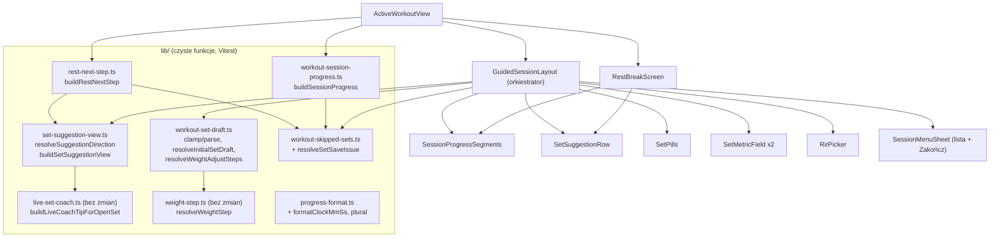

# ADR 0003: Ekran aktywnego treningu - kierunek sugestii, stan paska, wartość początkowa ciężaru, menu „Zakończ”, tokeny, podział komponentów

- Status: zaproponowany (etap 3 zadania 004)
- Data: 2026-10-24
- Autor: architekt
- Numer: zadanie wskazywało `0002`, ale ten numer zajmuje `0002-ekran-trening-dane-huba.md` (zadanie 003). Ten ADR ma numer 0003.
- Karta: `docs/zadania/004-ekran-aktywnego-treningu.md` (makieta pkt 1-15, D-1..D-3, P-1..P-5; P-1 ma pierwszeństwo przed BR-2 analizy: seria pominięta jest **pomarańczowa** z „–”)
- Wejście: `docs/analiza/004-ekran-aktywnego-treningu.md` (BR-1..BR-13, US-1..US-14, R-1..R-8), `docs/prawo/004-ekran-aktywnego-treningu-wejscie.md` (LR-1..LR-10), `docs/adr/0000-architektura-stanu-obecnego.md`
- Równolegle: `docs/ux/004-...` (wygląd, mikrokopia, wartości kolorów). Ten ADR ustala kontrakty danych, nazwy tokenów i podział kodu, nie ustala wyglądu.
- Next.js: zmiana dotyczy wyłącznie komponentów klienckich (`"use client"`) i czystych funkcji w `lib/`. Nie zmienia tras, RSC, cache, `proxy.ts` ani konfiguracji, więc przewodniki z `node_modules/next/dist/docs/` nie mają tu zastosowania.

## 1. Kontekst (stan potwierdzony w kodzie)

- `ActiveWorkoutView` (`active-workout-view.tsx`, 1246 l.) trzyma store, przerwę, `lastCompleted`, dialogi i składa `GuidedSessionLayout` (1199 l.) oraz `RestBreakScreen` (548 l.).
- **Sugestia ma dziś dwa źródła**: `exercise.suggestedWeights[i]` (sama liczba, liczona raz w `mergeHintsIntoExercises`, `lib/last-workout-hints.ts:421`) oraz `buildLiveCoachTipForOpenSet(exercise, i).apply` (`{weightKg, reps}`, uwzględnia serie z bieżącej sesji). Ekran serii pokazuje oba naraz (baner `LiveCoachBanner` i przycisk „Sugestia: X kg”). Ekran przerwy (`restNextSet` w widoku, l. 174-229) bierze `restCoachTip.apply` z `buildLiveCoachTipAfterCompletedSet`, a ta dla następnej serii woła ten sam `buildLiveCoachTipForOpenSet(exercise, completedSetIndex + 1)`. Gdy następny krok to **inne ćwiczenie**, `restCoachTip.apply` dotyczy poprzedniego ćwiczenia, a `targetLine` i tak go używa (błąd istniejący, usuwany przez D1).
- `deltaKg` > 0 tylko dla `kind="weight"`; deload ma `kind="reps"` i `deltaKg = 0` (analiza, ustalenie 3).
- **Błąd z karty**: `weightText` jest synchronizowany tylko z `set.weight` (l. 299-304), sugestia trafia do `placeholder` (l. 759). Przy `set.weight = 0` `canZaliczyc = false`, więc etykieta to „Pomiń serię”, a klik wywołuje `skipSet()` (l. 1049), czyli seria zostaje **pominięta**, a nie zapisana. `completeSet` przy niepełnych danych wraca bez komunikatu (l. 446-449).
- `ActiveWorkoutView.patchSet` (l. 765-774) zamienia `done: true` bez kompletnych danych na `skipped: true`; gdy patch **nie ma pola `done`**, `isDoneNext = canCompleteWorkoutSet(...)` (l. 782-785), więc patch z poprawnym ciężarem i powtórzeniami bez `done` uruchamia przerwę jak zapis serii. Każde wstępne wypełnienie musi podawać `done` jawnie (D3).
- `requestActiveWorkoutCloudPush(immediate)` zapisuje localStorage i wysyła zdarzenie; `ActiveWorkoutCloudSync` robi push po 700 ms (`PUSH_DEBOUNCE_MS`) albo od razu przy `immediate`. Widok wysyła push natychmiastowy przy każdym patchu z `done: true` (l. 777).
- `clampWeight` w komponencie zaokrągla do 0,5 kg (`Math.round(n * 2) / 2`), a `lib/weight-step.ts` dopuszcza kroki 1,25 i 0,25 (`minStepKg`, `weightStepKg`), a silnik zwraca ciężary w krokach `round2`. Sugestia 61,25 kg zostałaby po wstawieniu do pola zamieniona na 61,5 kg.
- Krok ciężaru na ekranie to plakietka przełączająca 0,5 / 2,5 / 5 (`WEIGHT_STEPS`), niezależna od `resolveWeightStep`.
- Liczniki postępu są liczone w trzech miejscach: `totals` w `GuidedSessionLayout` (l. 306), `completedSets` + `exercisesProgress` + `countSetsDone` w widoku (l. 231, 523, 708). Wszystkie liczą `s.done`, więc pominięte liczą się jak zapisane (P-5). `countSetsDone(...).done >= total` to to samo co istniejące `areAllWorkoutSetsDone`.
- Menu ☰: prawy przycisk `SessionChromeHeader` (`aria-label="Menu ćwiczeń"`) otwiera pełnoekranową listę ćwiczeń (`listOpen`, l. 1119-1196), sterowaną z widoku, bo przerwa też ją otwiera (`stopRest()` + `setListOpen(true)`). „Zakończ” (dolny rząd, l. 1103-1115): `hapticTap()`, `flushDraft()`, `onFinishSession()` = `setFinishOpen(true)`, czyli `WorkoutFinishedScreen` z „Wróć” jest potwierdzeniem.
- Przerwa: `onAddSeconds` przycina wartość do `Math.max(1, …)`, więc −15 s jest dziś niemożliwe. Wibracja końca przerwy istnieje (`playRestTimerEndSignal` -> `hapticRestEnd`) i działa tylko przy włączonym dźwięku (bez zmian, LR-7).
- Martwy kod w katalogu: `PlanProgressHeader` (`plan-progress-header.tsx`, 0 importów), `SessionProgressBar` w `session-chrome.tsx` (0 importów), prop `onDiscardSession` (zadeklarowany, nieużywany), `onDeferExercise` w widoku przekazywany jako pusta funkcja, opcje `keepDone` / `pushImmediate` w `flushDraft` (żaden wywołujący ich nie podaje), `ActiveWorkoutCoachPanel` (0 importów). Po usunięciu banera z ekranu serii `LiveCoachBanner` traci jedynego konsumenta.
- Duplikaty: `formatElapsed` (layout) i `formatMmSs` (przerwa) robią to samo (i jeszcze 4 kopie w `cardio/` i `community/`); `plSeries` powiela `plural()` z `lib/progress-format.ts`; karty „Ciężar” i „Powtórzenia” to prawie ten sam znacznik (l. 728-920).
- Tokeny: paleta `--gym-*` w `app/globals.css` (`:root` i `.dark`), używana jako `[var(--gym-gold)]`; `--gym-gold #ebc44a`, `-bright #f7e28f`, `-deep #c49a1f`, `--gym-on-gold #1a1408`. Ekran treningu ma na sztywno `#D6B36A`, `#F0D58A`, `#E8C97A`, `#A8893F`, `#DDBB6D`, `#76D686`, `emerald-400`, `orange-400`, `#121212`, `#0A0A0A`.

## 2. Przegląd rozwiązania



Zasada: każda reguła (kierunek sugestii, stan serii, wartość początkowa, walidacja, następny krok) ma jedną czystą funkcję w `lib/` z testem. Komponenty tylko renderują model i wywołują istniejące akcje store. Brak nowych wywołań sieciowych, kluczy storage i pól stanu synchronizowanego.

## 3. Decyzje

### D1. Jedna funkcja kierunku sugestii i jeden model sugestii dla ekranu serii i „Następnie”

Opcje:
- A. Kolor liczony z `kind` / `deltaKg` / `tone` porady w każdym komponencie.
- B. Czysta funkcja porównująca ciężary (BR-5) plus jeden konstruktor modelu sugestii, wołany przez oba ekrany.
- C. Dodać kierunek do silnika (`SetProgressionSuggestion.direction`).

Decyzja: **B**. A nie działa (deload ma `kind="reps"`, `deltaKg = 0`) i dubluje logikę na dwóch ekranach (R-5). C zmienia silnik wbrew D-3 i nie obejmuje porad Live Coach.

Miejsce: nowy plik `lib/set-suggestion-view.ts`. Silnik (`set-progression-suggestion.ts`) i Live Coach (`live-set-coach.ts`) bez zmian.

Źródło sugestii (jedno, ta sama kolejność co dziś w `restNextSet`): `buildLiveCoachTipForOpenSet(exercise, setIndex).apply`, gdy `weightKg > 0`; w przeciwnym razie `exercise.suggestedWeights[setIndex]`, gdy `> 0` (wtedy `reps = null`). Powód: `tip.reason` (krótki, z Live Coach), przy źródle `suggestedWeights` brak powodu. Odniesienie `B` (BR-5): `exercise.lastSessionSets[setIndex].weight`, gdy `> 0`; w przeciwnym razie brak odniesienia, więc kierunek „hold” (analiza: „B = bieżąca wartość pola”, a pole jest wypełnione sugestią z D3, więc wynik jest ten sam bez zależności od stanu pola).

„Następnie” na przerwie woła ten sam `buildSetSuggestionView(nextExercise, nextSetIndex)` dla celu z `resolveAdvanceAfterSet`, więc chip na przerwie jest identyczny z chipem, który użytkownik zobaczy na następnej serii, także gdy następny krok to inne ćwiczenie (usuwa błąd z pkt 1).

### D2. Model stanu paska postępu i pigułek: jedna funkcja `buildSessionProgress`

Opcje:
- A. Każdy komponent liczy stany z `isCompletedWorkoutSet` / `isSkippedWorkoutSet` samodzielnie (tak jest dziś, 3 kopie liczników).
- B. Jedna czysta funkcja zwracająca grupy segmentów, stany i liczniki; pasek A, pasek B, pigułki, lista ćwiczeń i nagłówek czytają ten sam model.

Decyzja: **B**, nowy plik `lib/workout-session-progress.ts`. Stany opierają się wyłącznie na istniejących `isCompletedWorkoutSet` i `isSkippedWorkoutSet` (bez zmiany ich semantyki: 0 kg nadal = pominięta, P-2). Liczniki „zapisane” nie obejmują pominiętych (P-5). „Ćwiczenie zaliczone” = wszystkie serie zapisane, żadna pominięta (BR-3). Seria bieżąca już zapisana ma stan `saved` i `isCurrent = true` (BR-1).

Konsumenci po zmianie: `GuidedSessionLayout` (nagłówek „seria X/Y”, pasek, pigułki, lista ćwiczeń), `RestBreakScreen` (pasek, nagłówek, „ćwiczenie ✓”). Usuwane kopie: `totals` w layoucie, `exercisesProgress` w widoku. `completedSets` w widoku zostaje tylko dla `WorkoutFinishedScreen` i podsumowania `completeWorkout` (świadomie: semantyka podsumowania po treningu jest poza zakresem 004, patrz sekcja 10). `countSetsDone` zastępuje istniejące `areAllWorkoutSetsDone`.

### D3. Wartość początkowa ciężaru (BR-7) tylko w szkicu pola, nie w store

Opcje:
- A. Przy wejściu na serię zapisać wartość początkową do store (`onPatchSet`) z pushem odroczonym.
- B. Wstawić wartość do pola (szkic `weightText`) bez zapisu do store; store dostaje ją dopiero przy akcji użytkownika: „Zapisz serię”, zmiana pola, przejście na inną serię (`flushDraft`).
- C. Zostawić `placeholder` i zmienić tylko etykietę przycisku.

Decyzja: **B**.
- Brak pushu przy samym wejściu na serię (LR-3, R-6), brak ryzyka, że wejście nadpisze na drugim urządzeniu świeższą wartość, a w store nie ma wstępnie wypełnionych serii udających dane użytkownika (dokładność danych, LR-3).
- A wymagałoby patcha z jawnym `done: false` (inaczej `patchSet` widoku uruchamia przerwę, sekcja 1) i powodowałoby push przy każdym przejściu przez serię. C nie usuwa błędu: zapis zależałby od wartości, której nie widać w polu.
- Wartość jest deterministyczna (liczy się z tych samych danych), więc po wznowieniu albo na drugim urządzeniu pole pokazuje to samo bez zapisu.
- Odstępstwo od dosłownego brzmienia BR-7 („i do stanu serii”): kryteria US-5 są spełnione (pole zawiera wartość, przycisk zawsze „Zapisz serię N”, zapis jednym dotknięciem), a stan serii dostaje wartość przy pierwszej akcji użytkownika.

Kolejność źródeł (BR-7): (1) wartość z serii: `set.done` albo `set.weight > 0`; (2) sugestia z D1; (3) `lastSessionSets[setIndex]` z ciężarem `> 0`; (4) najbliższa wcześniejsza **zapisana** (`isCompletedWorkoutSet`) seria tego ćwiczenia w sesji; (5) brak (pole puste, placeholder „0”).

Powtórzenia: store inicjuje `set.reps` celem planu (`planExercisesToSession`), więc „wpisane” i „cel” są nieodróżnialne. Reguła: `set.reps > 0` ma pierwszeństwo (cel albo wpis użytkownika, bez nadpisywania), a powtórzenia ze źródła z ciężarem (sugestia, poprzedni trening, wcześniejsza seria) wypełniają pole tylko wtedy, gdy `set.reps` jest puste (plan bez celu, US-6). Tap w chip nadal wstawia ciężar i powtórzenia sugestii (jak `applyLiveTip`).

Kiedy liczyć: tylko przy **wejściu na serię**, czyli przy zmianie klucza `${exercise.id}:${activeSetIndex}`. Przy tym samym kluczu pole synchronizuje się ze store (drugie urządzenie, własny patch) tylko wtedy, gdy `set.done` albo wartość w store `> 0`. Dzięki temu wyczyszczenie pola przez użytkownika nie przywraca wartości początkowej, a zdalna zmiana nadal dociera.

Jak to usuwa błąd: etykieta przycisku głównego nie zależy już od danych (D-2, BR-8): `setCompleted ? "Popraw serię N" : "Zapisz serię N"`. Usuwamy `canZaliczyc`, gałąź `skipSet()` w przycisku głównym i ikonę `X`. Zapis bierze **dokładnie to, co widać w polach**: `weight = parseWeightInput(weightText) ?? 0`, `reps = parseRepsInput(repsText)`, bez ukrytych zastępstw `set.reps ?? targetReps` (dziś puste pole powtórzeń zapisuje po cichu cel planu).

Walidacja przy zapisie: `resolveSetSaveIssue(weight, reps)` (D-2/BR-8, P-2: ciężar musi być `> 0`). Przy problemie: brak `onPatchSet`, brak pushu, brak przejścia dalej, fokus na polu z problemem, komunikat inline w `role="alert"`, pole `aria-invalid`. Komunikat znika po zmianie tego pola albo po zmianie serii. Teksty komunikatów należą do komponentu (mikrokopia `ux`, LR-10: „Podaj ciężar”, „Podaj liczbę powtórzeń”). Ani wartości, ani kod problemu nie trafiają do `console.*`, Sentry ani analityki (LR-1). Bezpiecznik w `ActiveWorkoutView.patchSet` (zamiana niekompletnego `done` na `skipped`) zostaje jako druga linia obrony.

Podwójne dotknięcie (US-8): po D3 następna seria ma od razu poprawne wartości, więc drugie szybkie dotknięcie zapisałoby **następną** serię wartością początkową (fałszywe dane, LR-3). Gdy automatyczna przerwa jest wyłączona, nic tego dziś nie zasłania. Wymóg: po zapisie przycisk główny ignoruje dotknięcia przez `SAVE_TAP_GUARD_MS = 700` (stała nazwana w komponencie) albo do pierwszego renderu z nowym kluczem serii, zależnie co nastąpi później.

`flushDraft` bez zmian wartości (ciężar i powtórzenia równe stanowi serii) nie wywołuje `onPatchSet` ani pushu (dziś pushuje przy każdym przejściu i `onBlur`). Usuwamy nieużywane opcje `keepDone` / `pushImmediate`.

Poprawka zaokrąglenia: `clampWeight` przenoszony do `lib/workout-set-draft.ts` używa `round2` z `lib/weight-step.ts` (0,01 kg, zakres 0..999) zamiast 0,5 kg; `<input step>` ustawiony na `minStepKg`. Bez tego wartość początkowa 61,25 kg zmieniałaby się w 61,5 kg.

### D4. Szybkie przyciski: ±1 i ±2 kroki ćwiczenia (P-4)

Opcje:
- A. Stałe ±2,5 / ±5 kg.
- B. Wielokrotności kroku ćwiczenia z `resolveWeightStep({ name, explicitStepKg: exercise.weightStepKg })`.

Decyzja: **B**. Steppery −/+ zmieniają ciężar o 1 krok (`stepKg`), szybkie przyciski o 2 kroki (`2 × stepKg`), w obie strony. Plakietka „krok 0,5 / 2,5 / 5” i stałe `WEIGHT_STEP`, `WEIGHT_FINE`, `WEIGHT_STEPS` znikają (dawały wartości nieładowalne na hantlach i maszynach). Przykłady: sztanga 2,5 / 5 kg, hantle 2 / 4 kg, kettlebell 4 / 8 kg, jawne `weightStepKg` 1,25 -> 1,25 / 2,5 kg. Wynik zawsze przez `clampWeight` (0..999). Ciężar nie jest przyciągany do siatki kroku (wpis użytkownika 63 kg + 2,5 = 65,5 kg); świadomie, żeby nie zmieniać wpisanej wartości bez działania użytkownika. Układ przycisków (czy szybkie przyciski stoją obok stepperów, czy pod polem) ustala `ux`; kontrakt wartości jest stały.

### D5. „Zakończ” w menu ☰ = istniejąca nakładka listy ćwiczeń

Opcje:
- A. Pozycja „Zakończ trening” w istniejącej pełnoekranowej nakładce otwieranej przez ☰ (lista ćwiczeń zostaje treścią, akcja na dole nakładki).
- B. Nowe menu rozwijane (`components/ui/dropdown-menu.tsx`) z pozycjami „Lista ćwiczeń” i „Zakończ trening”.

Decyzja: **A**. Jedno miejsce menu, bez nowego poziomu nawigacji (B dokłada dotknięcie do listy) i bez drugiego mechanizmu otwierania. Nakładka jest wydzielona do `components/active-workout/session-menu-sheet.tsx`. Akcja: `hapticTap()`, `flushDraft()`, zamknięcie nakładki, `onFinishSession()`. Potwierdzeniem pozostaje `WorkoutFinishedScreen` z „Wróć” (bez zmian, LR-9). Przy `finishPending` pozycja jest wyłączona i pokazuje stan kończenia. Z przerwy menu otwiera się jak dziś (`stopRest()` + `setListOpen(true)`), więc „Zakończ” jest osiągalne też z ekranu B. Dolny rząd ekranu A: Wstecz · Później · Pomiń.

„Pomiń” (BR-11): `disabled = setCompleted` (zamiast zależności od `canZaliczyc`); zachowanie `skipSet` bez zmian. Prop `onDeferExercise` (w widoku pusta funkcja) i nieużywany `onDiscardSession` usuwamy; „Później” działa dalej przez `findNextIncompleteExercise`.

### D6. Tokeny kolorów w `app/globals.css`, prefiks `--gym-`

Opcje:
- A. Nowa rodzina `--gb-*` (propozycja z polecenia).
- B. Rozszerzenie istniejącej rodziny `--gym-*` o tokeny semantyczne, a złoto z istniejących `--gym-gold*`.
- C. Lokalne stałe w komponentach (jak `GOLD` w `rest-break-screen.tsx`).

Decyzja: **B**. A tworzy drugą, równoległą konwencję nazw obok `--gym-*` (zakazane „jedna funkcjonalność w jednym miejscu”). C to stan, który usuwamy (niespójność nr 1 w `docs/ux/00-system-projektowy-stan.md`).

| Token | Rola | Uwagi dla `ux` |
|---|---|---|
| `--gym-gold`, `--gym-gold-bright`, `--gym-gold-deep`, `--gym-on-gold` (istniejące) | akcent, przycisk główny, bieżący segment, ring, kicker, sugestia „=” | „Więcej złota” = zastąpienie `#D6B36A`/`#DDBB6D` (przygaszone) przez `--gym-gold #ebc44a`. Zmiana wartości `--gym-gold` na #F5C542 zmieniłaby całą aplikację; jeśli `ux` tego chce, osobna decyzja, nie w 004 |
| `--gym-set-saved` (nowy) | seria / grupa zapisana, karta „Zapisano”, ✓ | zielony, kontrast tekstu >= 4,5:1 na `--gym-black` |
| `--gym-set-skipped` (nowy) | seria pominięta (P-1, pomarańczowy) + „–” | zastępuje `orange-400` |
| `--gym-suggest-up` (nowy) | fragment ciężaru sugestii ↑ | może być aliasem `var(--gym-set-saved)`; decyzja `ux` |
| `--gym-suggest-down` (nowy) | fragment ciężaru sugestii ↓ | czerwień informacyjna, **nie** `--destructive`/`--gym-red` (alarm, LR-5), >= 4,5:1 (R-4) |
| `--gym-surface*` (istniejące) | tła kart zamiast `#121212`, `#0A0A0A` | złoty odcień tła kart przez `color-mix(in oklab, var(--gym-gold) N%, var(--gym-surface))` lub `rgba(var(--neon-rgb), a)`; bez nowego tokenu, chyba że `ux` uzna inaczej |

Tokeny dopisuje się w `:root` i `.dark` obok pozostałych `--gym-*` (jak `--gym-on-gold` w zadaniu 003). Użycie w komponentach: `text-[var(--gym-set-saved)]`, `bg-[var(--gym-suggest-down)]/15` (konwencja z `docs/ux/003-przebudowa-ekranu-trening.md`). Bez nowych `--color-*` w `@theme inline`: obecny kod nie używa utility z tej rodziny, a dodanie jej dla czterech tokenów utworzyłoby drugi sposób odwołania do tych samych kolorów. Wymóg przeglądu: w zmienionych plikach `components/active-workout/*` brak literałów hex i klas palety Tailwind (`emerald-*`, `orange-*`) dla kolorów stanu; wyjątek to neutralna biel z przezroczystością (`white/…`, jak w całej aplikacji). Wartości kolorów ustala `ux`.

### D7. Podział `guided-session-layout.tsx` i ekranu przerwy

Opcje:
- A. Zmiany w miejscu, plik zostaje jednym komponentem (ok. 1200 l.).
- B. Rozbicie na komponenty prezentacyjne bez stanu sesji; `GuidedSessionLayout` zostaje orkiestratorem (stan szkicu, handlery zapisu i nawigacji), reguły w `lib/`.

Decyzja: **B**. Komponenty współdzielone przez ekran A i B (pasek, wiersz sugestii) muszą istnieć w jednym miejscu, inaczej powstaną dwie kopie. Każdy nowy komponent ma co najmniej jednego konsumenta; nie tworzymy komponentów na zapas.

| Komponent (`components/active-workout/`) | Odpowiedzialność | Konsumenci |
|---|---|---|
| `guided-session-layout.tsx` (zmiana) | stan szkicu, `flushDraft`, zapis, pominięcie, nawigacja, składanie widoku | `ActiveWorkoutView` |
| `session-chrome.tsx` (zmiana) | nagłówek: X, tytuł, podpis „trening m:ss · seria X/Y”, ☰, miejsce na plakietkę Ghost; usunięty martwy `SessionProgressBar` | ekran A, ekran B (zastępuje własny nagłówek w `rest-break-screen.tsx`) |
| `session-progress-segments.tsx` (nowy) | render `SessionProgress.groups`, aria-label z liczbami | ekran A, ekran B |
| `set-pills.tsx` (nowy) | pigułki serii ćwiczenia ze stanów `SessionProgressGroup.segments` | ekran A |
| `set-suggestion-row.tsx` (nowy) | „Ostatnio … · N dni” + chip sugestii (kolor z `direction`) + powód; `onApply` opcjonalny (na przerwie tylko odczyt) | ekran A, „Następnie” na ekranie B |
| `set-metric-field.tsx` (nowy) | karta pola liczbowego: etykieta, input, steppery, opcjonalny slot (szybkie przyciski ciężaru, znacznik celu powtórzeń), komunikat walidacji | ciężar i powtórzenia (usuwa zdublowany znacznik) |
| `rir-picker.tsx` (nowy) | 0 / 1 / 2 / 3+, `aria-pressed`, brak podświetlenia przy `targetRir == null` (BR-9) | ekran A |
| `session-menu-sheet.tsx` (nowy) | nakładka ☰: lista ćwiczeń (kropki ze stanów modelu D2) + „Zakończ trening” | ekran A (otwierana też z B przez widok) |
| `rest-break-screen.tsx` (zmiana) | karta „Zapisano”, licznik, −15 s / +30 s, „Następnie” z `SetSuggestionRow`, „Zacznij serię N / ćwiczenie N”; stałe `GOLD*` zastąpione tokenami | `ActiveWorkoutView` |
| `ghost-picker-sheet.tsx` (zmiana) | mikrokopia plakietki (bez „bez zapisu”, D-1, LR-8); logika i `fetch` bez zmian | nagłówek ekranu A |
| `active-workout-view.tsx` (zmiana) | `restNextSet` -> `buildRestNextStep`; `buildSessionProgress`; `onAdjustRestSeconds` z ujemną deltą; usunięcie `countSetsDone`, `exercisesProgress`, pustego `onDeferExercise`, `onDiscardSession` | - |
| `live-coach-banner.tsx` (usunięcie) | po zastąpieniu banera wierszem sugestii brak konsumentów | - |
| `plan-progress-header.tsx` (usunięcie) | martwy (0 importów) | - |

`ghost-race-hud.tsx`: bez zmian logiki; ewentualne przeniesienie w układzie decyduje `ux`. `lib/ghost-training/*` i `app/api/ghost-training/*` bez zmian (LR-8 f). `active-workout-cloud-sync.tsx`, `lib/stores/active-workout.ts`, `lib/set-progression-suggestion.ts`, `lib/live-set-coach.ts`, `lib/weight-step.ts`: bez zmian.

Kod usuwany z `guided-session-layout.tsx` (nie może zostać jako martwy): `WEIGHT_STEP`, `WEIGHT_FINE`, `WEIGHT_STEPS`, `formatStep`, `weightStepIdx`, `plSeries` (zastąpione `plural()`), `formatElapsed` (zastąpione `formatClockMmSs`), lokalne `clampWeight` / `clampReps` / `parseWeightInput` / `parseRepsInput` (przeniesione do `lib/workout-set-draft.ts`), `SegmentedSessionProgress`, `totals`, `canZaliczyc`, `repeatBase` (zastąpione tapem w „Ostatnio”, który wstawia wartości z `lastSessionSets`), stałe klas z hex. `formatMmSs` w `rest-break-screen.tsx` zastępuje to samo `formatClockMmSs`.

### D8. Brak zmian schematu Drizzle, API, `/api/android/*`, Javy i zmiennych środowiskowych (LR-2)

Potwierdzone: zmiana obejmuje wyłącznie komponenty klienckie w `components/active-workout/`, czyste funkcje w `lib/` i tokeny w `app/globals.css`. Brak migracji (`db/schema.ts`, `db/ensure-schema.ts`, `db/migrations` bez zmian), brak nowych endpointów, zmian `app/api/android/*` (brak odwołań do aktywnego treningu), Javy, `lib/ghost-training/*`, `AndroidManifest.xml`. Kształt `WorkoutSetState` / `WorkoutExerciseState` i payloadu `active_workout_sessions` bez zmian, więc synchronizacja z drugim urządzeniem i starszą wersją klienta działa bez wersjonowania. Brak nowych zmiennych środowiskowych, więc `lib/admin-config-status.ts` i `env.example` bez zmian. Brak nowych kluczy localStorage / sessionStorage / IndexedDB i nowych wywołań `fetch` (LR-9). Brak nowych zależności npm.

## 4. Kontrakty (typy TS, wspólne dla backend i frontend)

### 4.1 `lib/set-suggestion-view.ts` (nowy)

```ts
import type { WorkoutExerciseState } from "@/components/workout/types";

export type SuggestionDirection = "up" | "down" | "hold";

/** Tolerancja porównania ciężarów (zaokrąglenia round2). */
export const SUGGESTION_WEIGHT_EPSILON_KG = 0.01;

/**
 * BR-5: kierunek wynika z porównania ciężarów, nie z kind/deltaKg/tone.
 * Brak odniesienia (null, <= 0) albo |S - B| <= epsilon -> "hold".
 */
export function resolveSuggestionDirection(
  suggestedKg: number,
  referenceKg: number | null | undefined,
): SuggestionDirection;

export type SetSuggestionView = {
  weightKg: number;            // > 0
  reps: number | null;         // null przy źródle suggestedWeights
  direction: SuggestionDirection;
  /** round2(S - B); 0 przy "hold". Do tekstu „+5 kg” / „−5 kg”. */
  deltaKg: number;
  /** Ciężar odniesienia B (lastSessionSets[i].weight) albo null. */
  referenceKg: number | null;
  /** Krótki powód z Live Coach; null przy źródle suggestedWeights. */
  reason: string | null;
  source: "liveCoach" | "progression";
};

/**
 * Jedno źródło sugestii dla serii: Live Coach apply (> 0), potem suggestedWeights[i] (> 0).
 * null = brak sugestii (chip nie jest renderowany).
 * Deterministyczna, bez efektów ubocznych; ekran serii i „Następnie” wołają ją tak samo.
 */
export function buildSetSuggestionView(
  exercise: WorkoutExerciseState,
  setIndex: number,
): SetSuggestionView | null;
```

Użycie: ekran A `useMemo(() => buildSetSuggestionView(exercise, activeSetIndex), [exercise, activeSetIndex])` (zastępuje `liveTip` i `suggestedWeight`); ekran B przez `buildRestNextStep` (4.5). Komponent formatuje liczby przez istniejące `formatKgPl`; mapa `direction -> token/symbol`: `up -> --gym-suggest-up, ↑`, `down -> --gym-suggest-down, ↓`, `hold -> złoto/biel, =` (LR-5).

### 4.2 `lib/workout-session-progress.ts` (nowy)

```ts
export type SetSegmentState = "saved" | "skipped" | "current" | "todo";

export type SessionProgressSegment = {
  exerciseId: string;
  setIndex: number;
  /** "current" tylko dla bieżącej niezapisanej; bieżąca zapisana = "saved" + isCurrent. */
  state: SetSegmentState;
  isCurrent: boolean;
};

export type SessionProgressGroup = {
  exerciseId: string;
  exerciseIndex: number;      // 0-based
  segments: SessionProgressSegment[];
  /** BR-3: wszystkie serie zapisane, żadna pominięta. */
  completed: boolean;
  /** Wszystkie serie done (zapisane lub pominięte). */
  finished: boolean;
};

export type SessionProgress = {
  groups: SessionProgressGroup[];
  savedSets: number;          // isCompletedWorkoutSet (P-5)
  skippedSets: number;        // isSkippedWorkoutSet
  totalSets: number;
  exercisesCompleted: number; // groups.filter(completed)
  exercisesTotal: number;
  /** 1-based numer bieżącej serii w całej sesji (BR-4); null gdy brak bieżącej. */
  currentOrdinal: number | null;
};

export function buildSessionProgress(
  exercises: WorkoutExerciseState[],
  current: { exerciseId: string; setIndex: number } | null,
): SessionProgress;
```

Ekran A: `current` = wybrane ćwiczenie i `activeSetIndex`. Ekran B: `current` = cel `resolveAdvanceAfterSet` (następna seria), `null` po ostatniej serii; czy pasek na przerwie wyróżnia bieżący segment, decyduje `ux`. Złożoność O(liczba serii), w `useMemo` po `exercises` i `current`.

### 4.3 `lib/workout-set-draft.ts` (nowy, kod przeniesiony z komponentu + nowe funkcje)

```ts
import type { WeightStep } from "@/lib/weight-step";
import type { WorkoutSetState } from "@/components/workout/types";

export const MAX_WEIGHT_KG = 999;
export const MAX_REPS = 99;

export function clampWeight(n: number): number;            // round2, 0..MAX_WEIGHT_KG
export function clampReps(n: number | null): number;      // całkowite, 0..MAX_REPS
export function parseWeightInput(raw: string): number | null; // "," -> ".", "" -> null
export function parseRepsInput(raw: string): number | null;

export type SetDraftSource = "set" | "suggestion" | "lastSession" | "previousSet" | "empty";

export type InitialSetDraft = {
  weightKg: number | null;    // null = puste pole
  reps: number | null;
  source: SetDraftSource;     // do testów i aria; nie do logów
};

/** BR-7 + D3. Nie zapisuje niczego; wynik trafia tylko do pól szkicu. */
export function resolveInitialSetDraft(args: {
  set: WorkoutSetState;
  suggestion: { weightKg: number; reps: number | null } | null; // z buildSetSuggestionView
  lastSessionSet: WorkoutSetState | null;
  /** Najbliższa wcześniejsza zapisana seria tego ćwiczenia w sesji. */
  previousSessionSet: WorkoutSetState | null;
}): InitialSetDraft;

/** P-4 / D4: steppery = 1 krok, szybkie przyciski = 2 kroki. */
export function resolveWeightAdjustSteps(step: WeightStep): {
  stepperKg: number;   // step.stepKg
  quickKg: number;     // round2(2 * step.stepKg)
};
```

`previousSessionSet` wybiera komponent przez prosty filtr (`exercise.sets.slice(0, i)` od końca, pierwszy `isCompletedWorkoutSet`); jeśli `backend` uzna, że to druga kopia reguły, może dodać eksportowany helper w tym samym pliku.

### 4.4 `lib/workout-skipped-sets.ts` (rozszerzenie)

```ts
export type SetSaveIssue = "weight" | "reps";

/** BR-8 / P-2: ciężar > 0 i powtórzenia > 0. Kolejność: najpierw ciężar. */
export function resolveSetSaveIssue(weight: number, reps: number | null): SetSaveIssue | null;

// canCompleteWorkoutSet(w, r) === (resolveSetSaveIssue(w, r) === null) - jedna reguła, bez kopii.
```

Komentarz przy `canCompleteWorkoutSet` („inaczej UI pokazuje Pomiń serię”) do aktualizacji, bo po D-2 UI pokazuje komunikat walidacji.

### 4.5 `lib/rest-next-step.ts` (nowy, logika przeniesiona z `restNextSet` w widoku)

```ts
export type RestNextStep = {
  kind: "set" | "exercise";   // ta sama vs następne ćwiczenie -> „Zacznij serię N” / „Zacznij ćwiczenie N”
  exerciseId: string;
  exerciseName: string;
  exerciseOrdinal: number;    // 1-based
  setIndex: number;
  setOrdinal: number;         // 1-based
  setsInExercise: number;
  targetReps: number | null;
  targetRir: number | null;
  suggestion: SetSuggestionView | null; // buildSetSuggestionView(nextEx, setIndex)
  lastSessionSet: WorkoutSetState | null;
};

export type RestCompletedSet = {
  weightKg: number;
  reps: number;
  rir: number | null;
  /** BR-3 dla ćwiczenia zapisanej serii; steruje „ćwiczenie ✓”. */
  exerciseCompleted: boolean;
};

/** null = koniec treningu (brak celu z resolveAdvanceAfterSet). */
export function buildRestNextStep(
  exercises: WorkoutExerciseState[],
  completed: { exerciseId: string; setIndex: number },
): RestNextStep | null;
```

`RestBreakScreen` dostaje zamiast `setsDone`, `setsTotal`, `exercisesDone`, `exercisesTotal`, `completedWeightKg`, `completedReps`, `nextSet: RestNextSetInfo` nowe propsy: `progress: SessionProgress`, `completed: RestCompletedSet | null`, `next: RestNextStep | null`, `onAdjustSeconds(deltaSec: number)`. Teksty (`setLine`, `schemeLine`, „Cel: …”) składa komponent; typ `RestNextSetInfo` znika. `onAdjustSeconds` w widoku: przesuwa `restEndsAtRef` o deltę (także ujemną), `remaining = max(0, ceil(...))`; gdy wynik `<= 0`, woła istniejące `finishRestFromTimer()` (ten sam koniec przerwy, ta sama wibracja). `+30 s` i `−15 s` to stałe nazwane w komponencie przerwy.

### 4.6 `lib/progress-format.ts` (rozszerzenie)

```ts
/** „m:ss” z sekund, ujemne -> 0. Zastępuje formatElapsed / formatMmSs na ekranach treningu. */
export function formatClockMmSs(totalSeconds: number): string;
```

## 5. Testy jednostkowe (Vitest, `lib/*.test.ts`)

- `set-suggestion-view.test.ts`: `up` (70 vs 65), `down` (deload `kind="reps"`, `deltaKg=0`, niższy `weightKg`), `hold` (równe, różnica 0,005), brak odniesienia -> `hold`; źródło Live Coach ma pierwszeństwo przed `suggestedWeights`; `suggestedWeights` 0/null i brak porady -> `null`; „Następnie” dla innego ćwiczenia używa danych tego ćwiczenia.
- `workout-session-progress.test.ts`: grupy per ćwiczenie; zapisana / pominięta (flaga i 0 kg) / bieżąca / do zrobienia; bieżąca zapisana = `saved` + `isCurrent`; `completed` fałszywe przy pominięciu; `savedSets` bez pominiętych; `currentOrdinal` po pominięciu (US-1: seria 4/Y); 1 i 10 serii; pusta lista.
- `workout-set-draft.test.ts`: kolejność źródeł 1-5; brak nadpisania `set.weight > 0` i serii `done`; powtórzenia z `set.reps` przed źródłem; plan bez celu bierze powtórzenia ze źródła; `clampWeight(61.25) === 61.25`, przycinanie 0 i 999; `parseWeightInput("62,5")`; kroki: sztanga 2,5/5, hantle 2/4, kettlebell 4/8, jawne 1,25/2,5.
- `workout-skipped-sets.test.ts` (rozszerzenie): `resolveSetSaveIssue` (0 kg -> `weight`, brak powtórzeń -> `reps`, oba -> `weight`, poprawne -> `null`), zgodność z `canCompleteWorkoutSet`.
- `rest-next-step.test.ts`: ta sama seria vs następne ćwiczenie; koniec treningu -> `null`; pominięcie serii już `done` (kolejność z `resolveAdvanceAfterSet`); `exerciseCompleted` przy pominięciu w ćwiczeniu = `false`.
- Testy komponentów / E2E (`tester`): przycisk zawsze „Zapisz serię N” / „Popraw serię N”; zapis jednym dotknięciem po wejściu na serię z historią; walidacja z fokusem i bez zapisu; podwójne dotknięcie zapisuje jedną serię; wejście na serię nie wysyła pushu (spy na `requestActiveWorkoutCloudPush`); „Zakończ” w menu z `flushDraft`; zapis identyczny z Ghostem i bez (LR-8 c).

## 6. Podział pracy

- **backend** (czyste funkcje, bez komponentów): `lib/set-suggestion-view.ts`, `lib/workout-session-progress.ts`, `lib/workout-set-draft.ts`, `lib/rest-next-step.ts`, rozszerzenia `lib/workout-skipped-sets.ts` i `lib/progress-format.ts`, wszystkie testy z sekcji 5 (poza komponentowymi/E2E). Potwierdzenie `VIBRATE` w `AndroidManifest.xml` bez zmian (pytanie prawnika). Kontrakty z sekcji 4 są stałe; zmiana sygnatury wymaga uzgodnienia z `frontend` i aktualizacji tego ADR.
- **frontend**: komponenty z tabeli D7, tokeny w `app/globals.css` (wartości od `ux`), zmiany w `active-workout-view.tsx`, `ghost-picker-sheet.tsx`, usunięcie `live-coach-banner.tsx` i `plan-progress-header.tsx`, wpis w `components/changelog/changelog-data.ts` z `planned: true`. Mikrokopia (walidacja, plakietka Ghost, „Zapisano”, powód sugestii, przyciski przerwy, zamiana „Uwaga.” i „🔥” w karcie coacha na przerwie zgodnie z LR-4 / LR-10) według `docs/ux/004-...`.
- Kolejność: `backend` i `frontend` równolegle; `frontend` może zacząć od rozbicia komponentów i tokenów na kontraktach z sekcji 4 (typy jako punkt odniesienia).

## 7. Konsekwencje i kompromisy

- `GuidedSessionLayout` zmniejsza się do orkiestratora (szacunkowo 350-450 l.); reguły testowane bez renderu. Więcej plików (6 komponentów, 4 pliki `lib/`), ale każdy ma jedną odpowiedzialność i konsumenta.
- Wartość początkowa nie trafia do store do pierwszej akcji użytkownika (D3): mniej pushów niż dziś (dodatkowo `flushDraft` bez zmian nic nie wysyła), koszt Turso/Upstash nie rośnie.
- Puste pole powtórzeń przestaje po cichu zapisywać cel planu; użytkownik dostaje komunikat. To zmiana zachowania wynikająca z BR-8, a nie regresja.
- `clampWeight` z dokładnością 0,01 kg zmienia się dla wszystkich ścieżek wpisu na tym ekranie; wpisy w krokach 0,5 działają jak dotąd.
- Steppery nie mają już trybu 0,5 kg. Kto potrzebuje innej wartości, wpisuje ją w pole. Dokładne kroki ćwiczenia ustawia `weightStepKg`.
- Sugestia na ekranie serii pochodzi teraz z jednego źródła (Live Coach przed `suggestedWeights`), więc znika sytuacja dwóch różnych sugestii naraz (baner i przycisk).

## 8. Ryzyka

| Ryzyko | Prawdop. | Skutek | Środek |
|---|---|---|---|
| Podwójne dotknięcie zapisuje następną serię wartością początkową (fałszywe dane, LR-3) | średnie | średni | `SAVE_TAP_GUARD_MS`, test E2E (US-8) |
| Wartość początkowa nadpisuje wyczyszczone pole albo wpis z drugiego urządzenia | niskie | średni | liczenie tylko przy zmianie klucza serii, synchronizacja ze store tylko dla `done` / `> 0` (D3), test |
| Regresja przepływu zapisu i przerwy (R-1) | średnie | wysoki | zapis przez istniejące `onPatchSet` z `done: true`; testy `resolveSetSaveIssue`, E2E zapis, pominięcie, popraw |
| Rozjazd sugestii ekran A vs „Następnie” | niskie | niski | jedna funkcja `buildSetSuggestionView`, test „inne ćwiczenie” |
| Kontrast czerwieni / zieleni (R-4), daltonizm | średnie | średni | wartości tokenów od `ux`, symbole ↑ ↓ = ✓ –, aria-label (LR-5) |
| Rozbicie komponentu wprowadza duplikat albo martwy kod | średnie | niski | lista usuwanego kodu w D7, przegląd kodu (etap 6), `npm run lint`, `npx tsc --noEmit` |
| Wartości z pól w komunikatach / Sentry (LR-1) | niskie | średni | komunikaty bez wartości, brak `console.*` w katalogu; przegląd |

## 9. Kolejność wdrażania

1. `backend`: funkcje `lib/` + testy (sekcja 4, 5).
2. `frontend` równolegle: tokeny w `app/globals.css`, wydzielenie komponentów bez zmiany działania (pasek, pigułki, pola, RIR, menu), potem podpięcie modeli z `lib/` i zmiany zachowania (D3, D4, D5), na końcu ekran przerwy i plakietka Ghost.
3. Usunięcie martwego kodu (`live-coach-banner.tsx`, `plan-progress-header.tsx`, `SessionProgressBar`, nieużywane propsy i opcje).
4. `npm run lint`, `npx tsc --noEmit`, `npm test`, wpis changelog `planned: true`, przegląd kodu (etap 6), Preview, `npm run deploy:check` przed merge.

## 10. Odłożone (backlog)

- Semantyka „wykonane” w `WorkoutFinishedScreen` i podsumowaniu `completeWorkout` (`completedSets` liczy pominięte) - spójność z P-5 poza tym ekranem; właściciel: właściciel produktu / analityk, priorytet niski.
- Ćwiczenia z masą ciała (P-2, R-3) - w karcie.
- Pozostałe kopie `formatElapsed` (`cardio/cardio-record-client.tsx`, `community/friend-live-detail-client.tsx`, `community/friend-live-watch-widget.tsx`, `community/group-workout-floating-widget.tsx`) -> `formatClockMmSs`; właściciel: frontend, niski.
- `ActiveWorkoutCoachPanel` (`active-workout-coach-panel.tsx`, 0 importów) i martwe komponenty z `docs/ux/00-system-projektowy-stan.md` pkt 11 - do usunięcia osobnym zadaniem porządkowym; właściciel: frontend, niski.
- `persistRestSecondsFromTimer` zapisuje przerwę do serii `setIndex + 1` / ćwiczenia `+1`, a nie do celu `resolveAdvanceAfterSet` (rozjazd przy „Później” i seriach poza kolejnością); właściciel: backend, niski. Nie zmieniać w 004 bez testu.

## 11. Przegląd kodu (etap 6)

- Data: 2026-10-24, autor: architekt.
- Werdykt: **ZATWIERDZONE Z UWAGAMI** (brak uwag blokujących).
- Zakres: `components/active-workout/` (nowe: session-segmented-progress, set-pills, set-suggestion-row, set-metric-field, rir-picker, session-menu-sheet; zmienione: guided-session-layout, session-chrome, rest-break-screen, ghost-picker-sheet, ghost-race-hud, active-workout-view; usunięte: live-coach-banner, plan-progress-header, active-workout-coach-panel), `lib/` (set-suggestion-view, workout-session-progress, workout-set-draft, rest-next-step, active-workout-copy, workout-skipped-sets, progress-format + testy), tokeny w `app/globals.css`, wpis changelog `planned: true`. Zmiany zadań 001 i 003 pominięte.
- Uwaga o stanie repo: zmiany zadania 004 są już w commicie `fd61b1e` (poza `ghost-picker-sheet.tsx`, zmiana typu `TargetsState`, niezatwierdzona).

### Wyniki narzędzi
- `npx tsc --noEmit`: bez błędów.
- `npx vitest run` (7 plików `lib/` zadania): 72 testy zielone.
- `npx eslint` na katalogu i plikach `lib/` zadania: 8 błędów `react-hooks/set-state-in-effect` + 1 ostrzeżenie, wszystkie **sprzed zadania** (4 w `active-workout-view.tsx` w niezmienionych efektach, potwierdzone na wersji z HEAD~1; `workout-finished-screen.tsx`, `active-workout-global-bar.tsx` nietknięte). Nowe i przepisane pliki zadania: czyste.

### Zgodność z ADR / LR
- D1 (jedno źródło sugestii, kierunek z porównania ciężarów), D2 (`buildSessionProgress` czytany przez pasek, pigułki, menu, nagłówek, przerwę), D3 (wartość początkowa tylko w polach, render-phase reset po kluczu serii, brak `onPatchSet` przy wejściu), D4 (kroki z `resolveWeightAdjustSteps`), D5 (kolejność `hapticTap` -> `flushDraft` -> `closeMenu` -> `onFinishSession`, `finishPending` blokuje), D7 (rozbicie i usunięcie martwych plików): zgodne.
- LR-1: brak `console.*`, Sentry i logowania wartości w nowych plikach. LR-3: wejście na serię nie woła `onPatchSet` ani pushu. LR-9: brak nowych `fetch`/storage w nowych plikach (`fetch` w `ghost-picker-sheet` istniał wcześniej). LR-4/LR-5: kierunek niesie ikona + słowo w `aria-label`, czerwień to `--gym-trend-down`, nie `--destructive`.
- P-1 (pominięta pomarańczowa, pusty segment, ikona „–”), BR-3 (`isExerciseCompleted`), BR-8 (przycisk główny nigdy „Pomiń”, `resolveSetSaveIssue` + `role="alert"` + `aria-invalid` + fokus): zgodne.
- Odstępstwo nazewnicze od D6: zaimplementowano `--gym-success`, `--gym-trend-up/-down`, `--gym-skipped`, `--gym-surface-gold`, `--gym-border-gold`, `--gym-track`, `--gym-text-secondary` zamiast `--gym-set-saved` / `--gym-set-skipped` / `--gym-suggest-*`. Rodzina `--gym-*` i miejsce definicji (`:root` + `.dark`) zachowane; przyjęte jako decyzja `ux` (nazwy semantyczne). Do ujednolicenia w dokumentacji, bez zmian w kodzie.
- Duplikaty: `formatElapsed`/`formatMmSs`/`plSeries`/`clamp*`/`parse*`/`totals`/`exercisesProgress` w ekranach treningu usunięte, jedno źródło w `lib/`. Pozostałe 4 kopie `formatElapsed` poza zakresem (cardio, community) są już w backlogu (sekcja 10).

### Defekty i uwagi
Średni:
- M-1 `components/active-workout/active-workout-view.tsx:664` + `guided-session-layout.tsx:416-420,431-436`: edycja zapisanej serii. Wyczyszczenie ciężaru patchem `done: true, skipped: false` przechodzi przez bezpiecznik `patchSet` (l. 654-662) i ustawia `skipped: true`; ponowne wpisanie ciężaru przekazuje `skipped: currentSet.skipped` (true), więc seria zostaje „pominięta” mimo kompletnych danych (pigułka „–”, pasek pomarańczowy), dopóki użytkownik nie dotknie „Zapisz serię N”. Poprawka logiki (nie wprowadzona): w `onWeightInput`/`onRepsInput`/`patchValues` dla `done` przekazywać `skipped: false`, gdy dane są kompletne (albo nie przekazywać `skipped`), albo w `patchSet` zdejmować `skipped`, gdy `canCompleteWorkoutSet`. Właściciel: frontend. Dodać test regresji.

Niskie:
- L-1 `guided-session-layout.tsx:241-252` (`flushDraft`) wywoływane z `onBlur`, nawigacji i otwarcia menu: niezatwierdzona wartość początkowa (sugestia) trafia do store i do chmury (debounce 700 ms) przy samym przejściu na inną serię albo otwarciu ☰. Zgodne z literą D3 („przejście na inną serię”), ale pasywna nawigacja utrwala wartość, której użytkownik nie potwierdził (LR-3, dokładność). Do decyzji analityka: czy zapisywać w `flushDraft` tylko pola zmienione względem wartości początkowej. Właściciel: analityk/frontend.
- L-2 `guided-session-layout.tsx:48,335,343`: ochrona podwójnego tapnięcia (US-8) to tylko 700 ms; ADR D3 wymagał „później z: 700 ms albo pierwszy render z nowym kluczem serii”. Po zwiększeniu opóźnienia renderu (wolne urządzenie) okno bywa za krótkie. Dodać test E2E US-8.
- L-3 `set-pills.tsx:98`: cel dotyku 40 × 44 px (`w-10`), wymóg 44 px; `role="tablist"/"tab"` bez `tabpanel` i bez nawigacji strzałkami. Zmienić na `w-11` albo zastąpić grupą przycisków z `aria-pressed`/`aria-current`. Właściciel: frontend/ux.
- L-4 martwe pola modelu: `SessionProgressGroup.finished`, `SessionProgress.exercisesCompleted` (`lib/workout-session-progress.ts`), `SetSuggestionView.source` (`lib/set-suggestion-view.ts`) nie mają konsumentów w kodzie produkcyjnym (tylko testy). Zgodne z kontraktem ADR 4.1/4.2, ale do usunięcia przy najbliższej zmianie albo gdy `ux` potwierdzi brak użycia. `countSkippedWorkoutSets` (`lib/workout-skipped-sets.ts`) nie ma żadnego użycia (sprzed zadania).
- L-5 `active-workout-view.tsx:905,998,999`: literały `#0f0f0f`, `#111`, `#FF9500` w stanie pustym (kod sprzed zadania, plik zmieniany w 004). Zastąpić tokenami przy okazji.
- L-6 `lib/active-workout-copy.ts` eksportuje `formatSignedKg`, a `components/home/start-metric-tiles.tsx:11` ma lokalną funkcję o tej samej nazwie i innej sygnaturze. Nie kolizja, ale myląca; zmienić nazwę lokalnej przy okazji.
- L-7 `session-chrome.tsx:63-77`: niespójne wcięcia JSX w `<span aria-hidden>` (kosmetyka).
- L-8 `actions/active-workout-coach.ts` (+ `activeWorkoutCoachZodMessage` w `lib/user-facing-errors.ts`): osierocone (0 importów, 0 wywołań). Ocena: **nie usuwać w 004**. Plik jest server action z własnym `guardAction`, jego usunięcie to zmiana publicznej powierzchni akcji i wymaga osobnego zadania porządkowego razem z `activeWorkoutCoachZodMessage` i wpisem w `docs/analiza/00-mapa-produktu.md`; zgodnie z sekcją 10. Właściciel: frontend, niski.

### Ryzyka regresji w `active-workout-view.tsx` (sprawdzone)
- `adjustRestSeconds`: ujemna delta przesuwa `restEndsAtRef`, wynik <= 0 woła `finishRestFromTimer` (ten sam koniec, ta sama wibracja); `restDurationTotal` rośnie tylko w górę; brak regresji dla +30 s.
- `LastCompletedSnap` i `buildCompletedSnap` bez zmian; `restCompleted`/`restNext`/`restProgress` liczone z tego samego snapa, więc po „+ Seria” (`addSetToExercise`) pasek i „Następnie” są spójne. `persistRestSecondsFromTimer` bez zmian (znany rozjazd w sekcji 10).
- `patchSet`: wszystkie nowe wywołania podają `done` jawnie (brak niezamierzonej przerwy z patcha pola).

### Poprawione w przeglądzie (bez zmiany logiki)
- `rest-break-screen.tsx:336`: literał `rgba(255,232,160,0.72)` i token spoza rodziny (`--neon-fg`) zastąpione `border-[var(--gym-gold-bright)]/70` i `text-[var(--gym-on-gold)]` (D6).

### Backlog
M-1 przed Preview (frontend, test regresji); L-1 (analityk), L-2/L-3 (frontend, ux), L-4..L-7 (frontend), L-8 (osobne zadanie porządkowe).

### Przegląd kodu - runda 2

- Data: 2026-10-24, autor: architekt. Zakres: poprawki M-1 i L-3.
- Werdykt: **ZATWIERDZONE Z UWAGAMI** (M-1 i L-3 zamknięte, brak uwag blokujących).
- Narzędzia: `npx vitest run lib/workout-skipped-sets.test.ts lib/active-workout-copy.test.ts`: 26 testów zielonych (16 + 10, w tym 3 nowe dla `resolveSkippedAfterEdit`). `npx eslint` na 5 zmienionych plikach: jedynie błędy `react-hooks/set-state-in-effect` w niezmienionych efektach `active-workout-view.tsx` (znane z rundy 1, sprzed zadania); `workout-skipped-sets.*`, `guided-session-layout.tsx`, `set-pills.tsx` czyste.
- M-1 zamknięte. `resolveSkippedAfterEdit` to czysta funkcja w `lib/` (jedno miejsce reguły, używa `canCompleteWorkoutSet`, bez duplikacji z `patchSet`). Przejścia sprawdzone: zapisana -> ciężar 0 => pominięta; pominięta -> ciężar > 0 przy kompletnych powtórzeniach => zapisana; jawne `skipped` w patchu (`skipSet`, `saveSet`, `goToSkippedTarget`) oraz seria niezaliczona (`done: false`) nie są ruszane (zwrot `undefined`). Patche edycji (`flushDraft`, `patchValues`, `onWeightInput`, `onRepsInput`, RIR) nie niosą już `skipped`; brak nieużywanych parametrów i martwego kodu. Bezpiecznik w `patchSet` (done:true bez kompletu => skipped) pozostaje spójny z funkcją.
- Wpływ: `buildSessionProgress`, `countSetsDone`, podsumowanie i pasek czytają `isSkippedWorkoutSet` ze store, więc po edycji stan jest spójny w jednym miejscu. Sync do chmury: wejście na serię nie woła `onPatchSet` (`flushDraft` wraca wcześniej, gdy wartości bez zmian), push tylko przy realnej edycji (LR-3 bez regresji). Brak zmian schematu, API, Androida, Javy, env (D8, LR-2).
- L-3 zamknięte: `role="group"` + `aria-pressed`, przycisk 44x44 (`h-11 w-11`) z wizualną pigułką 34 px, etykiety `aria-label`; zgodne z wymogiem dotyku 44 px.
- Nowa uwaga niska (N-1, frontend, backlog): seria jawnie pominięta przez „Pomiń” przy kompletnych danych w polach (np. 60 x 8) po późniejszej edycji wartości zmienia się na zapisaną bez „Zapisz serię”. Dane są kompletne, więc stan jest poprawny wg BR-8, ale zmienia intencję użytkownika; dopuszczalne, do decyzji `ux`. Brak testu tego przejścia (3 testy pokrywają ścieżki główne).

### Przegląd kodu - runda 3

- Data: 2026-10-24, autor: architekt. Zakres: 2 defekty średnie z przeglądu wizualnego `ux` (etap 8) — powód sugestii bez mapowania `rule` (backend) i zawijanie pigułek 360×640 (frontend) — plus jednoliniowa poprawka koordynatora w `lib/rest-next-step.test.ts`.
- Werdykt: **ZATWIERDZONE**.
- Narzędzia: `npx vitest run lib/set-suggestion-view.test.ts lib/rest-next-step.test.ts lib/live-set-coach.test.ts` — 58/58 zielonych. `npx tsc --noEmit` czyste (poza znanym `docs/wydajnosc/skrypty/001-takeover-batch.bench.ts` z zadania 001). `npx eslint` na 7 zmienionych/sprawdzonych plikach (`set-suggestion-view.ts`, `set-progression-suggestion.ts`, `live-set-coach.ts`, `set-pills.tsx`, `guided-session-layout.tsx`, `rest-next-step.test.ts`, `active-workout.spec.ts`) — czyste.
- Średni 1 (powód sugestii) zamknięty. `SET_PROGRESSION_RULES` (`lib/set-progression-suggestion.ts`) wylicza wszystkie 6 kodów reguł silnika (`layoff_reduce`, `stagnation_deload`, `below_range_or_hard`, `in_range_add_reps`, `top_of_range_easy`, `top_of_range_reps_only`); każdy ma odpowiednik w `REASON_BY_RULE` (`lib/set-suggestion-view.ts`) — brak rozjazdu. `suggestionReasonForRule(rule, direction)` jest czystą funkcją: nieznany kod albo kod niepasujący do `direction` (mapa `directions`) spada na `DEFAULT_SUGGESTION_REASON` neutralny tekst, nigdy na `p.reason` silnika (który bywa rozkazujący/oceniający, np. „ostatnio było na styk”). Przepływ danych sprawdzony end-to-end: `buildSetProgressionSuggestion` ustawia `rule` na stringu ze stałej (`set-progression-suggestion.ts:401,414,441,454,481,510`) → `tipFromProgression` kopiuje `p.rule` do `LiveCoachTip.rule` bez przepisywania tekstu → `buildSetSuggestionView` bierze `tip.rule`, woła `suggestionReasonForRule` i dopiero ten wynik trafia do `SetSuggestionView.reason`; surowy `tip.reason`/`p.reason` (teksty silnika) nigdzie nie wpada do widoku serii. Dla `source: "progression"` (ścieżka `suggestedWeights`, bez Live Coach) `rule` i `reason` są zawsze `null` — zgodne z typem i testem `rest-next-step.test.ts`. Brak duplikacji: jedna mapa reguł, jedna funkcja mapująca, używana identycznie przez ekran serii i „Następnie”.
- Średni 2 (zawijanie pigułek 360×640) zamknięty. `compact:` to istniejący `@custom-variant compact (@media (max-height: 719px))` (`app/globals.css:7`) — więc nowe klasy (`compact:max-w-[9.5rem] compact:chip-scroll compact:shrink` w `set-pills.tsx`; `compact:flex-nowrap`, `compact:min-w-0 compact:flex-1 compact:truncate` w `guided-session-layout.tsx`) aktywują się tylko pod 720 px wysokości i nie zmieniają układu na wyższych ekranach — potwierdzone czytaniem klas (brak warunku szerokości, tylko wysokość; na ekranach ≥720 px wysokości `flex-wrap` i pełny tekst schematu zostają jak w rundzie 2). Przycisk pigułki zostaje `h-11 w-11` (44×44, L-3) niezależnie od kompaktu — kompakt zmienia tylko kontener (`max-w`, scroll, `shrink`), nie rozmiar przycisku. Test geometrii `e2e/active-workout.spec.ts` („geometria ekranu A przy wielu seriach”, 360×640 i 390×844, 2/4/6 serii) już istnieje w drzewie (commitowany w `ekrany`, `8157186`) i mierzy `scrollHeight <= clientHeight` w przeglądarce, nie licząc z klas — nie uruchomiony w tej rundzie (wymaga serwera dev i bazy `file:`, poza zakresem review), ale zakres sprawdzony statycznie jest zgodny z `docs/ux/004-ekran-aktywnego-treningu.md` i wymogiem L-3.
- Poprawka koordynatora w `lib/rest-next-step.test.ts` (dopisanie `rule: null` do oczekiwanego `SetSuggestionView`) to jedyna rozbieżność z nowym polem typu — zweryfikowane: żadne inne miejsce w pliku testowym nie konstruuje `SetSuggestionView` bez `rule`, test zielony.
- Brak nowych duplikatów, martwego kodu czy zmiany kontraktów API/Androida/Javy/schematu/env (D8, LR-2) — zmiana jest wyłącznie w `lib/` i dwóch komponentach UI istniejącego katalogu `components/active-workout/`.

### Przegląd F1/F2 po bramce wyjściowej

- Data: 2026-10-25, autor: architekt. Zakres: naprawy F1 i F2 nakazane bramką wyjściową prawnika (`docs/prawo/004-ekran-aktywnego-treningu-wyjscie.md`, sekcja 3.2/3.3, LR-3/LR-8 d).
- Werdykt: **ZATWIERDZONE**.
- Narzędzia: `npx tsc --noEmit` czyste; `npx eslint lib/ghost-training/timeline.ts lib/ghost-training/timeline.test.ts lib/workout-set-draft.ts lib/workout-set-draft.test.ts components/active-workout/guided-session-layout.tsx` czyste; `npx vitest run lib/ghost-training/timeline.test.ts lib/workout-set-draft.test.ts` — 27/27 zielonych (4 nowe w `timeline.test.ts`, 5 nowych w `workout-set-draft.test.ts` w grupie `isDraftUnchangedFromInitial`).
- F1 (`lib/ghost-training/timeline.ts`) zamknięte. Stary warunek pomijania (`reps <= 0 && weight <= 0 && !s.done`) zastąpiony pojedynczym wywołaniem `isCompletedWorkoutSet` (`lib/workout-skipped-sets.ts`, już używanego przez `last-workout-hints.ts` i `workout-set-draft.ts` — jedna reguła „co się liczy jako zaliczona seria” w jednym miejscu, bez duplikacji). Filtr stoi na początku jedynej pętli budującej checkpointy (`for (const ex of exercises) for (i ...)`) i obejmuje każdą ścieżkę — nie ma drugiego miejsca w pliku, które dodaje checkpointy czy liczy `cumulativeSets`/`cumulativeVolume` z osobnej logiki. Test regresji („serie faktycznie zaliczone… tworzą oś czasu jak dotąd”) i test mieszany (zaliczona + draft w tym samym ćwiczeniu) potwierdzają brak wpływu na normalne serie; `lib/ghost-training/deltas.test.ts` nie importuje `timeline.ts` i nie zależy od tej zmiany.
- F2 (`guided-session-layout.tsx` + `isDraftUnchangedFromInitial`) zamknięte. Nowa funkcja jest czysta (brak zależności od store, Date, Math.random), ma jedno wywołanie (`flushDraft`) i jeden plik z logiką porównania „bieżący draft vs. baseline z wejścia na serię” — zgodnie z D3 (wartość początkowa tylko w polu, nie w store). Sprawdzone dla wszystkich czterech źródeł `resolveInitialSetDraft` (`"set"`, `"suggestion"`, `"lastSession"`, `"previousSet"` — `previousSessionSet` z tabeli to w typie `"previousSet"`) oraz `"empty"`: dla źródła `"set"` `flushDraft` i tak wraca wcześniej na pierwszym guardzie (`weight === set.weight && reps === set.reps`), bo `initial` w tej gałęzi jest zbudowany z tych samych wartości co `set` — druga (nowa) gałąź jest więc faktycznie używana tylko dla `"suggestion"`/`"lastSession"`/`"previousSet"`/`"empty"`, czyli właśnie tych przypadków, które LR-3 oznaczył jako niepotwierdzony prefill. Brak regresji dla realnej zmiany: `isDraftUnchangedFromInitial` porównuje tylko bieżącą znormalizowaną wartość z baseline (nie historię edycji), więc zmiana i powrót do identycznej wartości sugestii jest też traktowana jako niezmieniona — zgodne z intencją F2 (push dopiero przy realnej różnicy od tego, co było zaproponowane), potwierdzone testem „zmiana i powrót do dokładnie tej samej wartości”.
- `useState` zamiast `useRef` dla baseline (`initialDraft`) nie wprowadza dodatkowego re-rendera. `setInitialDraft` jest wywoływane w tej samej gałęzi `if (... setKey !== draftKey)`, która już dziś woła `setDraftKey`/`setWeightText`/`setRepsText`/`setSynced`/`setSaveIssue` podczas renderu (ten plik już stosuje wzorzec „derived state reset on key change” z React — wiele `setState` w jednym przebiegu renderu, które React zbiera i renderuje ponownie przed commitem, bez dodatkowego osobnego commitu). Dodanie jednego state'u do tej samej grupy nie zmienia liczby przebiegów renderu ani commitów względem stanu przed F2; `useRef` było niedopuszczalne, bo mutacja refu podczas renderu (bez `useEffect`) jest złapana przez `eslint-plugin-react-hooks` w tej wersji reguł (ten sam powód, dla którego pozostałe pola wejścia na serię już są w `useState`, nie w `useRef`). Bez wpływu na SLO z etapu 9 (próg wpisu ciężaru 200 ms; wejście na serię i tak już re-renderuje przy zmianie `draftKey`).
- Brak nowych duplikatów ani martwego kodu: `isDraftUnchangedFromInitial` ma jedną definicję (`lib/workout-set-draft.ts`) i jedno wywołanie (`flushDraft`); stary warunek w `timeline.ts` usunięty całkowicie, nie zostawiony jako nieużywany kod. Brak zmian kontraktów API/Androida/Javy/schematu/env (D8, LR-2) — zmiana jest wyłącznie w `lib/ghost-training/timeline.ts` i w istniejącym `guided-session-layout.tsx`.
- Uwaga niska do backlogu (bez właściciela, priorytet niski): test LR-8 c (zapis identyczny z Ghost włączonym/wyłączonym, wskazany przez bramkę wyjściową jako wymagany przed Promote) nie jest pokryty żadnym z tych 27 testów — `timeline.test.ts` testuje tylko filtr osi czasu, nie porównanie dwóch ścieżek zapisu. Ta uwaga nie blokuje F1/F2 (to osobny punkt listy kontrolnej prawnika, sekcja 9 pkt 3 bramki wyjściowej), ale musi zostać zamknięty przed Promote razem z e2e regresji F2, które karta zadania odnotowuje jako jeszcze nieuruchomione.
- Backlog bez zmian (N-1 wciąż otwarte, niskie, do decyzji `ux`).
