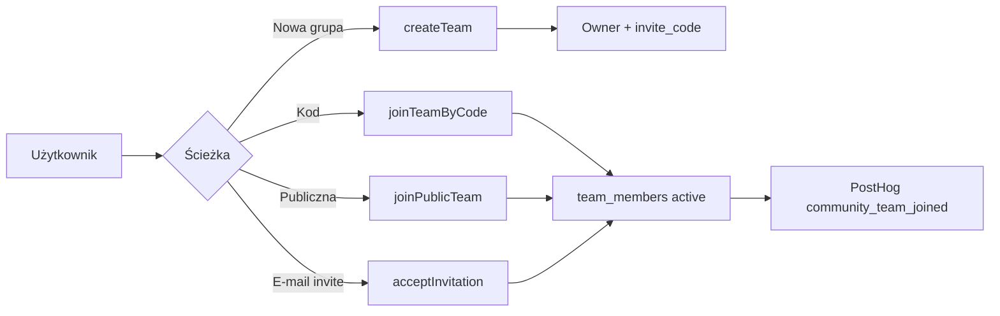

# GymBrat Community — dokumentacja produktowa i techniczna

> **Jak wkleić do Notion:** Import → Markdown / skopiuj całość do pustej strony. Nagłówki `#`–`###` tworzą outline; tabele i bloki kodu importują się poprawnie.
>
> **Repo:** `github.com/damianchmielewski33-cmyk/GymBrat`  
> **Stack:** Next.js App Router · Auth.js (JWT) · Drizzle + Turso (SQLite/libSQL) · Server Actions + REST · SSE (bez WebSocket) · Zustand  
> **Status:** Teams · Friends (mutual workout share) · Feed · Live · Chat · Challenges · Notifications · Analytics (PostHog) — **live w kodzie**. Fair Ranking FCS / Reputation / pełny Hall of Fame seasons — **zaplanowane / stuby powiadomień**.

---

## Spis treści

1. [Architektura](#1-architektura)
2. [Baza danych](#2-baza-danych)
3. [API](#3-api)
4. [Komponenty UI](#4-komponenty-ui)
5. [Workflow](#5-workflow)
6. [Role i uprawnienia](#6-role-i-uprawnienia)
7. [Ranking](#7-ranking)
8. [Challenges](#8-challenges)
9. [Live training](#9-live-training)
10. [Feed, Chat, Powiadomienia](#10-feed-chat-powiadomienia)
11. [Wydajność i realtime](#11-wydajność-i-realtime)
12. [Analityka PostHog](#12-analityka-posthog)
13. [Mapa ekranów](#13-mapa-ekranów)
14. [Bezpieczeństwo (ALAC)](#14-bezpieczeństwo-alac)
15. [Roadmapa](#15-roadmapa)

---

## 1. Architektura

### 1.1 Cel produktu

Community łączy zawodników GymBrat w **Teams** (grupy), z:

- wspólnym **Team Feed** (auto-posty z treningu + ręczne),
- **rankingiem tygodnia**,
- **wyzwaniami** (XP, odznaki, celebracje),
- **live treningiem grupowym** (presence <1 s),
- **Workout Chat** (team / workout / challenge),
- **Centrum powiadomień**.

### 1.2 Warstwy

```
┌─────────────────────────────────────────────────────────┐
│  UI (App Router)  /community/*                          │
│  components/community/*  · hooks/*  · Zustand stores    │
├─────────────────────────────────────────────────────────┤
│  Mutacje: Server Actions (actions/teams|team-feed|…)    │
│  Odczyt / realtime: Route Handlers app/api/community/*  │
├─────────────────────────────────────────────────────────┤
│  Domain: lib/community/*                                │
│  Analytics: lib/analytics/* → PostHog HTTP capture      │
├─────────────────────────────────────────────────────────┤
│  Drizzle schema (db/schema.ts) + ensure-schema          │
│  Turso / libSQL                                         │
└─────────────────────────────────────────────────────────┘
```

### 1.3 Zasady techniczne

| Zasada | Opis |
|--------|------|
| **ALAC** | Brak RLS w Turso — autoryzacja w warstwie aplikacji (`assertActiveTeamMember`, role checks) |
| **Auth** | Auth.js JWT; API/actions wymagają `session.user.id` |
| **Realtime** | **SSE** + polling DB (adaptive idle/active), nie WebSocket |
| **Mutacje** | Preferowane Server Actions; listy/streamy przez REST |
| **Mobile-first** | Shell `max-w-lg → xl:max-w-2xl`, thumb CTA, sticky Team subnav |
| **Źródło produkcji** | Tylko repo GymBrat (nie AWP) |

### 1.4 Kluczowe katalogi

| Ścieżka | Rola |
|---------|------|
| `lib/community/` | Logika domenowa (teams, feed, chat, challenges, live, notifications) |
| `actions/` | Server Actions (CSRF + sesja) |
| `app/api/community/` | REST + SSE |
| `components/community/` | UI |
| `db/schema.ts` + `db/migrations/0012+` | Model danych |
| `lib/analytics/` | Event plan + PostHog |
| `hooks/use-*-realtime.ts` | Klienckie subskrypcje SSE |

---

## 2. Baza danych

Silnik: **SQLite / Turso (libSQL)** przez Drizzle. Migracje Community: `0012`–`0020` (+ ensure-schema przy starcie).

### 2.1 Diagram relacji (skrót)

```
users
  │
  ├── teams (owner_user_id)
  │     ├── team_members
  │     ├── team_invitations
  │     ├── team_posts → media, comments, reactions, mentions
  │     ├── team_feed_events          (SSE cursor)
  │     ├── group_workout_sessions → participants
  │     ├── challenges → participants, progress, reward_claims
  │     └── chat_channels → messages, reactions, mentions, read, typing, events
  │
  └── notifications → notification_events
        user_badges (odznaki z challenges)
```

### 2.2 Teams

**`teams`**

| Kolumna | Typ | Opis |
|---------|-----|------|
| `id` | text PK | UUID |
| `owner_user_id` | FK users | Właściciel |
| `name` | text | 2–60 znaków |
| `description` | text | max ~500 |
| `privacy` | text | `public` \| `private` |
| `invite_code` | text UNIQUE | Kod dołączenia |
| `avatar_emoji` | text | Avatar v1 |
| `banner_color` | text | Hex |
| `ranking_metric` | text | `sessions` \| `tonnage` \| `cardio` |
| `max_members` | int | domyślnie 50 |
| `member_count` | int | denormalizacja |
| `archived_at` | ts? | soft archive |

**`team_members`** — UNIQUE `(team_id, user_id)`  
Status: `active` \| `invited` \| `left` \| `banned`  
Role: `owner` \| `admin` \| `moderator` \| `member`

**`team_invitations`** — e-mail / user + `token` UNIQUE, status lifecycle `pending` → accepted/declined/revoked/expired

### 2.3 Team Feed

| Tabela | Opis |
|--------|------|
| `team_posts` | Typ posta, body, `snapshot_json`, `source_key` (dedup auto), liczniki, moderation, soft delete |
| `team_post_media` | data URL obrazów (skompresowane klient) |
| `team_post_comments` | wątek 1 poziom odpowiedzi |
| `team_post_reactions` | UNIQUE `(post_id, user_id)` — jedna reakcja na usera |
| `team_post_mentions` | @mention post lub comment |
| `team_feed_events` | log zdarzeń pod SSE |

**Typy postów:** `workout_complete` · `personal_record` · `achievement` · `streak` · `challenge_complete` · `level_up` · `text` · `gallery`

**Reakcje:** `beast` · `strong` · `king` · `monster` · `progress` · `insane`

### 2.4 Live / Group workout

| Tabela | Opis |
|--------|------|
| `group_workout_sessions` | `live` \| `ended`, host, team |
| `group_workout_participants` | presence JSON, status joined/left |

Presence JSON (skrót): ćwiczenie, seria, powtórzenia, ciężar, elapsed, rest, progress, phase.

### 2.5 Workout Chat

| Tabela | Opis |
|--------|------|
| `chat_channels` | `kind`: team \| workout \| challenge; UNIQUE `scope_key` |
| `chat_messages` | body, parent (reply), soft delete |
| `chat_message_reactions` | emoji |
| `chat_mentions` | |
| `chat_read_states` | last read per user/channel |
| `chat_typing` | wskaźnik pisania (TTL ~4 s) |
| `chat_events` | SSE |

### 2.6 Challenges

| Tabela | Opis |
|--------|------|
| `challenges` | scope, metric, target, XP, badge, status, template_key |
| `challenge_participants` | active \| completed \| left |
| `challenge_progress` | current_value per user |
| `challenge_reward_claims` | idempotencja nagród |
| `user_badges` | odblokowane odznaki |

### 2.7 Notifications

| Tabela | Opis |
|--------|------|
| `notifications` | kind, title, body, href, group_key, collapsed_count, read_at |
| `notification_events` | SSE inbox |

### 2.8 Indeksy wydajnościowe (m.in. `0020_community_perf`)

- Feed: `(team_id, moderation_status, created_at)` + partial visible
- Comments / chat: partial „live” (bez deleted)
- Notifications: `(user_id, created_at)`, unread composite

---

## 3. API

Bazowa ścieżka: `/api/community/...`  
Wszystkie endpointy wymagają sesji (401 bez logowania). Autoryzacja członkostwa w Team / kanale — 403.

### 3.1 Teams Feed

| Metoda | Ścieżka | Opis |
|--------|---------|------|
| `GET` | `/teams/[teamId]/feed?before=&limit=` | Paginacja feedu (infinite scroll) |
| `GET` | `/teams/[teamId]/feed/stream?since=` | **SSE** eventy feedu |
| `GET` | `/teams/[teamId]/feed/[postId]/comments?before=&limit=` | Lazy komentarze |

### 3.2 Group workout (Live)

| Metoda | Ścieżka | Opis |
|--------|---------|------|
| `POST` | `/group-workout` | Start sesji (host) |
| `POST` | `/group-workout/[sessionId]/join` | Dołącz |
| `PUT` | `/group-workout/[sessionId]/presence` | Presence update (<1 s sync) |
| `GET` | `/group-workout/[sessionId]/presence` | Lista presence (cache TTL ~450 ms) |

### 3.3 Chat

| Metoda | Ścieżka | Opis |
|--------|---------|------|
| `GET` | `/chat/channels` | Lista / resolve kanałów |
| `GET` | `/chat/[channelId]/messages` | Historia (cursor) |
| `POST` | `/chat/[channelId]/messages` | Wyślij |
| `GET` | `/chat/[channelId]/stream` | **SSE** |
| `POST` | `/chat/[channelId]/typing` | Typing |
| `POST` | `/chat/[channelId]/read` | Mark read |
| `GET` | `/chat/[channelId]/search` | Szukaj |
| `GET` | `/chat/[channelId]/sync` | Sync delta |
| `PATCH/DELETE` | `/chat/messages/[messageId]` | Edycja / usuwanie |
| `POST` | `/chat/messages/[messageId]/reactions` | Reakcje |

### 3.4 Notifications

| Metoda | Ścieżka | Opis |
|--------|---------|------|
| `GET` | `/notifications?cursor=&limit=&kind=&unreadOnly=` | Lista + pagination |
| `GET` | `/notifications/unread-count` | Badge (cache ~2 s) |
| `POST` | `/notifications/read` | Oznacz przeczytane |
| `GET` | `/notifications/stream` | **SSE** |

### 3.5 Server Actions (mutacje UI)

**`actions/teams.ts`**

- `createTeamAction` · `joinTeamByCodeAction` · `joinPublicTeamAction` · `leaveTeamAction`
- `updateTeamSettingsAction` · `regenerateInviteCodeAction` · `inviteByEmailAction`
- `acceptInviteAction` · `declineInviteAction` · `revokeInviteAction`
- `changeMemberRoleAction` · `removeMemberAction` · `transferOwnershipAction` · `archiveTeamAction`

**`actions/team-feed.ts`**

- `createTeamFeedPostAction` · `addTeamFeedCommentAction` · `setTeamFeedReactionAction` · `deleteTeamFeedPostAction`

**`actions/challenges.ts`**

- `createChallengeAction` · `joinChallengeAction` · `markCelebrationSeenAction`

---

## 4. Komponenty UI

### 4.1 Teams

| Komponent | Rola |
|-----------|------|
| `team-card.tsx` | Karta grupy na liście |
| `create-team-form.tsx` | Tworzenie |
| `join-team-form.tsx` | Dołączanie kodem |
| `team-invite-forms.tsx` | Invite e-mail, accept/decline, regenerate |
| `team-detail-view.tsx` | Hub Team (feed, live, ranking, challenges…) |
| `team-subnav.tsx` | Sticky: Feed · Wyzwania · Ludzie |
| `team-settings-form.tsx` | Ustawienia |
| `team-members-panel.tsx` | Role / kick |

### 4.2 Feed

| Komponent | Rola |
|-----------|------|
| `team-feed-section.tsx` | Lista + SSE incremental + infinite scroll |
| `team-feed-composer.tsx` | Nowy post + zdjęcia + @mention |
| `team-feed-post-card.tsx` | Post, reakcje, komentarze lazy |

### 4.3 Live + Chat + Znajomi

| Komponent | Rola |
|-----------|------|
| `start-workout-mode-sheet.tsx` | Solo vs Trening grupowy |
| `join-group-workout-button.tsx` | Dołącz do live |
| `group-workout-presence-sync.tsx` | Sync presence |
| `group-workout-floating-widget.tsx` | Widżet awatarów / progresu |
| `friends-page-client.tsx` | Lista znajomych, invite e-mail, share toggle |
| `friend-live-presence-sync.tsx` | Publikacja presence dla mutual share |
| `friend-live-watch-widget.tsx` | Chip / panel podglądu + skrót „X trenuje” |
| `friend-live-detail-client.tsx` | Strona szczegółów podglądu |
| `add-friend-from-team-button.tsx` | CTA na liście członków Team |
| `workout-chat-panel.tsx` | Pełny panel czatu |
| `workout-chat-launcher.tsx` | Floating chat w active-workout |

### 4.4 Challenges + Notyfikacje

| Komponent | Rola |
|-----------|------|
| `create-challenge-form.tsx` | Wybór szablonu |
| `challenge-card.tsx` / `challenge-detail-view.tsx` | Lista / detal + leaderboard |
| `challenge-celebration.tsx` | Fullscreen po ukończeniu |
| `notification-bell.tsx` | Dzwonek w headerze |
| `notification-center.tsx` | Inbox + filtry + infinite scroll |

### 4.5 Shell (cross-cutting)

| Element | Rola |
|---------|------|
| `AppShell` | Bottom nav, header (menu + Community shortcut + bell) |
| `ThumbActionBar` | CTA w strefie kciuka |
| `AppMenuButton` | Menu boczne (Teams, Challenges, …) |

---

## 5. Workflow

### 5.1 Utworzenie i dołączenie do Team



1. **Publiczna** — widoczna w wyszukiwarce, join 1 klik.
2. **Prywatna** — tylko kod lub zaproszenie e-mail.
3. Limit: `max_members` (50). Banned nie wraca bez admina.

### 5.2 Trening → Feed (auto)

1. User kończy trening (`/api/workouts/complete` / active workout).
2. `team-feed-auto` publikuje posty do wszystkich aktywnych Teamów użytkownika (`source_key` = dedup).
3. Emit `team_feed_events` → SSE odświeża head feedu u członków.
4. Opcjonalnie progress challenges + XP.

### 5.3 Challenge lifecycle

```
Template → createChallengeFromTemplate
    → auto-join creator (+ wszyscy członkowie przy group/seasonal)
    → chat challenge channel
    → auto-post na feed
    → notify team
Workout complete → update progress
Target reached → award XP + badge → celebration → community_challenge_completed
```

### 5.4 Live trening grupowy

1. Start z planu → sheet: **Solo** | **Trening grupowy**.
2. Host: `createGroupWorkoutSession` → status `live` + chat workout.
3. Członkowie Team widzą sesję na stronie Team → **Dołącz**.
4. Presence PUT z active-workout → floating widget u innych.
5. Host leave → session `ended`; uczestnik leave → tylko jego status.

### 5.5 Powiadomienia

Emit przy: komentarz, reakcja, invite, live, **friend_live**, challenge, achievement, ranking, HoF, team announcement.  
**Grupowanie:** ten sam `group_key` w oknie ~2 h → `collapsed_count++` (bez floodu inboxa).

### 5.6 Znajomi + podgląd treningu (mutual share)

```
Invite (email | członek Team)
  → accept → accepted friendship
  → obie strony: share_workout = true
  → mutual share
Start treningu (solo/Team) → FriendLivePresenceSync
  → upsert friend_live_presence + notify friend_live
Znajomy: widget / /community/friends/[id]/live (read-only, bez join)
```

- Tabele: `friendships` (para kanoniczna `user_a < user_b`), `friend_live_presence` (sanitized JSON).
- **Nie** wymaga uczestnictwa w `group_workout_participants`.
- ALAC: presence GET tylko przy mutual share.

---

## 6. Role i uprawnienia

### 6.1 Hierarchia

| Rola | Rank | Opis |
|------|------|------|
| **Owner** | 4 | Pełnia praw; transfer ownership; archive |
| **Admin** | 3 | Ustawienia, invite, regen kodu; role poniżej admina |
| **Moderator** | 2 | Invite; usuwanie Memberów |
| **Member** | 1 | Feed, chat, live, challenges (join) |

Źródło: `lib/community/team-types.ts` + `team-permissions.ts`.

### 6.2 Matryca (skrót)

| Akcja | Owner | Admin | Mod | Member |
|-------|:-----:|:-----:|:---:|:------:|
| Ustawienia Team | ✅ | ✅ | ❌ | ❌ |
| Regen kodu | ✅ | ✅ | ❌ | ❌ |
| Invite e-mail / kod share | ✅ | ✅ | ✅ | ❌* |
| Tworzenie challenge | ✅ | ✅ | ✅ | ❌ |
| Zmiana roli → Admin | ✅ | ❌ | ❌ | ❌ |
| Kick Member | ✅ | ✅ | ✅ | ❌ |
| Kick Admin | ✅ | ❌ | ❌ | ❌ |
| Transfer ownership | ✅ | ❌ | ❌ | ❌ |
| Archive Team | ✅ | ❌ | ❌ | ❌ |
| Feed / chat / live | ✅ | ✅ | ✅ | ✅ |
| Leave Team | ❌† | ✅ | ✅ | ✅ |

\* Member może przekazać istniejący kod, jeśli go zna — UI invite tylko dla ról z `canInviteMembers`.  
† Owner musi najpierw przekazać własność.

### 6.3 Widoczność prywatnego Team

- `privacy=public` → każdy zalogowany może zobaczyć kartę / dołączyć.
- `privacy=private` → detal tylko dla aktywnego członka (`canViewPrivateTeam`).

---

## 7. Ranking

### 7.1 Co jest live

**Ranking tygodnia per Team** — obliczany przy `getTeamDetail`.

| Metryka (`ranking_metric`) | Liczone |
|----------------------------|---------|
| `sessions` | liczba ukończonych treningów w tygodniu (pon–dziś, lokalny kalendarz) |
| `tonnage` | suma `weight × reps` z zaliczonych serii (bez cardio_log) |
| `cardio` | suma minut cardio |

- Sort: score DESC, potem nazwa.
- Rank 1…N.
- Soft „osiągnięcia” na karcie Team: Skład 5+, Lider tygodnia, Live teraz, Aktywny tydzień.

### 7.2 Czego jeszcze nie ma (roadmap)

| Element | Status |
|---------|--------|
| Fair Ranking / FCS 0–100 | plan (algorytm osobny) |
| Sezonowy Hall of Fame UI | stub powiadomień `notifyHallOfFameWin` |
| Trwały leaderboard historyczny | brak tabeli seasons |

### 7.3 Analityka rankingu

- `community_ranking_viewed` — mount Team (członek)
- `community_ranking_leader_changed` — przy `notifyRankingChange`

---

## 8. Challenges

### 8.1 Scope

| Scope | Znaczenie |
|-------|-----------|
| `individual` | Cel osobisty w Team |
| `group` | Wspólny cel / auto-join członków |
| `seasonal` | Krótki sezon (np. 30 dni) |
| `global` | Cała społeczność (`/community/challenges`) — seed platformy |

### 8.2 Szablony (v1)

| Key | Tytuł | Scope | Target | XP |
|-----|-------|-------|--------|-----|
| `sessions_50` | 50 treningów | individual | 50 | 500 |
| `run_100km` | 100 km biegu | individual | 100 km | 600 |
| `pushups_10k` | 10 000 pompek | group | 10k reps | 800 |
| `leg_sets_500` | 500 serii nóg | group | 500 sets | 700 |
| `seasonal_sessions_30` | Sezon: 30 treningów | seasonal | 30 / 30 dni | 400 |
| `global_tonnage_1m` | Globalnie 1M kg | global | 1e6 kg | 250 |

Filtry metryk (np. słowa kluczowe ćwiczeń) w `metric_filter_json`.

### 8.3 Nagrody

- **XP** → poziom użytkownika (progress w UI challenge).
- **Badge** → `user_badges` + celebracja fullscreen.
- Claim idempotentny (`challenge_reward_claims`).

### 8.4 Uprawnienia tworzenia

Owner / Admin / Moderator Team. Global — seed systemu (`ensureGlobalChallenges`).

---

## 9. Live training

### 9.1 Model

- Sesja = wiersz `group_workout_sessions` (`live` → `ended`).
- Uczestnicy = `group_workout_participants` + `presence_json`.
- Ten sam flow treningu GymBrat (`/active-workout`) — tryb group w Zustand `community-workout`.

### 9.2 Presence

- Klient syncuje stan serii / ćwiczenia.
- GET presence cache in-process ~450 ms (skala: wiele polli).
- Widget: awatary, ćwiczenie, seria, progress; na Team bottom-right; na active-workout top-right.

### 9.3 Chat treningowy

Przy starcie sesji: `getOrCreateWorkoutChatChannel` → floating `WorkoutChatLauncher` na active-workout.

### 9.4 Eventy PostHog

`community_live_started` · `community_live_joined` · `community_live_ended` (`ended_by`: host \| leave)

> **Uwaga bezpieczeństwa (audit):** publiczne UUID sesji + GET presence — w audycie oznaczone jako IDOR high; remedacja na roadmapie (membership check zaostrzony / nieprzewidywalne ID).

---

## 10. Feed, Chat, Powiadomienia

### 10.1 Feed

- SSR: pierwsze 12 postów; dalej infinite scroll (`before` cursor).
- Komentarze: preview 5; reszta lazy API.
- Reakcje: agregacja SQL `GROUP BY`.
- SSE: adaptive 5 s idle / 1.5 s active; refresh head bez `router.refresh()`.

### 10.2 Chat

Kanały:

| Kind | Scope key | Kontekst |
|------|-----------|----------|
| `team` | `team:{teamId}` | Stały czat grupy |
| `workout` | `workout:{sessionId}` | Live sesja |
| `challenge` | `challenge:{challengeId}` | Przy starcie wyzwania |

Funkcje: reply, emoji reactions, @mention, typing, read receipts, search, SSE.

### 10.3 Notifications — kinds

`comment` · `reaction` · `invite` · `live` · `challenge` · `achievement` · `ranking` · `hall_of_fame` · `team_announcement`

UI: dzwonek + `/community/notifications` (filtry, mark read, infinite scroll, SSE).

---

## 11. Wydajność i realtime

| Mechanizm | Cel |
|-----------|-----|
| Adaptive SSE | ↓ QPS przy 10k idle clients |
| Event-head cache ~400 ms | Współdzielenie ticków w jednym procesie |
| Presence / unread TTL | Hot path bez pełnego skanu |
| Partial indexes | Feed / comments / chat |
| Infinite scroll | Mniejsze payloady SSR |
| Brak WS | Prostota na Vercel; Redis fanout = later |

Zakładana skala projektowa: 100k users · 10k active · 1000 live · 100 posts/min · 1000 comments/min.

---

## 12. Analityka PostHog

**Config:** `NEXT_PUBLIC_POSTHOG_KEY` · opcjonalnie `NEXT_PUBLIC_POSTHOG_HOST` (EU).

**Konwencja:** `community_<obiekt>_<akcja>` · properties snake_case · `$groups.team` · `analytics_schema: 1`.

| Event | Trigger |
|-------|---------|
| `community_team_created` | createTeam |
| `community_team_joined` | code / public / invite |
| `community_post_published` | createTeamPost |
| `community_post_reacted` | add/change/remove |
| `community_post_commented` | comment |
| `community_challenge_created` | template create |
| `community_challenge_joined` | jawny join |
| `community_challenge_completed` | reward claim |
| `community_live_started/joined/ended` | group workout |
| `community_ranking_viewed` | Team page (client) |
| `community_ranking_leader_changed` | notifyRankingChange |
| `community_hof_viewed` / `_awarded` | HoF (view API ready / award stub) |

Pełny plan: `lib/analytics/community-events.ts` → `COMMUNITY_EVENT_PLAN`.

---

## 13. Mapa ekranów

| URL | Opis |
|-----|------|
| `/community` | Redirect → Teams |
| `/community/teams` | Moje + discover + Thumb CTA |
| `/community/teams/new` | Tworzenie |
| `/community/teams/join` | Kod |
| `/community/teams/[teamId]` | Hub Team |
| `/community/teams/[teamId]/members` | Członkowie |
| `/community/teams/[teamId]/settings` | Ustawienia |
| `/community/teams/[teamId]/challenges` | Lista wyzwań Team |
| `/community/teams/[teamId]/challenges/new` | Nowe |
| `/community/teams/[teamId]/challenges/[id]` | Detal |
| `/community/challenges` | Global |
| `/community/challenges/[id]` | Detal global |
| `/community/notifications` | Inbox |
| `/active-workout` | Sesja (+ live widget + chat) |

Page-view keys (wewnętrzna analityka): `community_teams`, `community_team_detail`, `community_challenges`, `community_notifications`, `community_hof`.

---

## 14. Bezpieczeństwo (ALAC)

| Kontrola | Implementacja |
|----------|----------------|
| Sesja | Auth.js na actions/API |
| Membership | `assertActiveTeamMember` / `getActiveMembership` |
| Role | `team-permissions.ts` |
| CSRF | Server Actions + cookie XSRF na mutacjach fetch |
| Soft delete | posty / komentarze / wiadomości |
| Dedup | `source_key` auto-postów |
| Rate limits | global rate-limit (wybrane API) |

**Znane ryzyka (audit):** presence IDOR (HIGH); zaufanie do client workout metrics w challenge progress (MEDIUM) — do remedacji przed pełną produkcją Fair Ranking.

---

## 15. Roadmapa

| Moduł | Status |
|-------|--------|
| Teams + roles + invites | ✅ |
| Friends + mutual workout share + watch | ✅ |
| Team Feed + SSE + infinite | ✅ |
| Live group workout + presence | ✅ |
| Workout Chat | ✅ |
| Challenges + XP + badges | ✅ |
| Notification Center | ✅ |
| Performance + PostHog events | ✅ |
| Mobile thumb UX | ✅ |
| Fair Ranking (FCS) | 📋 plan |
| Reputation tiers | 📋 plan |
| Hall of Fame seasons UI | 📋 stub notyfikacji |
| Ghost Training | 📋 plan |
| Redis fanout SSE | 📋 skala multi-instance |

---

## Szybki glossariusz

| Termin | Znaczenie |
|--------|-----------|
| **Team** | Grupa społecznościowa GymBrat |
| **ALAC** | Authorization Layer at Application Code |
| **SSE** | Server-Sent Events (jednokierunkowy stream) |
| **Presence** | Stan „co robię w treningu teraz” |
| **source_key** | Klucz deduplikacji auto-posta |
| **group_key** | Klucz grupowania powiadomień |
| **Thumb zone** | Dolna część ekranu wygodna dla kciuka |

---

*Dokument wygenerowany z kodu GymBrat. Przy zmianach schematu / API aktualizuj tę stronę razem z changelogiem (`planned: true` → Promote).*
